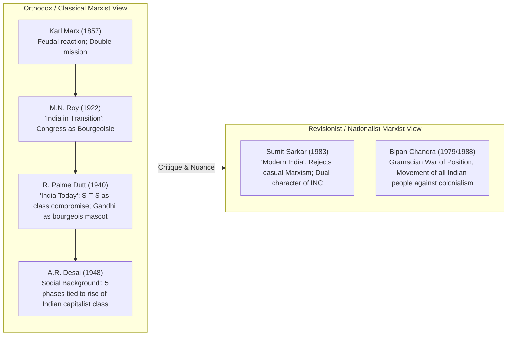
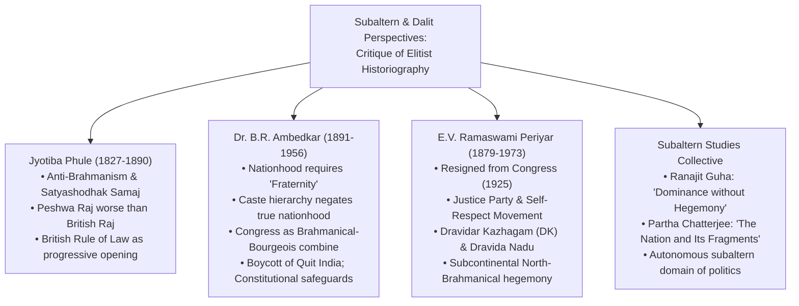
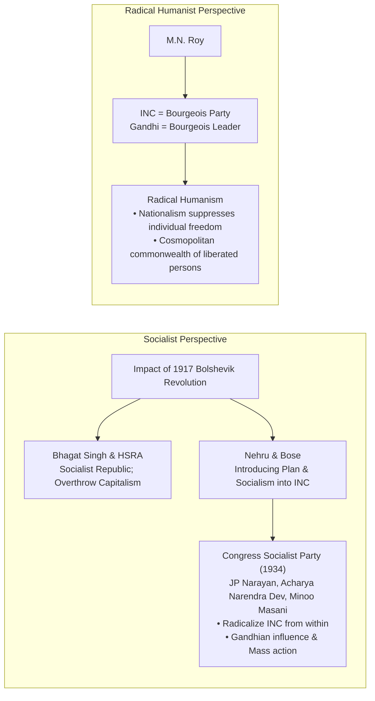
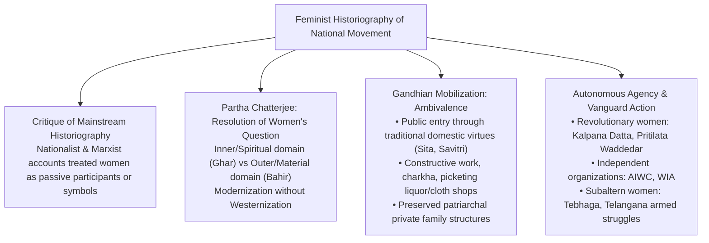
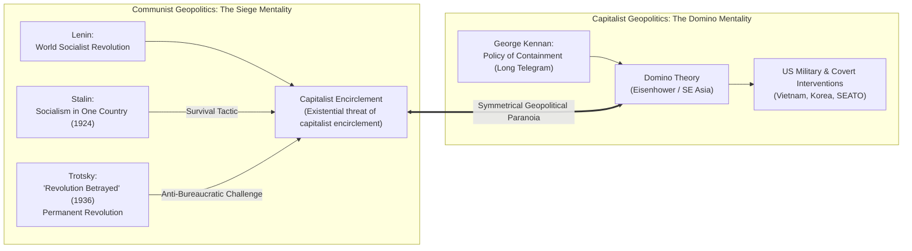
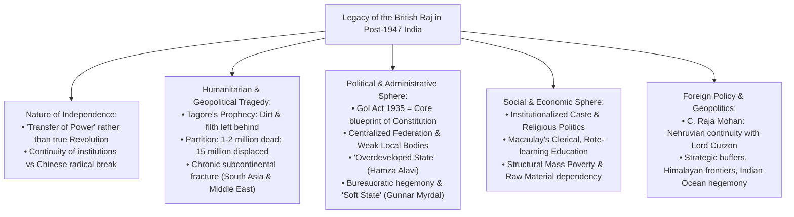
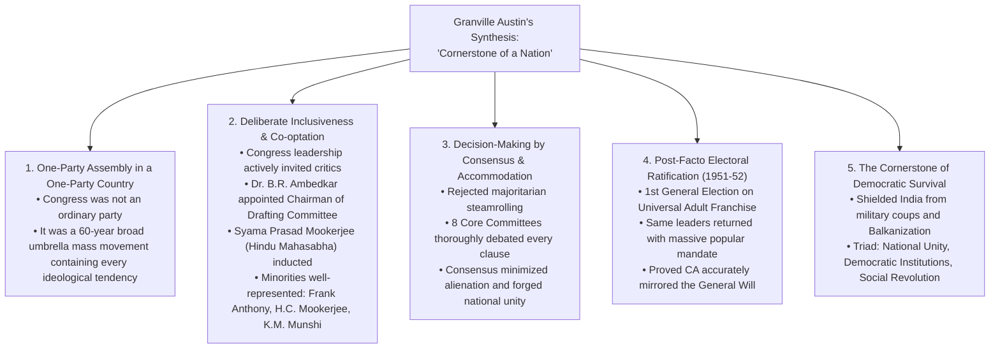

# Shubhra Ranjan PSIR Lecture Notes: Transcription & Scholarly Breakdown
## Paper 1, Section B: Indian Government and Politics (IGP)
### Topic 1 & 2: Perspectives on Indian Nationalism, Historiography, Legacy of the British Raj, and Making of the Indian Constitution

---

## Document Metadata
- **Faculty:** Shubhra Ranjan
- **Subject:** Political Science and International Relations (PSIR) — Paper 1, Section B (Indian Government and Politics)
- **Topics Covered:**
  1. **Historiography & Perspectives on Indian Nationalism:** Marxist Perspective (R.P. Dutt, A.R. Desai, Sumit Sarkar, Bipan Chandra), Dalit & Subaltern Perspectives (Jyotiba Phule, B.R. Ambedkar, E.V. Ramaswami Periyar), Socialist Perspective (Bhagat Singh, Nehru, Bose, CSP 1934), Radical Humanist Perspective (M.N. Roy), and Feminist Perspective.
  2. **Marxist Theory & Cold War Geopolitics (Lecture 58):** Capitalist Encirclement (Stalin vs. Lenin vs. Trotsky) vs. Domino Theory (US Containment Strategy in Southeast Asia).
  3. **Legacy of the British Raj:** Nature of Independence (Transfer of Power vs. True Revolution), Tagore's Prophecy, Partition Tragedy, Political & Administrative Legacies (Hamza Alavi's 'Overdeveloped State', Gunnar Myrdal's 'Soft State', GoI Act 1935), Socio-Economic and Educational Legacies, Foreign Policy Continuity (C. Raja Mohan vs. Lord Curzon).
  4. **Making of the Indian Constitution & The Constituent Assembly:** Question of Representativeness & Legitimacy, Modes of Election under Cabinet Mission Plan, Limited Franchise, Winston Churchill's Critique ("Assembly of Brahmins"), Amendment Controversies, and Granville Austin's Master Defense (*'The Indian Constitution: Cornerstone of a Nation'*).
- **Source Scans Analyzed:**
  - `page_089.png` (Notebook Page 43: Marxist Perspective on 1857, M.N. Roy, A.R. Desai, R.P. Dutt, Sumit Sarkar's Warning, Bipan Chandra's Defense of National Movement)
  - `page_090.png` (Notebook Page [43b]: Dalit / Subaltern Perspective: Jyotiba Phule, B.R. Ambedkar & French Revolutionary Ideals, E.V. Ramaswami Periyar, Self-Respect Movement, Dravidar Kazhagam)
  - `page_091.png` (Notebook Page 44: Dravidian Movement split into DMK; Socialist Perspective: CSP 1934; Radical Humanist Perspective: M.N. Roy)
  - `page_092.png` (Notebook Page [44b] / Lecture 58, 25/02/2017: Capitalist Encirclement: Stalin vs Lenin vs Trotsky; Domino Theory & US Containment)
  - `page_093.png` (Notebook Page 45: Legacy of the British Raj: Meaning, Transfer of Power vs Chinese Revolution, GoI Act 1935, Tagore's Prophecy, Partition, Overdeveloped State)
  - `page_094.png` (Notebook Page [45b]: Legacy of British Raj Continued: Soft State, Caste & Religion Politics, Macaulay Education System, Economic Linkages, Nehru vs Curzon Foreign Policy)
  - `page_095.png` (Notebook Page 46: Making of the Indian Constitution: Representativeness & Legitimacy Debate, Indirect Election, Princely Nominees, Restricted Franchise, Lack of Referendum)
  - `page_096.png` (Notebook Page [46b]: Constituent Assembly Debate Continued: Congress Dominance, Churchill's 'Assembly of Brahmins', Amendments, Granville Austin's Defense)

---

# PART 1: EXHAUSTIVE PAGE-BY-PAGE ZERO-LOSS TRANSCRIPTION

---

### PAGE 089 (`page_089.png`)
* **Header / Source Marking:** Join Telegram for More Update : - https://t.me/upsc_pdf
* **Handwritten Notebook Page Number (Bottom Right):** `43`
* **Topic:** Marxist Perspective on Indian National Movement (Savarkar vs Marx, M.N. Roy, A.R. Desai, R. Palme Dutt, Sumit Sarkar, Bipan Chandra)

```markdown
Unlike Savarkar who established Revolt of 1857 as the 1st war of independence. Karl Marx has suggested that it was the revolt by feudal elements.

M.N. Roy in his book 'India in Transition' has analysed the political activities under congress & Gandhi & has established that congress was Bourgeoise Party & Gandhi was Bourgeoise leader.

A.R. Desai in his book 'Social Background of Indian Nationalism' and R.P. Dutt in his book 'India Today' has expressed similar opinions.

Sumit Sarkar in his book 'Modern India' has warned the Marxist scholars for taking casual approach.
According to him, it is true that congress programme was not in the interest of the masses nor congress struggle benefited masses but it is also true that congress had no conscious or planned strategy against masses. It is also true that Indians were not so sharply devided that they could not be united.

Bipin chandra despite being Marxist has suggested that the movement led by congress can be called as a National Movement. It was not only a National Movement but most spectacular mass movement whose warmth is still felt.
```

---

### PAGE 090 (`page_090.png`)
* **Header / Source Marking:** Join Telegram for More Update : - https://t.me/upsc_pdf
* **Notebook Page Position:** Facing Notebook Page 43 [Page 43b]
* **Topic:** Dalit Perspective as Subaltern Perspective (Jyotiba Phule, B.R. Ambedkar, E.V. Ramaswami Periyar)

```markdown
-> Dalit Perspective :-
Dalit perspective is represented in the works of many Dalit leaders & scholars. We can also call it as Subaltern perspective. One of the earliest expression about the British Raj was given by Jyotiba Phule.
Jyotiba Phule was critic of Brahmanism. He held that Peshwa Raj was worse than British Raj.
He appreciated British for establishing the rule of law for the 1st time.

Ambedkar was influenced by the ideas of Jyotiba Phule. Ambedkar rejected the idea of India as a Nation. He rejected congress led movement as a National movement. His idea of Nationalism was influenced by French Revolution. According to him, nation is built on the feeling of fraternity. He never joined INC never participated in congress led movements, supported Jinna's demand, opposed Quit India movement & wanted that British should stay.

We can also bring the perspective of E.V. Ramaswami Naikar, popularly known as Periyar. Naikar initially joined INC but left congress in 1925 on the presumption that congress is the party of Brahmins. There is no scope for the members of other community. He joined Justice party. He initiated self respect movement against Brahmanism. He also supported Jinna's demand for Pakistan. He formed a political party Dravid Khadgam (DK). He put forward demand for seperate state for Dravidians.
```

---

### PAGE 091 (`page_091.png`)
* **Header / Source Marking:** Join Telegram for More Update : - https://t.me/upsc_pdf
* **Handwritten Notebook Page Number (Bottom Right):** `44`
* **Topic:** Dravidian Movement (Annadurai & DMK); Socialist Perspective (CSP 1934); Radical Humanist Perspective (M.N. Roy)

```markdown
Later on leaders like C.N. Annadurai & EVK Sampat came out of DK & formed DMK.

-> Socialist Perspective -
Socialist perspective was influenced by Russian Revolution. Revolutionaries like Bhagat Singh, Congress leader like Nehru, Subhashchandra Bose have introduced socialism in congress. Some radical congress-men known as Young turks like JP Narayan, Acharya Narendra dev & Minno Masani lead the foundation of congress socialist party in 1934.
They didn't opposed congress they only wanted to radicalise the political programme of congress.
They were also influenced by Gandhi.

-> Radical Humanist Perspective.
M.N. Roy considered congress as a Bourgeoise Party & Gandhi as a Bourgeoise leader.
M.N. Roy has given the philosophy of Radical Humanism. According to him, Nationalism suppresses man, there is a need to build cosmopolitan union of liberated persons.
```

---

### PAGE 092 (`page_092.png`)
* **Header / Source Marking:** Join Telegram for More Update : - https://t.me/upsc_pdf
* **Lecture Heading Box (Top Right):**
  ```
  Lecture 58
  25/02/2017
  ```
* **Topic:** Marxist Theory & Cold War Geopolitics: Capitalist Encirclement (Stalin, Lenin, Trotsky) vs. Domino Theory

```markdown
• Capitalist Encirclement.
Stalin proposed revolution in one country, whereas Lenin favoured expansion of revolution.
Why?
Revolution in Russia will not be secured if incircled by capitalist countries.
Stalin wanted to avoid the conflicts with Western world so he gave socialism in one country.
Trotsky was contemporary of Stalin who challenged Stalin's idea in his book 'Revolution Betrayed' & has proposed permanent revolution. Like Lenin he was also fearful of capitalist encirclement.

Just like Capitalist Encirclement theory exist in communist, Domino theory exist in Capitalism. Against Soviet Expansionism USA proposed containment of communism. Domino's theory came w.r.t South East Asia. It suggested that if one country will fall to communism other will also fall.
```

---

### PAGE 093 (`page_093.png`)
* **Header / Source Marking:** Join Telegram for More Update : - https://t.me/upsc_pdf
* **Handwritten Notebook Page Number (Bottom Right):** `45`
* **Topic:** Legacy of the British Raj (Meaning, Transfer of Power vs Revolution, GoI Act 1935, Tagore's Prophecy, Partition, Overdeveloped State)

```markdown
• Legacy of the British Raj -
What does legacy means?
Legacy show the continuity of 'the Raj' even after the independence.
Why legacy?
Unlike Chinese Revolution, Indian Revolution is not a revolution in true sense. It is actually the transfer of power. We see the continuity of the raj in almost all aspects of Independent India.
Constitution of India itself is based on Govt. of India Act 1935.
Rabindranath Tagore was correct when he had that Britishers are going to leave India one day, that is sure. However, when they will leave India they will leave so much dirt & filth that generations of Indians will not be able to clean the mess. One of the worst legacy of the British Raj is the partition of the subcontinent. The partition of subcontinent is still considered as the worst human tragedy i.e. in terms of loss of the life & violence on the subcontinent. It is the British legacy that South Asia & Middle East remained the least integrated of all regions. We can analyse the legacy of the raj as following

In political sphere, parliamentary democracy, centralised federation also the extremely powerful, Bureaucracy & weak institutions of local self govt. It is the legacy of the British rule & the preference of the elites that India also remains 'overdeveloped state'.
```

---

### PAGE 094 (`page_094.png`)
* **Header / Source Marking:** Join Telegram for More Update : - https://t.me/upsc_pdf
* **Notebook Page Position:** Facing Notebook Page 45 [Page 45b]
* **Topic:** Legacy of the British Raj Continued (Soft State, Caste/Religion Politics, Macaulay's Education, Economic Dependency, Nehru vs Curzon)

```markdown
Lack of transparency, corruption & the image of India as a soft state is also a colonial legacy.

In Social sphere the politics of caste & the politics of the religion can be considered as the worst legacies of the British Raj.

There is a legacy of British Raj on Indian Education system. Britishers have introduced the Education system which aims to produce clerks & emphasise on memorisation rather than critical thinking.

Rural poverty, mass poverty, lack of balanced regional developement also show the colonial legacy.

India's linkage with International economy continuous to be colonial. India continues to be the suppliers of Raw Materials. C Rajamohan has compared the foreign policy of Nehru in the Subcontinent with the foreign policy of Lord Curzon. India has continued with the tradition of the British India in dealing with the neighbours.
```

---

### PAGE 095 (`page_095.png`)
* **Header / Source Marking:** Join Telegram for More Update : - https://t.me/upsc_pdf
* **Handwritten Notebook Page Number (Bottom Right):** `46`
* **Topic:** Making of the Indian Constitution — Core Question & Arguments Challenging Representativeness & Legitimacy

```markdown
• Making of the Indian Constitution -
Q. To what extent it is appropriate to say that constituent assembly did not represent the general will of the people in India. Give Arguement to substantiate your view.

-> Context of the Debate.
There has always been a question mark on the representativeness of the constituent assembly as well as the legitimacy of the constitution. Those who challenge the representativeness & the legitimacy give following arguements on

(i) Constituent assembly was not directly elected by the people.
(ii) Constituent assembly had two categories of members.
  (a) Those who were representing princly states: they were nominated by the princes.
  (b) Those who representing British provinces they were indirectly elected by the members of provincial legislative assemblies by proportional representation.
  It is to be noted that at that time only 5% of Indians had right to vote.
(iii) Even after constituent assembly framed the constitution, it has not been subjected to the referendum to know the will of the people as happened in France. (Constitution of 5th republic).
```

---

### PAGE 096 (`page_096.png`)
* **Header / Source Marking:** Join Telegram for More Update : - https://t.me/upsc_pdf
* **Notebook Page Position:** Facing Notebook Page 46 [Page 46b]
* **Topic:** Arguments Challenging Constituent Assembly (Continued); Granville Austin's Master Defense (*'Cornerstone of a Nation'*)

```markdown
(iv) Constituent Assembly was dominated by the members of congress & that is why certain groups of India considered it as a congress constitution.

(v) In terms of caste & class constituent assembly was not representative. In the words of winston Churchill it was assembly of Brahmins.

(vi) Constitution has amended for more than 100 times in less that 100 years of its existence. Whereas the constitution of USA has been amended so far only 27 times.

(vii) No. of times there has been lack of clarity on various provisions in the constitution. One of the most contested issue in contemporary time is the nature of secularism.

(viii) Within the first year of existence of republic constitution has been amended.

Though above arguements may have factual correctness but it would not be appropriate to suggest that Indian constitution does not represent the will of the people.

One of the strongest defence has come from Granville Austin who is considered as the authority on the Indian constitution. In his book 'Indian Constitution the cornerstone of a nation', He has established the legitimacy of the Indian constitution & representativeness of the assembly. He consideres constitution of India as a 'Cornerstone of the Nation'.
```

---

# PART 2: COMPREHENSIVE STRUCTURAL BREAKDOWN & SCHOLARLY SYNTHESIS

```mermaid
flowchart TD
    subgraph Historiography["Perspectives on Indian Nationalism"]
        Colonial["Colonial / Cambridge School<br>(Anil Seal, Gallagher)<br>Factional struggles & patronage"]
        Nationalist["Nationalist School<br>(Tara Chand, Majumdar, Nehru)<br>Awakening of unified nationhood"]
        Marxist["Marxist School<br>(R.P. Dutt, A.R. Desai)<br>Bourgeois class hegemony"]
        RevMarxist["Revisionist Marxist<br>(Bipan Chandra, Sumit Sarkar)<br>Anti-imperialist mass movement"]
        Subaltern["Subaltern / Dalit School<br>(Ranajit Guha, Phule, Ambedkar)<br>Dominance without Hegemony"]
        Socialist["Socialist / CSP<br>(JP, Narendra Dev, Bhagat Singh)<br>Radicalizing from within"]
        RadicalHum["Radical Humanist<br>(M.N. Roy)<br>Cosmopolitan union of free individuals"]
        Feminist["Feminist School<br>(Tanika Sarkar, Forbes)<br>Patriarchal containment of agency"]
    end

    subgraph ColdWar["Cold War & Marxist Theory (L58)"]
        CapEncircle["Capitalist Encirclement<br>(Lenin, Stalin, Trotsky)"]
        Domino["Domino Theory & Containment<br>(Kennan, Truman, SE Asia)"]
    end

    subgraph Legacy["Legacy of the British Raj"]
        Transfer["Transfer of Power vs. True Revolution"]
        Partition["Partition Tragedy & Subcontinental Fracture"]
        Overdeveloped["Overdeveloped State (Hamza Alavi)<br>& Soft State (Gunnar Myrdal)"]
        Macaulay["Macaulay Clerical Education & Social Divide"]
        CurzonNehru["Strategic Continuity (C. Raja Mohan vs Curzon)"]
    end

    subgraph ConstAss["Constituent Assembly Debate"]
        Critique["Critique of Legitimacy & Representativeness<br>• Indirect election (Cabinet Mission Plan)<br>• Restricted Franchise (5-14%)<br>• Princely nomination<br>• Churchill: 'Assembly of Brahmins'<br>• Over 100 Amendments"]
        AustinDefense["Granville Austin's Master Defense<br>• One-party assembly in a one-party country<br>• Microcosmic national representation<br>• Decision by Consensus & Accommodation<br>• 1952 General Election ratification<br>• Cornerstone of a Nation"]
    end

    Historiography --> Legacy
    Legacy --> ConstAss
    ColdWar -.-> Historiography
```



---

## 1. HISTORIOGRAPHY OF THE INDIAN NATIONAL MOVEMENT: CONTESTED PARADIGMS

The historiography of the Indian National Movement represents one of the most vigorously debated fields in modern South Asian politics. How one conceptualizes the national movement directly determines how one views the character, legitimacy, and nature of the post-colonial Indian state and its Constitution.

---

### 1.1 The Marxist Perspective: Class Analysis and Anti-Imperialist Dialectics

Marxist historiography analyzes the national movement not as the miraculous awakening of an ancient civilization or the moral triumph of soul-force, but through the materialist conception of history, mode of production, class formations, and socio-economic contradictions.



#### A. Karl Marx on the Revolt of 1857
- While V.D. Savarkar hailed 1857 as the *"First War of Indian Independence"* (imbued with a proto-nationalist, revolutionary zeal), Karl Marx, in his dispatches for the *New-York Daily Tribune* (1853–1858), initially identified the uprising as a revolt engineered by **dispossessed feudal elements** (talukdars, nawabs, princes) attempting to restore their pre-modern privileges.
- Marx noted that Britain had a "double mission" in India: one destructive (annihilating Asiatic despotism and village economy) and the other regenerating (laying material foundations for modern bourgeois society via railways, telegraphs, and centralized administrative unity).

#### B. M.N. Roy: *'India in Transition'* (1922)
- Written from exile, M.N. Roy applied orthodox Marxist-Leninist frameworks to Indian political reality.
- He rejected the idea that the Indian National Congress (INC) was a representative mass movement of the Indian proletariat and peasantry.
- Roy demonstrated that the **Congress was a bourgeois party** and **Mahatma Gandhi was an ideological agent and defender of the Indian bourgeoisie**.
- Roy argued that Gandhian non-violence was not a spiritual virtue, but a deliberate political mechanism designed to rein in mass militancy whenever peasant and worker radicalism threatened native propertied classes (zamindars and industrialists).

#### C. Rajani Palme Dutt: *'India Today'* (1940)
- R. Palme Dutt provided the most influential orthodox Marxist critique of the national movement.
- **The "Safety-Valve" Thesis:** Dutt argued that the Congress was founded by A.O. Hume and British viceroys to act as a safety valve against genuine agrarian rebellion.
- **Three Historical Stages of Bourgeois Nationalism:**
  1. *Early Phase (1885–1905):* Big bourgeoisie and progressive intelligentsia seeking administrative concessions.
  2. *Extremist/Militant Phase (1905–1919):* Urban petty-bourgeoisie entering the political arena.
  3. *Gandhian Mass Phase (1920–1947):* Mobilization of the rural masses under strict bourgeois hegemony.
- **Gandhi as the "Mascot of the Bourgeoisie":** Dutt claimed Gandhi played a dual role: mobilizing the peasantry's enormous disruptive potential to extract concessions from the British, while abruptly aborting movements (e.g., after Chauri Chaura in 1922 and the Gandhi-Irwin Pact in 1931) the moment class conflict threatened Indian landlords and capitalists.
- For Dutt, the national movement was defined by an unprincipled **"Struggle-Truce-Struggle" (S-T-S)** dialectic that prioritized class compromise over true social revolution.

#### D. A.R. Desai: *'Social Background of Indian Nationalism'* (1948)
- A.R. Desai offered an extensive sociological and historical materialist analysis of Indian nationalism.
- He traced how British colonial rule transformed pre-capitalist Indian agriculture into a market-based economy, introduced private property in land, and birthed new socio-economic classes (the modern working class, industrial bourgeoisie, commercial petty-bourgeoisie, and professional middle class).
- Desai divided the growth of nationalism into **five distinct phases**, each corresponding to the material consolidation of particular classes. For Desai, Indian nationalism was fundamentally the product of the contradictions between the rising indigenous capitalist class and the constraints imposed by British imperialism.

#### E. Sumit Sarkar: *'Modern India: 1885–1947'* (1983) — Warning Against "Casual Marxism"
- Sumit Sarkar, a leading modern historian, cautioned against the crude, reductionist "vulgar Marxism" that treated the Congress as a mere conspiracy of mill-owners and zamindars.
- **Sarkar's Nuanced Realism:**
  - It is historically accurate that the official Congress programme did not represent the immediate class interests of the poorest workers and peasants, nor did its elite leadership prioritize structural agrarian reform.
  - However, it is an oversimplification to assume that Congress possessed a conscious, conspiratorial strategy against the Indian masses.
  - Furthermore, Indians were not so fundamentally and irreparably divided by class and caste that anti-imperialist solidarity was impossible.
- Sarkar stressed the **dual nature of the national movement**: an upper-level, elite constitutional negotiations track, alongside a semi-autonomous, explosive popular surge of peasants, tribals, and laboring poor.

#### F. Bipan Chandra's Revisionist Nationalist-Marxist Synthesis
- Bipan Chandra broke with orthodox Marxist reductions while retaining a materialist and Gramscian methodology.
- **A Genuine National Movement:** Despite being a Marxist, Chandra insisted that the movement led by the INC was unequivocally a **National Movement**—an all-inclusive, multi-class struggle of the entire Indian people against British colonialism.
- **The Primary Contradiction:** Chandra argued that the fundamental contradiction in modern India was between the **entire Indian people and British imperialism**. Secondary contradictions (landlord vs. tenant, capitalist vs. worker, caste vs. caste) were real, but subordinate to the overarching anti-imperialist imperative.
- **"War of Position" and Hegemony:** Drawing on Antonio Gramsci, Chandra conceptualized the Gandhian movement as a protracted **War of Position** against the semi-hegemonic colonial state. The movement systematically eroded the British claim to moral legitimacy, benevolence, and invincible power.
- **"The Warmth is Still Felt":** Chandra celebrated the national movement as one of the largest, most spectacular mass movements in global history, whose democratic, secular, and egalitarian ideals continue to animate modern Indian democracy.

---

### 1.2 The Dalit and Subaltern Perspectives: "Dominance without Hegemony"



The Subaltern and Dalit perspectives fundamentally challenge both Imperialist and Nationalist historiographies. They argue that traditional accounts represent an **"elitist bias"** that equates the history of Indian nationalism with the activities, compromises, and speeches of English-educated, upper-caste, bourgeois elites.

#### A. Jyotiba Phule: The Early Subaltern Critique of Brahmanical Hegemony
- Long before the rise of the INC, Mahatma Jyotiba Phule offered a radical subaltern critique of Indian society from the standpoint of the *Shudras* and *Ati-Shudras*.
- **Peshwa Raj vs. British Raj:** Phule forcefully held that the pre-colonial Peshwa rule in Maharashtra represented the pinnacle of Brahmanical oppression, wherein Dalits were subjected to degrading humiliations (carrying pots around their necks and brooms behind their waists).
- **British Rule of Law as an Emancipatory Space:** Phule welcomed British rule because it dismantled the monopoly of orthodox Hindu scripture, introduced modern secular education, and established the formal **Rule of Law**, providing Dalits and women an opening to demand human dignity.

#### B. Dr. B.R. Ambedkar: Nationalism Founded on Fraternity
- Dr. B.R. Ambedkar mounted a devastating intellectual critique of the Congress-led national movement:
  - **Rejection of "India as an Organic Nation":** In works like *'Annihilation of Caste'* and *'What Congress and Gandhi Have Done to the Untouchables'*, Ambedkar argued that India was not a nation, but a divided collection of castes. A society stratified into rigid, endogamous hierarchies lacking social endosmosis could not claim genuine national solidarity.
  - **Influence of the French Revolution:** Ambedkar's idea of democracy and nationhood was rooted in the trinity of **Liberty, Equality, and Fraternity**. Crucially, he argued that without *Fraternity* (social cohesion and mutual respect), liberty and equality were hollow illusions.
  - **Congress as an Upper-Caste Oligarchy:** Ambedkar rejected the claim that the Congress represented all of India, viewing it as dominated by upper-caste Brahmins and Banias.
  - **Tactical Realpolitik:** Ambedkar refused to participate in civil disobedience or the Quit India Movement (1942), viewing an unconditional British exit without binding constitutional guarantees for Depressed Classes as trading foreign rule for an entrenched domestic caste tyranny. He sought separate electorates, state socialism, and statutory representation.

#### C. E.V. Ramaswami "Periyar" and the Dravidian Movement
- Periyar joined the Indian National Congress in 1919 and served as Madras State Congress President, but resigned in 1925 after witnessing overt caste discrimination at the Cheranmadevi Gurukulam (where Brahmin and non-Brahmin students were forced to sit separately for meals).
- **Congress as a Brahminical Bastion:** Periyar concluded that the Congress was an instrument designed to perpetuate upper-caste northern hegemony, leaving no dignity or political mobility for non-Brahmins.
- **The Self-Respect Movement (1925):** Periyar launched a cultural crusade against Brahmanical supremacy, superstition, the caste system, and religious scriptures like the *Manusmriti* and *Ramayana*.
- **Dravidar Kazhagam (DK) and Dravida Nadu:** Joining the Justice Party and later transforming it into the Dravidar Kazhagam (1944), Periyar allied with M.A. Jinnah and put forward the demand for an independent sovereign state for southern Dravidians (*Dravida Nadu*).
- **Subsequent Evolution:** In 1949, younger leaders led by **C.N. Annadurai** and **E.V.K. Sampath** split from Periyar to form the **Dravida Munnetra Kazhagam (DMK)**, pivoting the movement from secessionism toward constitutional federalism, social justice, and state autonomy.

#### D. The Subaltern Studies Collective: Ranajit Guha and Partha Chatterjee
- Founded in the early 1980s by **Ranajit Guha**, the Subaltern Studies project sought to rectify the systemic elitism of colonialist and bourgeois-nationalist historiography.
- **Ranajit Guha (*'Dominance without Hegemony'*, 1997):**
  - The British colonial state ruled through military coercion and bureaucratic dominance, failing to establish genuine cultural and moral hegemony over the Indian masses.
  - Simultaneously, the indigenous elite (Congress) failed to speak for the nation; there existed a vast, autonomous **subaltern domain of politics** (peasant insurrections, tribal revolts, labor strikes) that operated independent of elite Congress committees.
- **Partha Chatterjee (*'The Nation and Its Fragments'*, 1993):**
  - Chatterjee revealed how anticolonial nationalism divided the world into two domains: the **material** (statecraft, economy, science—where the West was superior and had to be imitated) and the **spiritual** (culture, religion, family, language—where sovereignty was asserted long before political independence).
  - The post-colonial Indian state inherited the modernizing, homogenizing apparatus of colonial rule, inevitably suppressing subaltern fragments (Dalits, minorities, indigenous communities).

---

### 1.3 The Socialist and Radical Humanist Perspectives



#### A. The Socialist Perspective: Transforming Freedom into Social Emancipation
- **Catalyst:** The 1917 Bolshevik Revolution in Russia exerted an enormous gravitational pull on young Indian freedom fighters.
- **Bhagat Singh and the HSRA:** Bhagat Singh elevated the concept of *Inquilab Zindabad* from romantic terrorism to ideological revolution. The Hindustan Socialist Republican Association (HSRA) declared that political independence was worthless if British capitalists were simply replaced by Indian brown sahibs; true liberation required the abolition of all exploitation of man by man.
- **The Left Wing within Congress:** Jawaharlal Nehru and Subhas Chandra Bose introduced socialist vocabulary into mainstream Congress resolutions (e.g., the 1931 Karachi Resolution on Fundamental Rights and Economic Policy; the 1938 National Planning Committee).
- **The Congress Socialist Party (CSP, 1934):**
  - Founded by young radicals—**Jayaprakash (JP) Narayan, Acharya Narendra Deva, Minoo Masani, and Rammanohar Lohia**—within the organizational fold of the INC.
  - *Strategy:* They did not want to split or destroy the Congress; rather, they sought to **radicalize its socio-economic agenda from within**, reorienting its leadership toward workers, tenant farmers, and anti-landlord struggles.
  - *Synthesizing Marx and Gandhi:* Unlike the orthodox Communist Party of India (CPI), the CSP recognized Gandhi as an indispensable mass leader and embraced democratic and decentralized socialist principles.

#### B. The Radical Humanist Perspective: M.N. Roy's Final Philosophy
- After breaking with the Comintern and disillusioned with Soviet totalitarianism under Stalin, M.N. Roy evolved the philosophy of **Radical Humanism (New Humanism)**.
- **Nationalism as a Coercive Ideology:** Roy argued that nationalism was an antiquated, reactionary concept that elevates an abstract collective ("the Nation") above the concrete living individual, inevitably breeding authoritarianism, chauvinism, and war.
- **The Ideal of Cosmopolitan Freedom:** For Roy, the true measure of historical progress is the freedom and rational sovereignty of the individual human being. He called for dismantling the party system and replacing national chauvinisms with a **cosmopolitan union of spiritually liberated, rational individuals** operating through grassroots people's committees.

---

### 1.4 The Feminist Perspective on the Indian National Movement



Feminist historiography (represented by **Tanika Sarkar, Uma Chakravarti, Geraldine Forbes, Radha Kumar, and Kumari Jayawardena**) challenges both colonial and nationalist accounts by demonstrating that women's participation was neither purely derivative nor uniformly liberating.

1. **Critique of Nationalist Historiography:** Nationalist history celebrated women stepping onto the streets at Gandhi's call as proof of India's progressive modernity, while ignoring how patriarchal power was reconstituted in post-colonial law and society.
2. **The "Ghar vs. Bahir" Dichotomy (Partha Chatterjee):** The anticolonial elite resolved the "women's question" in the 19th century by constructing an inner spiritual sphere (*antahpur* / home) where the woman was venerated as the custodian of cultural purity, unsullied by the colonizer's material domain (*bahir*). Her modern education was sanctioned only to make her a better companion and mother, not an autonomous political agent.
3. **The Ambivalence of Gandhian Politics:**
   - Gandhi uniquely legitimized women's massive entry into the public arena during the Non-Cooperation and Civil Disobedience movements.
   - However, he grounded this mobilization in **traditional feminine ideals of suffering, sacrifice, and chastity (Sita, Damayanti, Draupadi)**.
   - Women were assigned non-violent tasks that mirrored domestic labor: spinning khadi, picketing liquor stores, and boycott of foreign cloth. While this granted moral sanction to leave the home, it left the patriarchal division of domestic labor unexamined.
4. **Autonomous Resistance and Revolutionary Vanguard:**
   - Women did not act merely as Gandhian foot-soldiers. Figures like **Pritilata Waddedar, Kalpana Datta, and Bina Das** took up armed revolutionary struggle in Bengal.
   - Women played leading roles in subaltern class warfare, including the **Tebhaga movement** in Bengal and the **Telangana armed struggle** (1946–51).
   - Autonomous platforms like the **All India Women's Conference (AIWC)** and **Women's Indian Association (WIA)** actively pressured the Constituent Assembly to ensure equal franchise, fundamental rights, and codification of the Hindu Code Bill.

---

## 2. COLD WAR THEORETICAL INTERLUDE (LECTURE 58 METADATA ANALYSIS)

Page 092 records notes from **Lecture 58 (25/02/2017)**, examining theoretical concepts of the Cold War and Marxist statecraft. Shubhra Ranjan uses these concepts to contrast international communist geopolitics with capitalist expansionism.



### 2.1 The Debate within Marxism: Lenin vs. Stalin vs. Trotsky
- **Capitalist Encirclement:** Following the 1917 Bolshevik Revolution and the subsequent Western intervention in the Russian Civil War, Soviet leaders realized that their fledgling socialist state was surrounded by hostile imperialist-capitalist powers.
- **Lenin's Position:** Lenin argued that socialism could not endure in isolation; the survival of the Soviet republic depended on rapid revolution in industrialized Western European nations (notably Germany).
- **Stalin's "Socialism in One Country" (1924):** Facing the failure of revolutions in Europe, Joseph Stalin formulated the doctrine of *Socialism in One Country*. He argued that the USSR had the resources to construct a complete socialist society on its own and sought to avoid premature direct military conflict with the capitalist West while rapidly industrializing and modernizing the Red Army.
- **Leon Trotsky's Critique (*'The Revolution Betrayed'*, 1936):**
  - Trotsky rejected Stalin's thesis as a nationalistic degeneration of Marxism that created an unaccountable, parasitic state bureaucracy.
  - In its place, Trotsky championed **Permanent Revolution**: the socialist revolution must not halt at national borders; true security from capitalist encirclement could only come from continuous, worldwide revolution.

### 2.2 Symmetrical Paranoia: Capitalist Encirclement vs. The Domino Theory
- **The Domino Theory:** Formulated by American Cold War strategists (popularized by President Dwight D. Eisenhower in 1954 w.r.t. Indochina), this theory posited that if one nation in Southeast Asia fell to communism, neighboring nations would inevitably collapse in succession, like a row of dominos.
- **US Policy of Containment:** Formulated by George F. Kennan (the "Long Telegram", 1946) and codified in the Truman Doctrine (1947), containment became the grand strategy of the capitalist West to draw military and political lines around the Soviet bloc.
- **Analytical Symmetry:** Shubhra Ranjan highlights that **Capitalist Encirclement** was the defensive paranoia of the Communist world, while the **Domino Theory** was the offensive-defensive paranoia of the Capitalist world. Both doctrines justified immense militarization, regional proxy wars, and the suppression of democratic self-determination across the Global South.

---

## 3. THE LEGACY OF THE BRITISH RAJ IN INDEPENDENT INDIA

Pages 093 and 094 analyze the profound institutional, structural, and cultural continuities between British colonial governance and post-colonial India.



### 3.1 Conceptualizing "Legacy": Continuity vs. Rupture
- **Transfer of Power vs. Revolution:** Unlike the French, Russian, or Chinese Revolutions—which violently destroyed the pre-existing state machinery, dispossessed the ruling classes, and created entirely new institutional apparatuses—the Indian transition in August 1947 was legally orchestrated via the **Indian Independence Act 1947** as an elite **"Transfer of Power"**.
- As a result, post-colonial India maintained significant institutional continuity with the colonial state apparatus.

### 3.2 Rabindranath Tagore's Prophetic Warning
- In his final public address, *'Crisis in Civilization'* (*Sabhyatar Sankat*, May 1941), written on his 80th birthday shortly before his death, Rabindranath Tagore offered a grim, haunting prognosis:
  > *"The wheels of Fate will some day compel the English to give up their Indian Empire. But what kind of India will they leave behind, what stark misery? When the stream of their centuries' administration runs dry at last, what a waste of mud and filth will they leave behind them!"*
- This prophecy found tragic fulfillment in the catastrophic bloodbath of **Partition** (August 1947), which left 1 to 2 million dead, uprooted 15 million refugees, and created a permanent geopolitical fault line that keeps South Asia one of the least economically integrated regions in the world.

### 3.3 The Political and Administrative Legacy: Hamza Alavi's "Overdeveloped State"
- **Government of India Act 1935 as Blueprint:** Nearly 75% of the administrative machinery, emergency provisions, distribution of legislative powers, and federal judiciary in the Indian Constitution were adapted directly from the 1935 Act.
- **Centralized Federation and Subordinated Local Government:** The colonial priority of preserving law, order, and revenue extraction over decentralization was carried forward into the Constitution’s strong unitary bias (Article 356, Governor's office, concurrent list dominance). Local self-governments (Panchayats) were relegated to the non-justiciable Directive Principles (Article 40) until the 73rd and 74th Amendments in 1992.
- **Hamza Alavi's Concept of the "Overdeveloped State":**
  - In his classic 1972 analysis (*'The State in Post-Colonial Societies: Pakistan and Bangladesh'*, extended to India), Marxist sociologist Hamza Alavi argued that the colonial state was created by foreign metropolitan capital to dominate *all* indigenous classes.
  - Hence, the colonial state constructed an **"overdeveloped" bureaucratic-military apparatus** and administrative infrastructure far in advance of the domestic socio-economic structure.
  - Post-1947, this overdeveloped civil bureaucracy ("The Steel Frame" of the ICS/IAS) and police machinery remained entrenched, mediating between competing ruling classes (indigenous bourgeoisie, landed elite, and metropolitan capital).

### 3.4 Gunnar Myrdal's "Soft State"
- In *'Asian Drama: An Inquiry into the Poverty of Nations'* (1968), Nobel laureate Gunnar Myrdal characterized India as a **"Soft State"**.
- A "Soft State" is characterized by widespread indiscipline, lack of social compliance, pervasive administrative corruption, regulatory loopholes, and a chronic reluctance on the part of state elites to place obligations on citizens or enforce tough social legislation against entrenched local powerholders. This administrative weakness and lack of transparency are direct inheritances from colonial arbitrariness.

### 3.5 The Socio-Economic and Educational Legacy
- **The Politics of Caste and Communalism:** British policies—such as the decennial census (classifying and rigidifying caste identities), the Morley-Minto separate electorates (1909), and the Communal Award (1932)—systematically institutionalized identity politics as the primary currency of political bargaining.
- **Macaulay's Educational System:** Thomas Babington Macaulay's *Minute on Indian Education* (1835) sought to produce *"a class of persons, Indian in blood and colour, but English in taste, in opinions, in morals, and in intellect"* to serve as clerical subordinates in colonial administration. This left an educational legacy centered on rote memorization, conformity, and degrees for government jobs, actively discouraging innovation and critical thinking.
- **Economic Underdevelopment:** India inherited an agrarian economy gutted by de-industrialization, regressive revenue systems (Permanent Settlement), chronic rural debt, and an unfavorable integration into the global economy as a peripheral supplier of raw materials.

### 3.6 Geopolitical Legacy: C. Raja Mohan on Nehru vs. Lord Curzon
- Renowned strategic analyst **C. Raja Mohan** has demonstrated that independent India’s foreign policy towards its immediate neighborhood represents an unbroken continuity with the strategic doctrines of **Lord Curzon** (Viceroy, 1899–1905).
- Curzon conceptualized India as a strategic fortress surrounded by concentric buffer rings:
  1. *Inner Ring:* The Himalayan border kingdoms (Nepal, Bhutan, Sikkim).
  2. *Middle Ring:* The buffer states (Tibet, Afghanistan).
  3. *Outer Ring:* The Indian Ocean maritime littoral (from the Persian Gulf to the Malacca Straits).
- Raja Mohan notes that despite Jawaharlal Nehru’s anti-imperialist rhetoric and Panchsheel, India’s security treaties with Bhutan (1949), Nepal (1950), and Sikkim (1950), alongside its maritime security posture, directly preserved British India's Curzonian imperial sphere of influence.

---

## 4. MAKING OF THE INDIAN CONSTITUTION & THE CONSTITUENT ASSEMBLY DEBATE

Pages 095 and 096 examine a foundational question in Indian political science: **Did the Constituent Assembly represent the General Will of the Indian people, and is the Indian Constitution legitimate?**

```mermaid
flowchart TD
    DebateRoot["The Constituent Assembly Debate: Legitimacy & Representativeness"]
    
    subgraph Critiques["The Critique: Arguments Against Representativeness"]
        C1["Indirect Election:<br>Elected by 1946 provincial assemblies under GoI Act 1935"]
        C2["Restricted Franchise:<br>Only ~10-14% (notes cite 5%) had voting rights based on property/tax"]
        C3["Nominated Princely Seats:<br>93 members nominated by autocrats, not elected by Praja Mandals"]
        C4["No Popular Referendum:<br>Unlike French 5th Republic (1958), never submitted to popular vote"]
        C5["One-Party Hegemony:<br>Congress captured 82% of seats; 'Congress Constitution'"]
        C6["Churchill's Racial/Caste Indictment:<br>'An Assembly of Brahmins'; Hindu upper-caste monopoly"]
        C7["Amendments Frequency:<br>Over 100 amendments in <75 yrs; 1st Amendment in 1951"]
    end

    subgraph AustinRebuttal["Granville Austin's Master Defense ('Cornerstone of a Nation')"]
        D1["One-Party Assembly in a One-Party Country:<br>Congress was a broad national umbrella movement, not a modern sect"]
        D2["Microcosmic Representation:<br>Deliberate induction of rivals: Ambedkar, Syama Prasad Mookerjee, Frank Anthony"]
        D3["Consensus & Accommodation:<br>Avoided majoritarian steamrolling; decisions reached through deep consensus"]
        D4["1951-52 General Election Ratification:<br>First universal adult franchise election returned CA leaders with massive mandate"]
        D5["Enduring Constitutional Endurance:<br>Outlasted neighbors (Pakistan, Myanmar); anchor of social revolution"]
    end

    DebateRoot --> Critiques
    Critiques -->|Refuted & Synthesized by| AustinRebuttal
```



---

### 4.1 The Core UPSC Question
> **"To what extent is it appropriate to say that the Constituent Assembly did not represent the general will of the people of India? Give arguments to substantiate your view."**

This question tests the student’s grasp of constitutional history, political theory (Rousseau's concept of *General Will* vs. *Will of All*), and empirical institutional realities.

---

### 4.2 The Case for the Critique: Why Legitimacy Was Challenged

Critics from diverse quarters (British imperialists, communists, socialists, communalists, and later subaltern scholars) leveled eight major objections against the Constituent Assembly:

1. **Not Directly Elected by Universal Adult Franchise:**
   The Constituent Assembly was convened under the terms of the British **Cabinet Mission Plan of May 1946**. Its members were not elected directly by the Indian masses on the basis of universal adult suffrage.
2. **Double Distortion of Representation:**
   - *British Indian Provinces (292 members):* Elected indirectly by members of Provincial Legislative Assemblies via proportional representation with single transferable vote. These provincial assemblies had been elected under the restricted franchise of the Government of India Act 1935.
   - *Restricted Franchise:* In the 1946 provincial elections, only about **10% to 14%** (the handwritten notes state **~5%**) of the adult population held voting rights based on stringent property, taxation, and educational qualifications. The vast majority of illiterate peasants, landless Dalits, and women were excluded from the franchise.
   - *Princely States (93 members):* These seats were not elected by the people of the princely states or the Praja Mandals; they were **nominated directly by the feudal rulers and princes**.
3. **Absence of a Popular Ratifying Referendum:**
   Unlike the Constitution of the United States (ratified by special state conventions) or the French Fifth Republic of 1958 (ratified by a direct national referendum), the Indian Constitution was enacted and adopted exclusively within the chamber of the Constituent Assembly on November 26, 1949, without being put to a direct popular vote.
4. **Hegemony of the Congress Party:**
   Following the Partition and the boycott by the Muslim League, the Congress held **82% of the seats** in the Assembly. Critics argued that it was merely a "Congress caucus" imposing a bourgeois nationalist ideology on the diverse peoples of India.
5. **Class and Caste Bias — Winston Churchill's Indictment:**
   British Prime Minister Winston Churchill famously dismissed the Constituent Assembly as an **"Assembly of Brahmins"**, asserting that it represented only the high-caste Hindu elite and could not speak for India's Muslim minority, Depressed Classes, or tribal populations.
6. **Phenomenal Frequency of Constitutional Amendments:**
   The Constitution has been amended over **105 times** in less than 75 years of its existence (in stark contrast to the US Constitution, which has been amended only 27 times in over 235 years). Critics argue that this rapid pace of revision proves that the original document was out of touch with the living aspirations and real contradictions of the nation.
7. **Early Instability — The First Amendment (1951):**
   Within months of the Constitution coming into force, the provisional Parliament enacted the **First Constitutional Amendment Act, 1951**, which curtailed fundamental rights to freedom of speech (Article 19(2)), insulated zamindari abolition from judicial review via the Ninth Schedule (Article 31B), and introduced special provisions for backward classes (Article 15(4)). Critics argued this showed the founding text was hastily designed.
8. **Ambiguity on Core Ideological Tenets:**
   Critics note that foundational concepts—such as the exact nature of Indian **Secularism** (principled distance vs. equal respect for all religions / *sarva dharma sambhava*) and **Socialism**—were left deliberately ambiguous in the original text, necessitating protracted political disputes and the insertion of these terms via the 42nd Amendment in 1976.

---

### 4.3 Granville Austin's Master Defense: The Definitive Historiographical Thesis

In his seminal works, *'The Indian Constitution: Cornerstone of a Nation'* (1966) and *'Working a Democratic Constitution: A History of the Indian Experience'* (1999), American constitutional scholar **Granville Austin** provided the definitive, globally acclaimed defense of the Constituent Assembly’s legitimacy and representativeness.



#### 1. "A One-Party Assembly in an Essentially One-Party Country"
Austin candidly acknowledges that the Constituent Assembly was effectively a one-party assembly dominated by the Congress. However, he emphasizes that **the Congress in 1946 was not a narrow, sectarian party, but an expansive national movement**:
> *"The Constituent Assembly was a one-party assembly in an essentially one-party country. The Assembly was the Congress and the Congress was India."*

Within its ranks, the Congress encompassed virtually every shade of political thought: socialists, conservative capitalists, traditionalist Hindus, radical secularists, agrarian populists, and trade unionists.

#### 2. Conscious Inclusiveness and Co-optation of Opposition Rivals
The Congress leadership (Nehru, Patel, Prasad, and Azad—what Austin terms the **"Oligarchy"**) deliberately transcended narrow partisanship:
- **Dr. B.R. Ambedkar**, a bitter critic of Congress and Gandhi, was elected from West Bengal with Congress support, made Law Minister, and appointed **Chairman of the Drafting Committee**.
- **Syama Prasad Mookerjee** of the Hindu Mahasabha was inducted into the Interim Cabinet.
- Non-Congress legal luminaries like **Alladi Krishnaswami Iyer, N. Gopalaswami Ayyangar, and Sir B.N. Rau** (Constitutional Adviser) were given pride of place in shaping the constitutional architecture.
- Religious and cultural minorities were given robust representation: **Frank Anthony** (Anglo-Indians), **H.C. Mookerjee** (Indian Christians; also Vice-President of the Assembly), **Hansa Mehta** and **Ammu Swaminathan** (women), and leading tribal leaders like **Jaipal Singh Munda**.

#### 3. Principles of Decision-Making: Consensus and Accommodation
Austin identified two defining procedural hallmarks of the Assembly:
- **Decision by Consensus:** Major, contentious issues (e.g., national language, federal distribution of revenues, fundamental rights vs. property rights) were not forced through by majoritarian votes. Instead, informal party meetings and select committee debates continued until a consensus acceptable to all factions emerged.
- **Principle of Accommodation:** The Assembly demonstrated a unique capacity to reconcile principles previously thought to be mutually incompatible: federalism with a strong unitary center, parliamentary supremacy with judicial review, and individual fundamental rights with state-directed socialist welfare goals.

#### 4. The 1951–52 First General Election as Post-Facto Popular Ratification
- Why was there no popular referendum in 1949? As Austin points out, India was grappling with the aftermath of Partition, communal riots, refugee rehabilitation, famine, the integration of 565 princely states, and a war in Kashmir. Conducting a nationwide referendum on a 395-article legal document among a largely non-literate population would have paralyzed the transition to constitutional democracy.
- The ultimate proof of the Assembly's representativeness came in the **1951–52 First General Election**, conducted under **Universal Adult Franchise**. The Indian electorate voted overwhelmingly for the very leaders who had drafted the Constitution, granting the Nehru-led Congress a massive democratic mandate and providing retrospective ratification of the Constituent Assembly's work.

#### 5. The "Cornerstone of a Nation" and Democratic Resilience
- Granville Austin concludes that the Indian Constitution was not a dry legalistic treaty, but first and foremost a **social document aimed at furthering the goals of the Social Revolution**.
- It established a seamless triad of goals:
  1. **National Unity and Stability;**
  2. **Democratic Institutions and Political Freedom;**
  3. **Social and Economic Revolution.**
- While dozens of post-colonial constitutions in Asia and Africa collapsed into military dictatorship or civil war (including Pakistan, Burma, and Sudan), the Indian Constitution successfully anchored the survival of the world's most populous and diverse democracy. In Austin's enduring formulation, it proved to be the true **"Cornerstone of a Nation"**.

---

# PART 3: COMPARATIVE MATRICES & SYNTHESIS TABLES

---

### TABLE 1: HISTORIOGRAPHICAL PERSPECTIVES ON THE INDIAN NATIONAL MOVEMENT

| Historiographical School | Key Proponents & Classic Texts | Central Theoretical Thesis | View of the Indian National Congress (INC) | View of Mahatma Gandhi | Key Blind Spots / Critiques |
| :--- | :--- | :--- | :--- | :--- | :--- |
| **Colonial / Imperialist** | Sir John Strachey, Valentine Chirol; Cambridge School (Anil Seal, John Gallagher) | India was never a nation, but a geographic expression with hostile religious and caste factions; nationalism was elite competition for office. | An elite, opportunistic caucus of Western-educated lawyers and Brahmins seeking self-aggrandizement. | A shrewd, opportunistic politician who manipulated religious symbolism to capture power. | Ignored broad anti-imperialist consciousness, mass economic exploitation, and patriotic self-sacrifice. |
| **Nationalist** | Tara Chand, R.C. Majumdar, Jawaharlal Nehru (*'Discovery of India'*) | Nationalism was the awakening of an ancient, spiritual, civilizational unity against alien colonial subjugation. | The sole, legitimate vanguard and vehicle of the Indian people's democratic aspirations. | The father of the nation, embodiment of moral soul-force (*Satyagraha*), and supreme unifier of India. | Glossed over deep internal caste, class, and gender hierarchies; romanticized elite leadership. |
| **Classical Marxist** | R. Palme Dutt (*'India Today'*), A.R. Desai (*'Social Background of Indian Nationalism'*), M.N. Roy (*'India in Transition'*) | Nationalism was the ideological reflection of the rising indigenous bourgeoisie fighting colonial constraints. | A bourgeois party operating on Struggle-Truce-Struggle (S-T-S) to derail mass peasant/worker revolution. | The "mascot of the bourgeoisie"; pacified mass militancy through the doctrine of non-violence. | Economic reductionism; failed to explain the genuine, non-bourgeois mass emotional resonance of the movement. |
| **Revisionist Marxist** | Bipan Chandra (*'India's Struggle for Independence'*), Sumit Sarkar (*'Modern India'*) | A protracted anti-imperialist mass movement; primary contradiction was between Indian people and colonialism; Gramscian War of Position. | An umbrella mass national movement fighting for hegemony against the colonial state, though bourgeois-led. | A master strategist, psychologist, and mass mobilizer who recognized the limits of mass endurance. | Sometimes minimized subaltern autonomy and overlooked systemic caste exclusions within Congress. |
| **Dalit / Subaltern** | Jyotiba Phule, Dr. B.R. Ambedkar (*'Annihilation of Caste'*), Ranajit Guha, Partha Chatterjee | Colonialism was "dominance without hegemony"; elitist historiography erased autonomous subaltern resistance; nationalism without social fraternity is tyranny. | A Brahmanical, upper-caste, conservative party safeguarding caste and class privileges. | A traditionalist leader who defended the *Varna* order and held back genuine social emancipation. | Tended to overlook the genuine unifying anti-imperialist solidarity forged across communities. |
| **Socialist (CSP)** | Jayaprakash Narayan, Acharya Narendra Deva, Minoo Masani, Rammanohar Lohia | National freedom must culminate in democratic social revolution; freedom from foreign rule is hollow without socialism. | An indispensable national platform that had to be radicalized from within on behalf of peasants and workers. | Respected as the supreme mass mobilizer, but critiqued for his conservative socio-economic trusteeship doctrine. | Struggled to maintain ideological autonomy while remaining within the Gandhian-dominated Congress umbrella. |
| **Radical Humanist** | M.N. Roy (*'New Humanism'*, *'Reason, Romanticism and Revolution'*) | Nationalism is a coercive, irrational collective egoism that crushes individual liberty; need for a cosmopolitan union of free humans. | A bourgeois apparatus perpetuating mass mystification through religious symbolism. | A backward-looking, religious-minded politician whose obscurantism stalled modernization. | Abstract intellectualism; alienated from the powerful emotional appeal of anticolonial patriotism. |
| **Feminist** | Tanika Sarkar, Uma Chakravarti, Geraldine Forbes, Radha Kumar | Nationalist mobilization brought women into the streets through traditional moral imagery without dismantling domestic patriarchy. | Maintained patriarchal control; relegated women's emancipation to a secondary position after independence. | Mobilized women as symbols of moral sacrifice (Sita/Savitri); expanded their public space while conserving private domestic roles. | Often an elite, urban, upper-caste feminist gaze; subaltern and Dalit women's struggles received delayed attention. |

---

### TABLE 2: THE MULTI-DIMENSIONAL LEGACY OF THE BRITISH RAJ IN INDIA

| Dimension | Colonial Origin & Mechanism | Manifestation in Independent India | Scholarly Anchor / Theoretical Concept |
| :--- | :--- | :--- | :--- |
| **Constitutional & Legal** | Government of India Act 1935; Police Act 1861; Indian Penal Code 1860; Sedition (Sec 124A). | ~75% structural continuity; preservation of preventive detention; colonial sedition laws; unitary emergency powers (Art 356). | Granville Austin (*'Cornerstone of a Nation'*); Upendra Baxi (*Crisis of the Indian Legal System*). |
| **Bureaucratic & State** | The Indian Civil Service ("Steel Frame"); centralized revenue and policing priorities. | Entrenched bureaucratic supremacy; IAS hegemony; over-centralization; resistance to administrative reform. | Hamza Alavi (*'The Overdeveloped State'*); Gunnar Myrdal (*'The Soft State'*). |
| **Federal & Local** | Highly centralized colonial state designed for imperial extraction; local boards treated as mere appendices. | Highly skewed fiscal federalism; dependent States; delayed empowerment of Panchayati Raj until 73rd/74th Amendments. | Atul Kohli (*Democracy and Discontent*); Morris-Jones (*Government and Politics of India*). |
| **Social & Communal** | Decennial Census classification; Morley-Minto separate electorates (1909); Communal Award (1932); Divide and Rule. | Institutionalized identity vote-banks; communal riots; caste-based political polarization. | Bernard Cohn (*Colonialism and Its Forms of Knowledge*); Paul Brass. |
| **Economic & Agrarian** | De-industrialization; raw material extraction; regressive land tenures (Zamindari/Ryotwari); drain of wealth. | Persistent agrarian distress; food shortages (PL-480); unequal regional development; import substitution industrialization. | Dadabhai Naoroji (*Poverty and Un-British Rule in India*); Amiya Kumar Bagchi. |
| **Educational & Cultural** | Macaulay’s Minute (1835); English education designed to produce clerical cadres; rote learning. | Disconnect between higher education and critical innovation; obsession with government clerical jobs; elite-mass divide. | Krishna Kumar (*Political Agenda of Education*); Gauri Viswanathan (*Masks of Conquest*). |
| **Strategic & Foreign Policy** | Lord Curzon's imperial frontier strategy (buffer states in Himalayas; security primacy in Indian Ocean). | Special treaties with Nepal, Bhutan, Sikkim; defense posture against Pakistan/China; Indian Ocean maritime primacy. | C. Raja Mohan (*'Crossing the Rubicon: The Shaping of India's New Foreign Policy'*). |

---

### TABLE 3: THE CONSTITUENT ASSEMBLY LEGITIMACY DEBATE

| # | Indictment by Critics | Counter-Argument & Granville Austin's Master Defense | Modern PSIR Analytical Assessment |
| :---: | :--- | :--- | :--- |
| **1** | **Indirect Election:** CA was elected by provincial assemblies, not directly by the people. | The Cabinet Mission Plan was the fastest, only feasible mechanism during the turbulent postwar transition to avoid years of delay. | Pragmatic constitutionalism: Speed was imperative to avert complete anarchy, communal civil war, and state collapse. |
| **2** | **Restricted Franchise:** Only ~10–14% (notes cite 5%) of the population had voting rights under GoI Act 1935. | Universal adult franchise elections in 1946 would have required massive voter registration, impossible amid Partition and famine. | The CA members saw themselves as trustees for the unfranchised masses, immediately embedding universal adult suffrage (Art 326). |
| **3** | **Princely State Nomination:** 93 members were nominated by autocratic rulers, not elected by citizens. | Sardar Patel’s rapid diplomatic integration ensured that princely state representatives soon aligned with democratic goals. | A transitional diplomatic concession that successfully achieved the territorial consolidation of 565 princely entities. |
| **4** | **No Popular Referendum:** The Constitution was never submitted to a nationwide direct vote. | 85%+ non-literate population and the chaos of Partition made a referendum operationally impossible; 1952 General Election provided clear retrospective ratification. | Electoral endorsement in 1951–52 under full universal suffrage served as a decisive *de facto* plebiscite. |
| **5** | **Congress Hegemony:** Congress held 82% of seats, effectively creating a "Congress Constitution". | *"The Assembly was the Congress and the Congress was India"*—Congress was an expansive, multi-class mass movement containing every ideological hue. | Congress was not an ordinary parliamentary party, but a comprehensive umbrella movement that institutionalized intra-party pluralism. |
| **6** | **Churchill's "Assembly of Brahmins":** Accused of being an upper-caste Hindu oligarchy. | Deliberate induction of bitter critics and minorities: Ambedkar as Drafting Chairman; Syama Prasad Mookerjee; representation for Christians, Parsees, and tribals. | The Assembly showed exceptional magnanimity and deliberate consensus-building that disproved Churchill's cynical racial slurs. |
| **7** | **Over 100 Constitutional Amendments:** Suggests the initial document was unstable and deficient. | Proves the Constitution is a **"living document"**; flexibility under Article 368 enabled structural social transformation without violent systemic collapse. | Transformative constitutionalism: Adaptation to socio-economic demands prevented the extra-constitutional breakdowns seen in neighboring states. |
| **8** | **Ambiguity on Secularism/Socialism:** Core ideals left ambiguous; inserted only in 1976. | Deliberate avoidance of rigid Western dogmas in favor of contextual, indigenous pluralism (*Sarva Dharma Sambhava*) and a mixed economy. | Rejection of rigid foreign definitions allowed Indian democracy to evolve its own contextual secularism (Rajeev Bhargava). |

---

# PART 4: HIGH-YIELD UPSC MAINS ANSWER WRITING FRAMEWORKS

---

### MODEL ANSWER 1: HISTORIOGRAPHY OF INDIAN NATIONALISM

**Question:** *"The Marxist critique of the Indian National Movement provides vital insights into its class dynamics, yet it often stumbles when assessing the autonomous emotional appeal and overarching anti-imperialist solidarity of the struggle." Critically evaluate with reference to R. Palme Dutt, A.R. Desai, and Bipan Chandra.* (20 Marks / 250 Words)

```
                       ANSWER ARCHITECTURE
┌─────────────────────────────────────────────────────────────┐
│ 1. INTRODUCTION: Historiographical shift introduced by     │
│    Marxism; challenging imperialist & nationalist myths.    │
├─────────────────────────────────────────────────────────────┤
│ 2. CLASS ANALYSIS INSIGHTS:                                 │
│    • R.P. Dutt: Safety-valve, 3 stages, S-T-S compromise.  │
│    • A.R. Desai: 5 phases linked to material capitalism.    │
│    • M.N. Roy: INC as bourgeois vehicle.                    │
├─────────────────────────────────────────────────────────────┤
│ 3. THE LIMITS / STUMBLING BLOCKS:                           │
│    • Sumit Sarkar's warning against "casual Marxism".       │
│    • Failure to grasp moral-psychological power of Gandhi.  │
├─────────────────────────────────────────────────────────────┤
│ 4. BIPAN CHANDRA'S REVISIONIST SYNTHESIS:                   │
│    • Primary contradiction: People vs. Imperialism.         │
│    • Gramscian "War of Position" and ideological hegemony. │
│    • "A movement whose warmth is still felt today."        │
├─────────────────────────────────────────────────────────────┤
│ 5. CONCLUSION: Synthesis of class dialectics with national  │
│    solidarity; foundation of modern Indian democracy.       │
```

#### Detailed Model Answer:

The Marxist interpretation of the Indian National Movement emerged as a vital corrective to both the colonial "divide-and-rule" historiography (which reduced nationalism to animal-like elite competition for patronage) and the romantic nationalist school (which presented it as an uninterrupted spiritual awakening). By deploying historical materialism, Marxist scholars illuminated the economic foundations and class dynamics of anticolonial resistance.

**1. The Explanatory Power of Marxist Class Analysis:**
- **R. Palme Dutt (*'India Today'*):** Demystified the Congress as an instrument of the Indian bourgeoisie. Dutt exposed how the bourgeois leadership mobilized the immense disruptive power of peasants and workers to extract constitutional concessions, only to abruptly abort movements (Chauri Chaura, 1922; Gandhi-Irwin Pact, 1931) through an orchestrated **Struggle-Truce-Struggle (S-T-S)** dialectic whenever mass radicalism threatened private property.
- **A.R. Desai (*'Social Background of Indian Nationalism'*):** Traced the material genesis of nationalism across five phases, demonstrating that national consciousness grew in tandem with the emergence of modern social classes birthed by colonial capitalism (industrialists, modern intelligentsia, and proletariat).
- **M.N. Roy (*'India in Transition'*):** Provided an early critique of Gandhi as an ideological defender of native capital, demonstrating how non-violence served as an ethical brake on proletarian revolution.

**2. The Analytical Deficits of Orthodox Marxism:**
Despite its incisive class critique, orthodox Marxism suffered from severe reductionism:
- As **Sumit Sarkar (*'Modern India'* )** observed, orthodox scholars often adopted a "casual Marxist" approach, treating the Congress as a conscious bourgeois conspiracy against the masses. In reality, the movement was a complex, multi-layered phenomenon where popular, subaltern mobilizations frequently broke through elite constraints.
- Orthodox Marxism struggled to explain why millions of impoverished peasants willingly suffered imprisonment and economic ruin for an abstract ideal of *Swaraj*, reducing rich cultural, moral, and emotional mobilization to crude class instrumentality.

**3. Bipan Chandra’s Gramscian Nationalist-Marxist Synthesis:**
To overcome these limitations, **Bipan Chandra** reformulated the Marxist framework:
- Chandra demonstrated that the **primary contradiction** in colonial India was between the **entire Indian people and British imperialism**. Secondary contradictions (class, caste) were real, but subordinated to this overarching anti-imperialist struggle.
- Utilizing Antonio Gramsci’s concept of the **"War of Position"**, Chandra argued that the Congress waged a protracted counter-hegemonic battle to dismantle the British state’s moral and political legitimacy.
- Far from being a mere bourgeois front, it was a genuine **National Mass Movement**—multi-class, secular, and democratic—whose transformative warmth continues to sustain the democratic edifice of modern India.

**Conclusion:**
While classical Marxism correctly identified the structural compromises of elite Congress leadership, it required Bipan Chandra’s nuanced synthesis to demonstrate that India's national movement was a genuine historical bloc of diverse classes that successfully built a resilient, sovereign democratic republic.

---

### MODEL ANSWER 2: THE LEGACY OF THE BRITISH RAJ

**Question:** *"Independent India's state apparatus represents an uncomfortable coexistence of democratic constitutional aspirations with the entrenched institutional machinery of the colonial state." Critically analyze this statement with reference to the political, administrative, and strategic legacy of the British Raj.* (20 Marks / 250 Words)

```
                       ANSWER ARCHITECTURE
┌─────────────────────────────────────────────────────────────┐
│ 1. INTRODUCTION: Nature of 1947 transition; legal "Transfer │
│    of Power" vs. revolutionary systemic overhaul.           │
├─────────────────────────────────────────────────────────────┤
│ 2. CONSTITUTIONAL & ADMINISTRATIVE CONTINUITIES:            │
│    • GoI Act 1935 as structural blueprint (~75%).          │
│    • Hamza Alavi: The "Overdeveloped State" & Bureaucracy.  │
│    • Unitary bias, Art 356, and colonial criminal codes.    │
├─────────────────────────────────────────────────────────────┤
│ 3. SOCIO-POLITICAL PATHOLOGIES:                             │
│    • Gunnar Myrdal's "Soft State" (indiscipline, leakage).  │
│    • Tagore's prophetic warning on colonial "filth".       │
│    • Institutionalization of communal/caste identity.       │
├─────────────────────────────────────────────────────────────┤
│ 4. STRATEGIC CONTINUITIES:                                  │
│    • C. Raja Mohan's thesis: Nehruvian foreign policy       │
│      mirroring Lord Curzon's imperial frontier strategy.    │
├─────────────────────────────────────────────────────────────┤
│ 5. CONCLUSION: Transformative constitutionalism as a tool   │
│    to continuously decolonize inherited structures.         │
```

#### Detailed Model Answer:

Unlike the Chinese or Russian Revolutions, which dismantled the old state machinery through violent rupture, India's transition to sovereignty in 1947 was executed via the **Indian Independence Act 1947** as an elite **"Transfer of Power"**. Consequently, independent India experienced profound structural continuities with the colonial Raj, producing an ongoing tension between democratic constitutional ideals and inherited authoritarian structures.

**1. Constitutional and Administrative Hegemony: The Overdeveloped State**
- **The Blueprint of 1935:** Nearly three-quarters of the Indian Constitution was derived directly from the **Government of India Act 1935**. While the preamble and Fundamental Rights articulated radical egalitarian democracy, the administrative skeleton (Emergency provisions under Articles 352–360, the Governor’s discretion, centralized fiscal architecture) retained the coercive DNA of the Raj.
- **Hamza Alavi’s "Overdeveloped State":** Alavi highlighted that the post-colonial state inherited a bureaucratic-military apparatus designed by metropolitan capital to dominate native society. The Indian Civil Service ("The Steel Frame"), rebranded as the IAS, retained its aloof, paternalistic, and unaccountable ethos, preserving state control over civil society.
- **Coercive Legal Architecture:** Colonial-era control statutes—including the Police Act of 1861, the Indian Penal Code of 1860 (notably Section 124A on Sedition), and preventive detention laws—remained operational in independent India.

**2. Socio-Political and Institutional Pathologies:**
- **Gunnar Myrdal’s "Soft State":** In *'Asian Drama'*, Myrdal observed that India's inherited colonial bureaucracy resulted in a "soft state"—reluctant to enforce social discipline, prone to elite capture, and plagued by administrative opacity and corruption.
- **Tagore’s Prophecy Realized:** In *'Crisis in Civilization'* (1941), Rabindranath Tagore warned that the British would leave behind *"so much dirt and filth that generations will not be able to clean the mess."* The ultimate realization of this legacy was the catastrophic bloodbath of **Partition**, creating a militarized subcontinental fracture and institutionalizing identity politics.
- **Macaulay’s Clerical Paradigm:** The colonial educational system, designed to produce obedient clerks, continued to prioritize rote learning over innovation and critical citizenship.

**3. Geopolitical and Strategic Continuities: Curzon to Nehru**
- As strategic thinker **C. Raja Mohan** demonstrates, independent India’s neighborhood policy preserved the strategic logic of **Lord Curzon**.
- Nehru's treaties with Nepal (1950), Bhutan (1949), and Sikkim (1950), along with India's insistence on treating the Himalayan frontiers as a non-negotiable security perimeter and the Indian Ocean as a primary sphere of influence, directly mirrored British India’s imperial buffer-state doctrine.

**Conclusion:**
Independent India’s founding fathers sought to harness the stability of the colonial apparatus to drive an egalitarian social revolution. The ultimate test of modern Indian democracy lies in using **transformative constitutionalism** to progressively dismantle these colonial legacies, making the state genuinely accountable to its sovereign citizens.

---

### MODEL ANSWER 3: MAKING OF THE CONSTITUTION & AUSTIN'S DEFENSE

**Question:** *"The Indian Constituent Assembly was neither directly elected nor based on universal suffrage, yet it succeeded in framing a Constitution that endures as the cornerstone of the world's most populous democracy." Comment on the representativeness and legitimacy of the Constituent Assembly in light of Granville Austin's analysis.* (20 Marks / 250 Words)

```
                       ANSWER ARCHITECTURE
┌─────────────────────────────────────────────────────────────┐
│ 1. INTRODUCTION: Context of CA under Cabinet Mission Plan;  │
│    tension between formal limitations & democratic reality. │
├─────────────────────────────────────────────────────────────┤
│ 2. THE CRITIQUE: CHALLENGES TO LEGITIMACY:                  │
│    • Indirect election & restricted franchise (10-14%).     │
│    • Nominated princely delegates; no direct referendum.    │
│    • Churchill's indictment: "Assembly of Brahmins".        │
├─────────────────────────────────────────────────────────────┤
│ 3. GRANVILLE AUSTIN'S MASTER DEFENSE:                       │
│    • One-party assembly in a one-party country (INC as      │
│      umbrella national movement, not a sectarian party).    │
│    • Microcosmic inclusion: Ambedkar, S.P. Mookerjee.       │
│    • Decision-making by Consensus and Accommodation.        │
├─────────────────────────────────────────────────────────────┤
│ 4. POST-FACTO DEMOCRATIC RATIFICATION:                      │
│    • 1951-52 General Election on Universal Adult Suffrage   │
│      confirmed the General Will and validated the text.     │
├─────────────────────────────────────────────────────────────┤
│ 5. CONCLUSION: Constitution as living social revolution;    │
│    justifying its title as "Cornerstone of a Nation".       │
```

#### Detailed Model Answer:

Formed under the turbulent circumstances of 1946 under the British Cabinet Mission Plan, the Indian Constituent Assembly has often been criticized by formalists and imperialist skeptics for lacking direct democratic credentials. Yet, it produced the world’s longest-surviving post-colonial constitution.

**1. The Formal Democratic Deficits Levelled by Critics:**
Critics advanced several institutional arguments against the Assembly's representativeness:
- **Indirect Mode of Election:** The Assembly was elected indirectly by provincial assemblies under the Government of India Act 1935, which granted voting rights to only **10% to 14%** (the handwritten notes highlight ~5%) of the population based on property, tax, and educational criteria.
- **Feudal Representation:** The 93 representatives of the Princely States were not elected by the people or Praja Mandals, but nominated directly by autocratic rulers.
- **Absence of Referendum:** The text was never submitted to a nationwide plebiscite (unlike the French Fifth Republic in 1958).
- **Churchill’s Racial-Communal Slander:** British Prime Minister Winston Churchill dismissed the Assembly as an unrepresentative **"Assembly of Brahmins"**, while the Muslim League boycotted it, leaving Congress with an 82% supermajority.

**2. Granville Austin’s Master Defense (*'Cornerstone of a Nation'*):**
Constitutional historian **Granville Austin** provided the definitive scholarly rebuttal to these formalist critiques:
- **"One-Party Assembly in an Essentially One-Party Country":** Austin observed that the Congress of 1946 was not a normal political party, but an expansive national movement containing every ideological persuasion: socialists, capitalists, Hindu traditionalists, radical secularists, and agrarian radicals.
- **Conscious Microcosmic Inclusion:** The leadership deliberately reached beyond party lines. **Dr. B.R. Ambedkar**, an outspoken critic of Congress, was elected with Congress support and appointed **Chairman of the Drafting Committee**. Rival figures like **Syama Prasad Mookerjee** (Hindu Mahasabha), legal scholars like **Alladi Krishnaswami Iyer**, and representatives of minorities (Frank Anthony for Anglo-Indians; H.C. Mookerjee for Christians; Jaipal Singh Munda for Adivasis) were given central roles.
- **Decision by Consensus and Accommodation:** The Assembly rejected majoritarian vote-ramming. Divisive issues—such as language, federal fiscal powers, and fundamental rights vs. property—were debated in committees until consensus emerged. It accommodated principles once considered antithetical: a strong unitary center with federal diversity; parliamentary sovereignty with judicial review.

**3. Retrospective Democratic Ratification (1951–52):**
The operational constraints of Partition, communal massacres, and administrative integration precluded holding a direct referendum in 1949. However, the ultimate validation of the "General Will" occurred during the **First General Election of 1951–52**, conducted under **Universal Adult Suffrage (Article 326)**. The Indian people decisively endorsed the leadership and vision of the Constituent Assembly, providing an unambiguous democratic ratification of its work.

**Conclusion:**
As Granville Austin concluded, the Indian Constitution succeeded because it was a **social document** dedicated to national unity, political democracy, and socio-economic revolution. In an era when post-colonial constitutions regularly collapsed into dictatorship, the Indian Constitution proved to be the enduring **"Cornerstone of a Nation"**.
