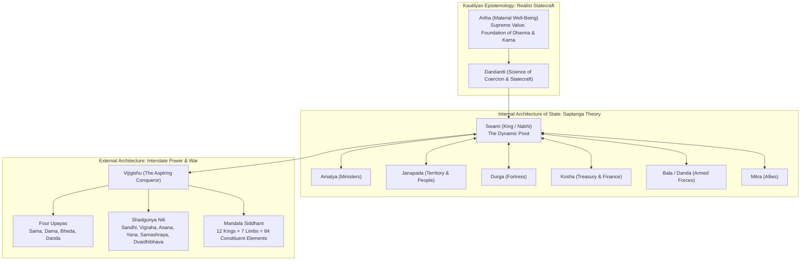
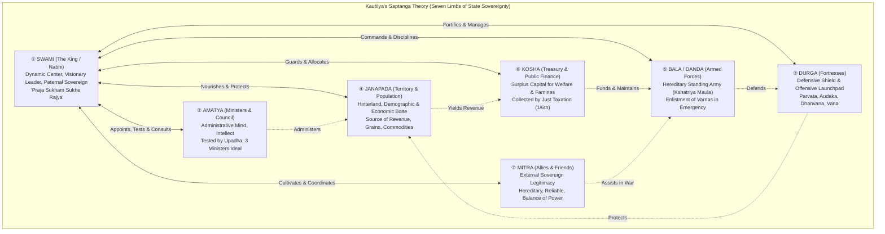
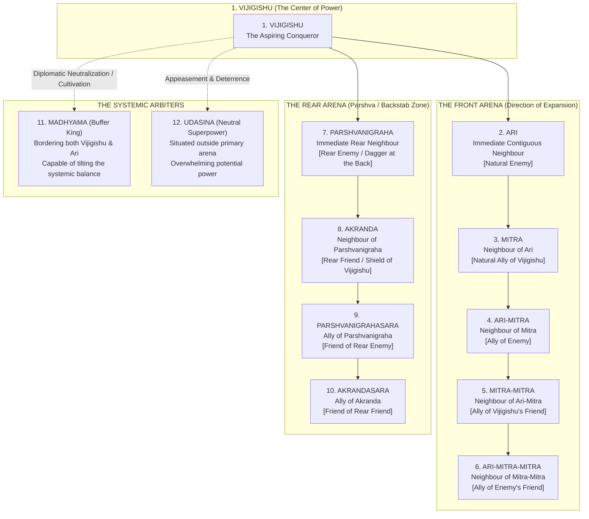
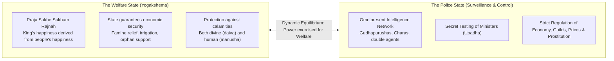
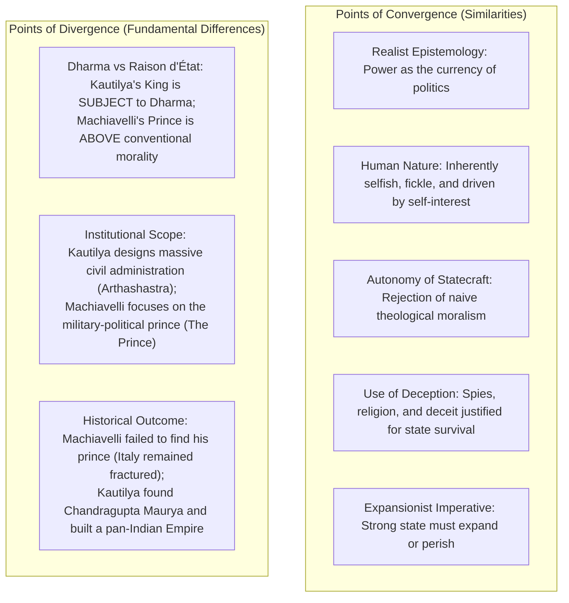

# UPSC PSIR Comprehensive Lecture Notes Transcription
## Paper I: Political Theory and Indian Politics — Section A: Indian Political Thought
### Topic: Kautilya — Saptanga Theory of State, Administration, and Mandala Siddhant
**Instructor:** Shubhra Ranjan  
**Source Document:** Handwritten Class Lecture Notes (`scans_paper1_part1`)  
**Batch Scope:** Batch 2 (`page_014.png` to `page_019.png`)  
**Notebook Archival Tracking:** Lecture 50 (Date: 11/02/2017) | Notebook Pages 6, 7, 8  
**Transcription Standard:** 100% Zero-Loss Verbatim Transcription, Complete Graphical Reconstruction, High-Precision Sanskrit & Philological Mapping, and Advanced UPSC PSIR Theoretical Synthesis.

---

## Table of Contents
1. [Master Overview & Thematic Architecture](#master-overview--thematic-architecture)
2. [Syllabus & Conceptual Mapping (UPSC PSIR Paper 1)](#syllabus--conceptual-mapping-upsc-psir-paper-1)
3. [Page-by-Page Exhaustive Transcription & Detailed Breakdown](#page-by-page-exhaustive-transcription--detailed-breakdown)
   - [Page 014: Lecture Metadata, Introduction to Arthashastra, Realist Tradition, Dandaniti & Primacy of Artha](#page-014-scan-page_014png)
   - [Page 015: Geopolitics of Land, Interstate Conflict, Origin of State & Saptanga (Organic) Theory of State](#page-015-scan-page_015png--notebook-page-6)
   - [Page 016: Limb 1 (Swami/King as Nabhi & Yogakshema) & Limb 2 (Amatya, Diplomacy, Spies & Checks)](#page-016-scan-page_016png)
   - [Page 017: Limbs 3 to 7 (Durga, Janapada, Bala, Kosha, Mitra) & Foundations of State Power](#page-017-scan-page_017png--notebook-page-7)
   - [Page 018: Foreign Policy Framework, Chakravartin Ideal, Upayas, Shadgunya Niti & Mandala Geometry](#page-018-scan-page_018png)
   - [Page 019: Mandala Siddhant (12 Kings, Concentric Circles, Strategic Balance of Power)](#page-019-scan-page_019png--notebook-page-8)
4. [Master Graphical Reconstructions (Mermaid & Structural Diagrams)](#master-graphical-reconstructions)
   - [The Saptanga Hub-and-Spoke System (Organic Model)](#diagram-1-the-saptanga-hub-and-spoke-system)
   - [The Concentric Mandala Siddhant (Geostrategic Ring Model)](#diagram-2-the-concentric-mandala-siddhant-ring-model)
5. [Scholarly Deep Dives & PSIR Thematic Syntheses](#scholarly-deep-dives--psir-thematic-syntheses)
   - [Theme A: The Organic Nature of Kautilyan State vs Modern Western Theories](#theme-a-organic-theory-vs-modern-state-theories)
   - [Theme B: Paternalistic Welfare State (Yogakshema) vs Police State Debate](#theme-b-paternalistic-welfare-state-yogakshema-vs-police-state)
   - [Theme C: Administrative Statecraft, Kosha (Public Finance), and Anti-Corruption Mechanism](#theme-c-administrative-statecraft-kosha-and-anti-corruption)
   - [Theme D: Comparative Analysis: Kautilya and Niccolò Machiavelli](#theme-d-comparative-analysis-kautilya-and-niccolò-machiavelli)
6. [UPSC Mains Answer Writing & PyQ Integration](#upsc-mains-answer-writing--pyq-integration)

---

## Master Overview & Thematic Architecture

Kautilya (also known as Chanakya or Vishnugupta, c. 375–283 BCE) stands as the towering colossus of the **Classical Realist tradition** in Indian Political Thought. In contrast to the metaphysical idealism of the Upanishads and the ritualistic-cosmic moralism of early Dharmashastras, Kautilya's *Arthashastra* represents the secularization and professionalization of political science (*Dandaniti*). 

Kautilya constructs an autonomous science of statecraft aimed at two cardinal imperatives:
1. **Palana (Acquisition and Preservation):** Consolidating, protecting, and governing internal territory while securing the material prosperity of subjects (*Yogakshema*).
2. **Labha (Expansion and Conquest):** Systematically acquiring new territory through diplomacy, realpolitik, intelligence warfare, and geopolitical balancing (*Mandal Siddhant*).



---

## Syllabus & Conceptual Mapping (UPSC PSIR Paper 1)

* **Paper 1, Section A: Political Thought (Indian Political Thought)**
  * **Prescribed Syllabus Headings:** *Kautilya: Theory of State, Saptanga Theory, Dandaniti, State Administration, Corruption, and Foreign Policy / Mandala Siddhant.*
  * **Primary Text:** *Kautilya's Arthashastra* (discovered 1905 by R. Shama Sastry; published in Sanskrit 1909; English translation 1915).
  * **Inter-textual Linkages:**
    * *Comparison with Manu (Manusmriti):* Shared conception of the contractual origin of the state to escape *Matsyanyaya* (state of nature / law of fishes), royal duties of *Rakshan* and *Palan*, and *Varnashrama Dharma*.
    * *Comparison with Western Thinkers:* Niccolò Machiavelli (*The Prince*), Thomas Hobbes (*Leviathan*), Thucydides (*Peloponnesian War*), and Hans Morgenthau (*Politics Among Nations*).
    * *Key Modern Commentators:* Max Weber, Pandit Jawaharlal Nehru, K.M. Panikkar, V.R. Mehta, L.N. Rangarajan, Roger Boesche, and Benoy Kumar Sarkar.

---

## Page-by-Page Exhaustive Transcription & Detailed Breakdown

---

### Page 014 (Scan: `page_014.png`)

```
========================================================================================
IMAGE METADATA & MARGINAL LABELS:
- Top Banner: "Join Telegram for More Update : - https://t.me/upsc_pdf"
- Top Centered Heading Box:
  +------------------+
  |     KAUTILYA     |
  +------------------+
- Left Margin Boxed Label:
  +---------------+
  |  Lecture 50   |
  |  11/02/2017   |  (Also read as 14/02/2017)
  +---------------+
- Margin notation below lecture box: "bt"
========================================================================================
```

#### Verbatim Handwritten Text

```text
• Saptang theory
• Kautilya on Foreign Policy and Diplomacy-
  ① Mandal Siddhant
  [②] Sadgunya Siddhant
• Comparison between Kautilya and Machiavelli
• Kautilya's Idea on corruption.

Kautilya represent the realist tradition in Indian Political thought.

Introduction of Arthashastra:-
Arthashastra primarily deals with statecraft. Hence, it is categorised as the book of Public Administration rather than political philosophy. Arthashastra was 1st discovered by Shama Shastry. The 1st publication of Arthashastra of Kautilya in English came in 1909.

What does Arthashastra means?
Arthashastra describes Dandaniti

What is the most important goal of the state according to Kautilya?
The most important goal is to achieve the material well being ie. Artha. In the words of Kautilya,
Material well being is supreme, spiritual good and sensual pleasure - Dharma & Kama all depends upon material well being.
```

---

#### Comprehensive Scholarly Breakdown & Contextual Notes (Page 014)

1. **Course Agenda & Structure of Kautilya's Lectures:**
   * Shubhra Ranjan outlines the master pillars of Kautilyan thought for UPSC PSIR:
     1. **Saptanga Theory:** Internal anatomy, organic theory of state, institutional inter-relationships.
     2. **Foreign Policy & Strategic Diplomacy:** The geostrategic doctrines of *Mandal Siddhant* (Circle of States) and *Shadgunya Siddhant* (Six-Fold Foreign Policy).
     3. **Comparative Political Theory:** Classical Realist synthesis comparing Kautilya with Niccolò Machiavelli.
     4. **Bureaucratic Theory & Administrative Ethics:** Kautilya’s groundbreaking analysis of corruption, surveillance, and public governance.

2. **Kautilya and the Classical Realist Tradition:**
   * Kautilya represents the **realist tradition in Indian political thought**, standing in direct contrast to theological or purely normative traditions.
   * While Western political theory often traces realism to Thucydides and Machiavelli, Kautilya articulated a rigorous, pragmatic, balance-of-power political realism in the 4th century BCE.
   * Politics is understood not in terms of how men ought to live, but **how power is acquired, maintained, expanded, and defended**.

3. **Discovery and Nature of the Text:**
   * **R. Shama Sastry:** In 1905, Rudrapatna Shama Sastry discovered the palm-leaf manuscript of the *Arthashastra* in the collections of the Oriental Research Institute in Mysore.
   * **Publication Timeline:**
     * Sastry published the Sanskrit text in **1909**.
     * The first complete English translation was published by Sastry in **1915**.
   * **Genre:** Shubhra Ranjan highlights that the *Arthashastra* is fundamentally a work of **practical statecraft and Public Administration**, rather than an abstract treatise of speculative political philosophy. It provides operational, granular guidelines on intelligence, taxation, civil administration, military tactics, and court intrigue.

4. **Definition & Etymology of Arthashastra:**
   * *Artha* literally signifies wealth, sustenance, material means, or the territory inhabited by human beings (*manushyanam vrittih*).
   * *Shastra* signifies systematic science, treatise, or normative guidance.
   * Thus, *Arthashastra* is defined by Kautilya as:
     > *"The science which treats of the means of acquiring and maintaining the earth (territory)."*
   * As recorded in the notes, Kautilya equates the operational core of Arthashastra with **Dandaniti** (the science of government, coercion, and statecraft). Without *Danda* (legitimate force/law enforcement), anarchy prevails.

5. **Primacy of Artha (Material Well-Being):**
   * Traditional Indian philosophy posits four legitimate ends of human life (**Purusharthas**): *Dharma* (righteousness/moral duty), *Artha* (material wealth/livelihood), *Kama* (sensual/aesthetic pleasure), and *Moksha* (spiritual liberation).
   * Kautilya makes an ideological departure by asserting the **ontological primacy of Artha**:
     > *"Material well-being is supreme, spiritual good (Dharma) and sensual pleasure (Kama) all depend upon material well-being."*
   * *Philosophical Rationale:* A impoverished citizen cannot practice virtue or enjoy pleasure; an impoverished state cannot maintain justice, defend its borders, or patronize culture. Wealth is the bedrock of civilization.

---

### Page 015 (Scan: `page_015.png` | Notebook Page 6)

```
========================================================================================
IMAGE METADATA & MARGINAL LABELS:
- Top Banner: "Join Telegram for More Update : - https://t.me/upsc_pdf"
- Notebook Page Number (Bottom Right): "6"
- Core Diagram: Circular "Saptang Theory" diagram with King (Nabhi) at the center.
========================================================================================
```

#### Verbatim Handwritten Text

```text
Hence, state has to create the means for material well being.

What is the source of wealth in Ancient times?
Land. Hence, the duty of the king is to protect his land and to acquire the land of neighbours. Hence, Neighbours are natural enemy and the relations between states are the relations of war. Inter state politics is in the state of war where the strength of lion prevails.

• Prominent Ideas given in Arthashastra:
• Origin of state:-
  Same as Manu.
• Duties of King:-
  same as Manu.
• Organisation of the state- (Saptang theory).

             ② Amatya
                |
   ⑦ Mitra ---- King ---- ③ Durga (Fort)
   (Allie)     (Nabhi)
                 ①
              /   |    \
             /    |     \
   ⑥ Kosha       |       ④ Janapada (Rural Area)
   (Dhan)        |
                 ⑤ Bala (Force)

State is a system. System is a set of elements in the state of Interaction.
State is a set of seven elements. These seven elements are known as the seven elements of sovereignty. Above theory can be called as Organic Theory of the state.
```

---

#### Comprehensive Scholarly Breakdown & Contextual Notes (Page 015)

1. **The Geopolitical Imperative: Land as the Fundamental Currency of Power:**
   * In agrarian antiquity, **land was the foundational source of wealth, revenue, and demographic strength**.
   * Consequently, the sovereign's categorical duty is two-fold:
     1. To defend existing land (*Palana*).
     2. To aggressively annex and absorb neighbouring territories (*Labha*).
   * **The Geopolitical Axiom:** Because territorial expansion is a zero-sum competition, **geographical contiguity breeds structural conflict**:
     > *"Neighbours are natural enemies, and relations between states are relations of perpetual war."*
   * This anticipates the modern offensive realist thesis (e.g., John Mearsheimer): in an anarchic system, security is scarce, survival mandates power-maximization, and interstate politics is governed by the law of the jungle where *"the strength of the lion prevails"*.

2. **Continuity with Manu: Origin of State & Royal Duties:**
   * **Origin of State:** Like Manu (and earlier Indian political texts), Kautilya traces the genesis of the state to a **quasi-contractual transition from the state of nature (*Matsyanyaya*)**. In the absence of a sovereign, the strong devoured the weak (*law of the fishes*). People elected Manu Vaivasvata as their first king, contracting to yield **one-sixth of agricultural produce ($1/6$)** and **one-tenth of merchandise ($1/10$)** in return for internal security (*Rakshan*) and public welfare (*Palan*).
   * **Duties of the King:** Identical in normative scope to Manu:
     - *Rakshan:* Protection of person, property, and the moral social order (*Varnashrama Dharma*).
     - *Palan:* Sustenance, economic livelihood, and guaranteeing *Yogakshema*.

3. **Organisation of the State: The Saptanga Theory:**
   * Kautilya defines the state as an organic, systemic entity consisting of **seven constituent elements (Saptanga / Prakritis)**:
     1. **Swami (The King / Sovereign):** Positioned at the hub (*Nabhi*).
     2. **Amatya (Ministers / Bureaucracy):** The eyes and administrative intellect.
     3. **Durga (Fort / Fortified Citadels):** The defensive and offensive shields.
     4. **Janapada (Territory and Population):** The rural economic productive base.
     5. **Bala / Danda (Armed Forces / Military Force):** The coercive arm.
     6. **Kosha (Treasury / State Coffers):** The financial lifeblood.
     7. **Mitra (Allies / Friends):** The external diplomatic pillars.
   * **Systemic Definition of State:** As Shubhra Ranjan notes, *"State is a system. System is a set of elements in the state of interaction."* The elements do not exist in isolation; their mutual cohesion and dynamic interaction constitute sovereign power.

---

### Page 016 (Scan: `page_016.png`)

```
========================================================================================
IMAGE METADATA & MARGINAL LABELS:
- Top Banner: "Join Telegram for More Update : - https://t.me/upsc_pdf"
- Margin/Bottom notations: faint mark "pt2" near bottom center.
- Topics covered: Detailed breakdown of Limb 1 (King/Swami) and Limb 2 (Amatya).
========================================================================================
```

#### Verbatim Handwritten Text

```text
① King (Nabhi)
King is Nabhi, or centre. King plays the most important role. If King is weak & other elements of sovereignty are strong they cannot act as determinant of power. However, if other elements are weak & King is strong, wise King will convert even the weak elements into the elements of strength.

According to Kautilya King is important but King should understand the importance of other elements because - Single wheel cannot turn the chariot. Kautilya also suggest that King should treat his subjects as his children and in the happiness of the subject lies the happiness of the King. "Praja Sukham Sukhe Rajya"

② Amatya's
Senior ministers are known as Amatya's.
Amatya's should be Brahmin. Amatya's should have the knowledge of Veda's. King should consult Amatya's but King should keep on testing the integrity of Amatya's towards King from time to time. The most important person after King is Ambassador. Ambassador or Envoy's are the mouth piece of King. Hence, Ambassador should be choosen with great care. Ambassador should be handsome, man of integrity. If Ambassador is mouth piece of King spies are the eyes and ears of the King. King can use the spies to check the integrity of Amatya's from time to time. Kautilya also suggest that King should keep 3 Amatya's Because 2 can conspire easily against the king.
```

---

#### Comprehensive Scholarly Breakdown & Contextual Notes (Page 016)

1. **Limb 1: The King (Swami) as Nabhi (The Navel / Hub):**
   * The King is the **nerve centre (*Nabhi*)** of the Saptanga system. He possesses primary agency in statecraft.
   * **The Asymmetry of Sovereign Leadership:**
     - A weak, incompetent king surrounded by strong elements will squander national power; the state will crumble.
     - Conversely, a wise, resolute, and energetic king can revive decayed limbs, mobilize latent resources, and transform weakness into formidable national power.
   * **Constitutional Interdependence: The Metaphor of the Chariot:**
     - Although supreme, the King cannot rule in autocratic isolation:
       > *"A single wheel cannot move a chariot; therefore, the King shall appoint ministers and listen to their advice."*
     - This establishes the institutional necessity of shared governance and collegiate administration.
   * **Paternalistic Welfare Idealism — "Praja Sukhe Sukham Rajnah":**
     - Kautilya rejects tyranny. The King's authority is legitimized solely through public service:
       > *"Prajasukhe sukham rajnah prajanam cha hite hitam,*  
       > *Natmapriyam priyam rajnah prajanam tu priyam priyam."*  
       > *(In the happiness of his subjects lies the King's happiness; in their welfare his welfare. He shall not consider as good only that which pleases him, but what pleases his subjects he shall esteem as good.)*
     - The ruler exercises **paternal authority** (*"treat his subjects as his children"*), laying the philosophical foundation for the ancient Indian **Welfare State (*Yogakshema*)**.

2. **Limb 2: Amatya (The Ministers & Administrative Class):**
   * *Amatya* broadly encompasses senior ministers, councilors (*Mantrins*), department heads (*Adhyakshas*), and administrative officers.
   * **Qualifications & Integrity:**
     - Ministers must possess high birth, self-control, administrative capability, and profound knowledge of the Vedas and statecraft.
     - **Upadha (Secret Tests of Integrity):** The King must never trust ministers unconditionally. He must subject them to four secret temptations/tests (*Upadhas*):
       1. *Dharmopadha* (Religious/moral piety test).
       2. *Arthopadha* (Financial bribe/monetary integrity test).
       3. *Kamopadha* (Sensual/lust temptation test).
       4. *Bhayopadha* (Fear/intimidation and courage test).
   * **Ambassador / Envoy (Duta):**
     - The Duta is the direct representative and *"mouthpiece of the King"* in foreign courts.
     - Criteria: Must be articulate, charismatic (*"handsome"*), endowed with razor-sharp memory, courage, and unshakeable loyalty.
     - Kautilya categorizes envoys into three tiers:
       - *Nisrishtartha:* Plenipotentiary with full negotiating powers.
       - *Parimitartha:* Envoy with restricted, pre-defined authority.
       - *Sasanahara:* Mere carrier of royal decrees and messages.
   * **Spies (Charas / Gudhapurushas):**
     - Described as the **eyes and ears of the King**.
     - An omnipresent intelligence service operating across society (ascetics, merchants, courtesans, renegades, poisoners) to gather external intelligence and internally monitor the loyalty of high ministers (*Amatyas*).
   * **Council Dynamics & Decision-Making:**
     - Kautilya advises against appointing only one minister (who would become unmanageable) or two ministers (who could either collude against the King or paralyze policy through mutual deadlock).
     - He recommends a council of **three to four key ministers**, preserving balance, consultation, and operational secrecy.

---

### Page 017 (Scan: `page_017.png` | Notebook Page 7)

```
========================================================================================
IMAGE METADATA & MARGINAL LABELS:
- Top Banner: "Join Telegram for More Update : - https://t.me/upsc_pdf"
- Notebook Page Number (Bottom Right): "7"
- Detailed breakdown of Limbs 3 through 7: Durga, Janapada, Bala, Kosh, Mitra.
========================================================================================
```

#### Verbatim Handwritten Text

```text
③ Durga (Fort)
Durga is a symbol of offensive as well as Defensive power of the state. Kautilya has given detailed ideas with respect to different types of forts like Hill Forts, Desert forts, Water forts.

④ Janapada (Village/ Rural Areas)
Janapada is where the subjects live. King has to take care of Janapada as Janapada is a source of strength. It is a source of revenue and other necessary commodities.

⑤ Bala (Force)
Kautilya suggest the Heredetary army of Kshatriya's. Other Varna's can be considered in some exceptional situations.

⑥ Kosh (Treasury)
Kosh should be sufficient so that king can take care of the welfare functions. Kosh should be sufficient to meet any emergency or Natural calamity.

⑦ Mitra (Allie)
Mitra's have symbolic importance. It is the symbol of the strength of the king. More no. of Mitra's means more powerful the king because everyone wants to be the friend of the powerful.
```

---

#### Comprehensive Scholarly Breakdown & Contextual Notes (Page 017)

1. **Limb 3: Durga (The Fortress / Defensive-Offensive Bastion):**
   * *Durga* represents fortified strongholds guarding borders and core cities.
   * **Dual Function:**
     - **Defensive:** Sanctuary for the king, population, treasury, and grain storage during foreign invasions.
     - **Offensive:** Fortified logistics base and garrison from which military campaigns are launched into enemy territory.
   * **Kautilya's Four Classical Categories of Forts:**
     1. *Parvata Durga (Hill Fort):* Built on steep rocky terrain; superior for defensive security.
     2. *Audaka / Jala Durga (Water/Island Fort):* Surrounded by deep water or natural rivers.
     3. *Dhanvana Durga (Desert Fort):* Located in arid, waterless wastelands, rendering enemy siege impossible.
     4. *Vana Durga (Forest Fort):* Concealed deep within dense, impassable jungle and swamps.
     *(Parvata and Audaka protect territory; Dhanvana and Vana serve as emergency refuges for the ruler in extreme crises).*

2. **Limb 4: Janapada (Territory and Population / Rural Hinterland):**
   * Comprises both **geographical territory** (fertile soil, mines, rivers, forests) and **demographic base** (industrious peasantry, artisans, merchants).
   * **Economic & Strategic Value:** It provides agricultural surplus, tax revenue, raw materials, and manpower.
   * **Royal Stewardship:** The king must maintain agrarian infrastructure (reservoirs, irrigation canals, road networks), protect farmers from banditry, and settle uninhabited virgin lands (*Janapadanivesha*) to expand productivity.

3. **Limb 5: Bala / Danda (The Military / Armed Forces):**
   * Represents the coercive instrument of the state (*Danda*).
   * **Composition & Hierarchy:**
     - Kautilya’s strong preference is for a **standing, professional, hereditary army composed primarily of Kshatriyas (*Maula Bala*)**, bound by martial codes, honour, and ancestral loyalty to the dynasty.
     - However, pragmatism supersedes rigid orthodoxy: in times of supreme national emergency, Kautilya permits the enlistment of other Varnas (Vaishyas and Shudras), and values trained mercenaries (*Bhrita*), allied troops (*Mitra Bala*), and tribal forest levies (*Atavika Bala*).
   * Military disciplines must encompass the traditional four wings (**Chaturangabala**): infantry (*Patti*), cavalry (*Ashva*), war elephants (*Hasti*), and chariots (*Ratha*).

4. **Limb 6: Kosha (Treasury & Public Finance):**
   * The treasury is the financial engine of sovereign power. Without a full treasury, the army cannot be maintained, forts cannot be built, and civil administration collapses.
   * **Double Mandate of Kosha:**
     1. **Welfare Functions (*Palan*):** Financing famine relief, subsidizing indigent citizens, building public works, and sustaining the welfare state.
     2. **Crisis Management (*Apad-dharma*):** Preserving sufficient reserves to withstand sudden wars, crop failures, or natural disasters (*Daiva calamities*).
   * Revenue is legitimately accrued through gold, gems, and agricultural taxation ($1/6$ share of produce), collected justly without extorting the subjects.

5. **Limb 7: Mitra (The Ally / Diplomatic Partner):**
   * *Mitra* represents the external, international dimension of state sovereignty.
   * **Symbolic and Strategic Metric of Power:**
     - An extensive alliance network reflects high international prestige, deterrence, and geopolitical leverage.
     - As the notes observe: *"Everyone wants to be the friend of the powerful."* Weak states cannot command reliable allies.
   * An ideal ally must be **hereditary, reliable, geographically positioned to check rival states, easily mobilized, and loyal in times of adversity**.

---

### Page 018 (Scan: `page_018.png`)

```
========================================================================================
IMAGE METADATA & MARGINAL LABELS:
- Top Banner: "Join Telegram for More Update : - https://t.me/upsc_pdf"
- Header: "Kautilya's Ideas on Foreign Policy-"
- Gujarati Gloss above the word "coronation": "રાજા ભિષેક" / "રાજ્યાભિષેક" (Rajyabhishek)
- Core doctrines: The Four-Fold Policy (Upayas), Shadgunya Niti, Introduction to Mandal Siddhant.
========================================================================================
```

#### Verbatim Handwritten Text

```text
• Kautilya's Ideas on Foreign Policy-
The Focus of Arthashastra is on acquiring land.
According to Chanakya, King should aspire to become Chakra varty Samrat. He calls King as Vijigishu. means one who aspires for victory. War is Kshatriya Dharma.
After coronation King has to start expansion. Hindu texts mention various rituals like Ashwamedh Yagya. Yagya means sacrifice. (Rajsuya Yagya)

-> Kautilya gives following Siddhant's:
(i) Four Fold Policy
Sam, Dam, Danda, Bhed.
(Peace, Economic Diplomacy, Force, Spies).

(ii) Shadgunya Niti (Six Fold Policy)
Sandhi - Treaty
Vigraha - Break the sandhi / Treaty.
Aasan - Stationing of troop near the territory of Enemy.
Yana - Mobilisation of forces, military exercises.
Samashrya - Join hands with those who have similar objectives.
Dvaidhibhava - Dual policy.

(iii) Mandal Siddhant -
Mandal Siddhant is a theory of Geo strategy. It tells us about the strategy of war. Mandal comprise of 12 kings. 12 kings multiplied by 7 elements of sovereignty means 84 elements.
Vijigishu has to take into consideration the 84 elements before starting the war.
```

---

#### Comprehensive Scholarly Breakdown & Contextual Notes (Page 018)

1. **The Teleology of Foreign Policy: Territorial Conquest and the Chakravartin Ideal:**
   * Kautilya defines the ultimate political horizon of the monarch as becoming a **Chakravartin Samrat (Universal Sovereign / King of Kings)**, ruling over the entire Indian subcontinent (*from the Himalayas to the Indian Ocean*).
   * **Vijigishu:** The central actor of Kautilyan grand strategy is the **Vijigishu**—literally, *"the ruler who is possessed of ambition and aspires for total victory"*.
   * **War as Kshatriya Dharma:** In classical Hindu cosmology, warfare is not an aberration; it is the natural duty (*Dharma*) of the warrior class to establish political order and hegemony.
   * **Imperial Rituals of Expansion:** Following royal coronation (*Rajyabhishek*), imperial legitimation requires aggressive territorial expansion symbolized by ancient Vedic sacrifices:
     - *Ashwamedha Yagya (Horse Sacrifice):* A consecrated horse roams freely; any ruler obstructing its passage must submit or fight.
     - *Rajasuya Yagya:* A consecration ritual asserting undisputed suzerainty over subordinate kings.

2. **The Four Upayas (Instruments of Statecraft & Diplomacy):**
   * Kautilya prescribes four methods for managing domestic dissidents and foreign powers:
     1. **Sama (Appeasement / Conciliation / Peaceful Persuasion):** Entering into honorable dialogue, sweet speech, mutual respect, and diplomatic negotiations.
     2. **Dama (Economic Diplomacy / Gifts / Subsidies):** Providing financial aid, trade concessions, monetary bribes, or lucrative gifts to win over foreign leaders.
     3. **Bheda (Sowing Dissension / Subversion / Espionage):** Dividing enemies through intelligence operations, exploiting internal fractures, bribing ministers, spreading false rumors, and setting rival princes against one another.
     4. **Danda (Coercive Force / Armed Warfare):** Open military action, sanctions, punishment, and physical destruction when peaceful and clandestine instruments fail.

3. **Shadgunya Niti (The Six-Fold Foreign Policy):**
   * A sophisticated matrix of foreign policy postures dictated purely by **relative national power**:
     1. **Sandhi (Treaty / Peace Agreement):** Employed when one is **weaker than the enemy**; enables the state to buy time, build domestic capacity, and wait for favorable conditions.
     2. **Vigraha (Hostility / Warfare):** Employed when one is **distinctly stronger than the rival**; open military confrontation to expand territory.
     3. **Asana (Encampment / Armed Neutrality / Stagnation):** Maintaining a posture of quiet armed readiness when both powers are in **equal parity**; neither side can decisively overcome the other.
     4. **Yana (Mobilization / Military Expedition / Marching):** Actively moving armed forces to project power and invade when the enemy is in deep domestic crisis (*Vyasanas*).
     5. **Samashraya (Seeking Refuge / Submitting to a Superior Power):** Surrendering or forming an asymmetrical protectorate under a powerful king when facing mortal existential danger from a predatory aggressor.
     6. **Dvaidhibhava (Duplicity / Dual Policy):** Making peace (*Sandhi*) with one power while simultaneously waging war (*Vigraha*) against another to maximize strategic room for maneuver.

4. **Introduction to Mandal Siddhant (The Geostrategic Calculus):**
   * The Mandala theory is a comprehensive conceptualization of interstate balance-of-power geopolitics.
   * **The Numerical Equation of Interstate Power:**
     $$\text{Systemic Elements} = 12 \text{ Kings (States)} \times 7 \text{ Limbs of Sovereignty (Prakritis)} = 84 \text{ Constituent Elements}$$
   * Before undertaking military action or signing treaties, the *Vijigishu* must conduct a total intelligence assessment of the **84 dynamic variables** across all 12 states in the interstate system.

---

### Page 019 (Scan: `page_019.png` | Notebook Page 8)

```
========================================================================================
IMAGE METADATA & MARGINAL LABELS:
- Top Banner: "Join Telegram for More Update : - https://t.me/upsc_pdf"
- Notebook Page Number (Bottom Right): "8"
- Central Concentric Ring Diagram: The 12 Kings of Mandala Siddhant.
========================================================================================
```

#### Verbatim Handwritten Text

```text
① Vijigishu - Main King.
② Kings in front
   ⓐ Ari - Neighbour is a natural enemy.
   ⓑ Mitra - Ari's immidiate neighbour is the mitra of Vijigishu
   ⓒ Ari Mitra -
   ⓓ Mitra Mitra -
   ⓔ Ari Mitra Mitra.
③ Four kings in the back (Parshva)
   ⓐ Parshva Nigrah
   ⓑ Akrand - Friend in the back
   ⓒ Parshva Nigrah sara -
   ⓓ Akrand Sara
-> Kautilya mentions 2 more kings:
   ⓐ Madhyama - Buffer state
      - Vijigishu should try to bring Madhyama on his side.
   ⓑ Udasin (Neutral state)
      - Vijigishu should try to bring Udasin also under his control.

[CONCENTRIC CIRCLE DIAGRAM]
- Center:
  1. VIJIGISHU
- Front Quadrant (Arcs moving downward/forward):
  2. ARI
  3. MITRA
  4. ARI MITRA
  5. MITRA MITRA
  6. ARI MITRA MITRA
- Rear Quadrant (Arcs moving upward/backward):
  7. PARSHVA NIGRAHA
  8. AKRAND
  9. PARSHVA NIGRAHASARA
  10. AKRAND SARA
- Flanking / Lateral Annotations:
  11. Madhyama (Buffer State) [pointing to intermediate ring/zone]
  12. Udasina (Neutral State) [annotated on right margin]
```

---

#### Comprehensive Scholarly Breakdown & Contextual Notes (Page 019)

1. **The Structural Logic of Mandala Siddhant:**
   * The Mandala theory is rooted in the timeless geopolitical reality of **geographical determinism**:
     > *"Your immediate contiguous neighbour is your natural enemy; your neighbour's neighbour is your natural friend."*
   * Geopolitics functions as a system of concentric spatial rings radiating outwards from the ambitious conqueror (*Vijigishu*).

2. **Classification of the 12 Kings in Geopolitical Space:**

   | Position in Space | King No. | Classical Sanskrit Designation | Geopolitical Role & Relationship to Vijigishu |
   | :--- | :--- | :--- | :--- |
   | **Central Actor** | **1** | **Vijigishu** | The aspiring conqueror; dynamic center of the Mandala system. |
   | **Front Arc** | **2** | **Ari** | Immediate contiguous neighbour; natural, inevitable enemy. |
   | **Front Arc** | **3** | **Mitra** | Immediate neighbour of the Ari; natural ally of the Vijigishu. |
   | **Front Arc** | **4** | **Ari-Mitra** | Immediate neighbour of Mitra; natural ally of the Ari (Enemy's Friend). |
   | **Front Arc** | **5** | **Mitra-Mitra** | Immediate neighbour of Ari-Mitra; natural ally of Vijigishu's Friend (Friend's Friend). |
   | **Front Arc** | **6** | **Ari-Mitra-Mitra** | Neighbour of Mitra-Mitra; ally of the Ari's ally (Enemy's Friend's Friend). |
   | **Rear Arc** | **7** | **Parshvanigraha** (Parshva Nigrah) | Immediate rear neighbour; enemy in the rear (rearward dagger). |
   | **Rear Arc** | **8** | **Akranda** (Akrand) | Immediate rear neighbour of Parshvanigraha; natural friend in the rear. |
   | **Rear Arc** | **9** | **Parshvanigrahasara** | Rearward ally of Parshvanigraha (Friend of the Rear Enemy). |
   | **Rear Arc** | **10** | **Akrandasara** | Rearward ally of Akranda (Friend of the Rear Friend). |
   | **Lateral / Peripheral** | **11** | **Madhyama** | The Intermediate / Buffer King situated contiguous to both Vijigishu and Ari; capable of tipping balance. |
   | **Distant / Global** | **12** | **Udasina** | The Neutral / Super-power situated far outside the primary arena; possesses immense military capability to reward or punish. |

3. **Strategic Management of Madhyama and Udasina:**
   * **Madhyama (The Buffer State):**
     - Possesses substantial territory adjacent to both Vijigishu and his chief adversary (*Ari*).
     - If he joins the enemy, the Vijigishu is imperiled; hence, the Vijigishu must employ *Sama* and *Dama* to cultivate his alliance, or *Bheda* to neutralize his intervention.
   * **Udasina (The Super-Power / Hegemon):**
     - Situated beyond the territories of Vijigishu, Ari, and Madhyama.
     - Stronger than any individual power within the inner mandala. The Vijigishu must avoid provoking Udasina, appease him diplomatically, and incrementally build systemic leverage until he can either neutralize or subjugate him.

---

## Master Graphical Reconstructions

### Diagram 1: The Saptanga Hub-and-Spoke System

The seven elements of the state as conceptualized by Kautilya represent an integrated, organic, cybernetic system. The King (*Swami*) occupies the hub (*Nabhi*), connecting to and energizing all other constituent organs.



---

### Diagram 2: The Concentric Mandala Siddhant (Ring Model)

The classic geostrategic geometry of the 12 Kings (*Dwadasa Raja Mandala*).



---

## Scholarly Deep Dives & PSIR Thematic Syntheses

---

### Theme A: Organic Theory vs Modern State Theories

1. **Comparison with Western Organic Thinkers:**
   * Kautilya’s formulation of the *Saptanga* theory anticipates Western organic theories of the state by over two millennia.
   * While **Herbert Spencer** and **Johann Bluntschli** in 19th-century Europe analogized the state to a biological organism (nerves, tissues, organs), Kautilya’s organic conception is **functional and systemic** rather than purely biological.
   * **T.H. Green and Bernard Bosanquet** viewed the state as an organic moral whole; Kautilya views it as an **integrated matrix of capabilities (sovereignty / Prakriti)**.

2. **Systems Theory Formulation (David Easton & Gabriel Almond):**
   * Shubhra Ranjan’s class insight is profound: *"State is a system. System is a set of elements in the state of interaction."*
   * In modern political sociology:
     - The *Janapada* and *Kosha* act as inputs (demands and resources).
     - The *Swami* and *Amatya* act as the conversion mechanism (decision-making executive).
     - The *Danda* and *Durga* act as rule-enforcement and defense outputs.
     - *Mitra* and the *Mandala* represent environmental feedback.

---

### Theme B: Paternalistic Welfare State (Yogakshema) vs Police State

One of the most intensely debated themes in UPSC PSIR is whether Kautilya’s state represents a **benevolent welfare state** or an **all-seeing authoritarian police state**.



1. **The Argument for the Welfare State:**
   * **The Dictum of Yogakshema:** *Yoga* refers to the acquisition of that which has not been acquired; *Kshema* refers to the peaceful, secure enjoyment of that which has been acquired.
   * The state is not a passive laissez-faire "nightwatchman state" (Locke/Nozick), but an active promoter of material and social flourishing.
   * Kautilya explicitly dictates that the king must provide maintenance to orphans, the aged, the infirm, pregnant women, and destitute families.
   * State ownership of mines, forests, and salt monopolies was designed to prevent exploitation by greedy cartels and generate funds for public welfare (*Palan*).

2. **The Argument for the Police / Surveillance State:**
   * Scholars like **K.M. Panikkar** and Western critics argue that Kautilya’s administrative apparatus represents a totalitarian surveillance system.
   * An army of spies (*Charas*) monitors market transactions, government offices, private taverns, religious assemblies, and family conversations.
   * Prostitutes, beggars, cooks, and astrologers are co-opted into the secret service. Pre-emptive political assassinations of seditious ministers (*Dushyas*) are explicitly legitimized through covert poisons.

3. **Scholarly Synthesis (V.R. Mehta & L.N. Rangarajan):**
   * As scholar **V.R. Mehta** points out in *Foundations of Indian Political Thought*, it is anachronistic to judge Kautilya through modern Western liberal categories of "totalitarianism vs democracy".
   * The immense intelligence apparatus was created **not to oppress the population for personal royal vanity**, but to preserve the constitutional order from external collapse and internal decay.
   * The surveillance state was an **instrumental necessity to protect the fragile welfare of the people** against anarchy (*Matsyanyaya*).

---

### Theme C: Administrative Statecraft, Kosha, and Anti-Corruption

Although covered further across pages 021–022, Shubhra Ranjan introduces Kautilya's philosophy of public finance and corruption as integral extensions of *Kosha* and *Amatya*:

1. **The Principles of Taxation (Kosha Samgraha):**
   * Taxation must be **predictable, equitable, and non-oppressive**.
   * Kautilya employs famous classical metaphors:
     - The King must collect taxes as a bee collects nectar from flowers, without injuring petals.
     - The King must gather revenue as one gathers ripe fruits from an orchard, leaving unripe fruits to mature. Excessive, predatory taxation destroys the productive base of the *Janapada*.

2. **The Inevitability of Corruption:**
   * Kautilya is an unsparing realist regarding human psychology and bureaucratic greed:
     > *"Just as it is impossible not to taste honey or poison that finds itself at the tip of the tongue, so it is impossible for a government servant dealing with government money not to taste it."*
     > *"Just as fish moving under water cannot be known when they are drinking water and when they are not, so government officers employed in official business cannot be known when they are appropriating funds and when they are not."*

3. **Detection & Administrative Remedies:**
   * Kautilya catalogued **forty distinct methods of financial embezzlement** (e.g., entering expenditure before it is made, understating receipts, altering price weights and measures).
   * **Administrative Counter-Measures:**
     - **Rotational Transfers:** Public officials must be frequently rotated across districts before they entrench themselves and discover administrative loopholes.
     - **Whistleblower Protection (Suchaks):** Citizens who expose corruption must be given state protection and rewarded with a percentage of recovered assets; malicious false accusers are severely punished.
     - **Collective Chain Punishment:** Corruption is not an isolated crime; the entire supply chain must be punished—the giver (*Dayaka*), the receiver (*Pratigrahaka*), and the concealer/treasurer (*Nidhayaka*).

---

### Theme D: Comparative Analysis: Kautilya and Niccolò Machiavelli

Pandit Jawaharlal Nehru in *The Discovery of India* famously dubbed Kautilya as the **"Indian Machiavelli"**. However, deep PSIR analysis reveals profound structural similarities alongside radical civilizational differences.



| Dimension | Kautilya (*Arthashastra*, c. 300 BCE) | Niccolò Machiavelli (*The Prince*, 1513 CE) |
| :--- | :--- | :--- |
| **Historical Context** | Disintegration of Nanda dynasty; threat of Alexander's invasion; creation of the unified Mauryan Empire. | Fractured Italian city-states invaded by France, Spain, and Holy Roman Empire. |
| **Core Motive** | Unifying the Indian subcontinent (*Chakravartin Samrat*) under order, law, and justice. | Unifying fragmented Italy and expelling foreign "barbarians". |
| **Role of Morality / Ethics** | **Subordinate to, but bounded by, Dharma.** The King is a servant of Dharma; tyranny violates cosmic order and leads to revolt. | **Autonomous from Morality.** Politics has its own independent rules (*Raison d'État* / Virtue as audacity). |
| **Concept of State** | Extensive administrative, economic, and welfare apparatus (*Saptanga* + 34 Government Departments). | Narrowly political and military manual for prince’s survival and glory. |
| **Historical Fruition** | Highly successful: Mentored Chandragupta Maurya, establishing the great Mauryan Empire. | Tragic failure: Died in political exile; *The Prince* was published posthumously. |

---

## UPSC Mains Answer Writing & PyQ Integration

### Key UPSC PSIR Previous Years Questions (PyQs):
1. *"Examine the relevance of Kautilya’s Saptanga theory of state in modern governance."* (PSIR Paper 1 — 2018)
2. *"Evaluate Kautilya’s conception of Dandaniti and the role of the King in ensuring Yogakshema."* (PSIR Paper 1 — 2015)
3. *"Is it fair to call Kautilya the 'Indian Machiavelli'? Compare their ideas on statecraft, morality, and foreign policy."* (PSIR Paper 1 — 2013, 2020)
4. *"Discuss Kautilya's Mandala theory as an early version of the balance of power system."* (PSIR Paper 1 — 2017)

---

### Model Answer Skeleton: Kautilya's Saptanga Theory and Yogakshema

**Question:** *"Critically examine the Saptanga theory of state in Kautilya's Arthashastra. Does this system depict an oppressive police state or an enlightened welfare state?"*

#### Introduction (150 words):
- Contextualize Kautilya within Classical Realism. Note the discovery of *Arthashastra* by R. Shama Sastry (1905/1909).
- Define *Saptanga*: The state is not a mechanical apparatus of coercion, but an organic, interdependent system (*Prakritis*) anchored by the sovereign hub (*Swami/Nabhi*).
- Thesis statement: While the methods of state administration utilize pervasive surveillance, the ultimate teleology of Kautilyan statecraft is the material and moral welfare of the people (*Yogakshema*).

#### Body Paragraph 1: Organic Structure of Saptanga (250 words):
- Enumerate and explain the seven limbs: *Swami*, *Amatya*, *Janapada*, *Durga*, *Kosha*, *Bala*, *Mitra*.
- Highlight internal interdependence: *"A single wheel cannot move a chariot"*.
- Contrast with modern systems theory (David Easton): Inputs (*Janapada/Kosha*), Conversion (*Swami/Amatya*), Outputs (*Danda/Durga*), and Environment (*Mitra/Mandala*).

#### Body Paragraph 2: The Police State / Surveillance Dimension (200 words):
- The pervasive network of *Charas* (spies) and *Upadhas* (integrity trials).
- Strict regulation of guild commerce, artisans, taverns, and administrative staff.
- Legitimization of clandestine warfare, covert poisons, and ruthless suppression of sedition (*Dushyas*). Max Weber's critique in *Politics as a Vocation* (radical Machiavellianism).

#### Body Paragraph 3: The Welfare State / Yogakshema Dimension (250 words):
- Cite the foundational dictum: *"Praja sukhe sukham rajnah prajanam cha hite hitam"*.
- The doctrine of *Yogakshema*: Economic protection, state-supported public works (irrigation, dams, storage granaries), support for orphans and the elderly.
- The principle of fair taxation: Extracting revenue like a bee gathering nectar without bruising the flower.

#### Conclusion (150 words):
- Reconcile the duality: The police state apparatus was not an end in itself, but a defensive shield to preserve internal stability from anarchy (*Matsyanyaya*).
- Conclude with V.R. Mehta's synthesis: Kautilya constructed a strong, centralized, regulatory welfare state that prioritized social security and cosmic righteousness (*Dharma*) through pragmatic statecraft.
