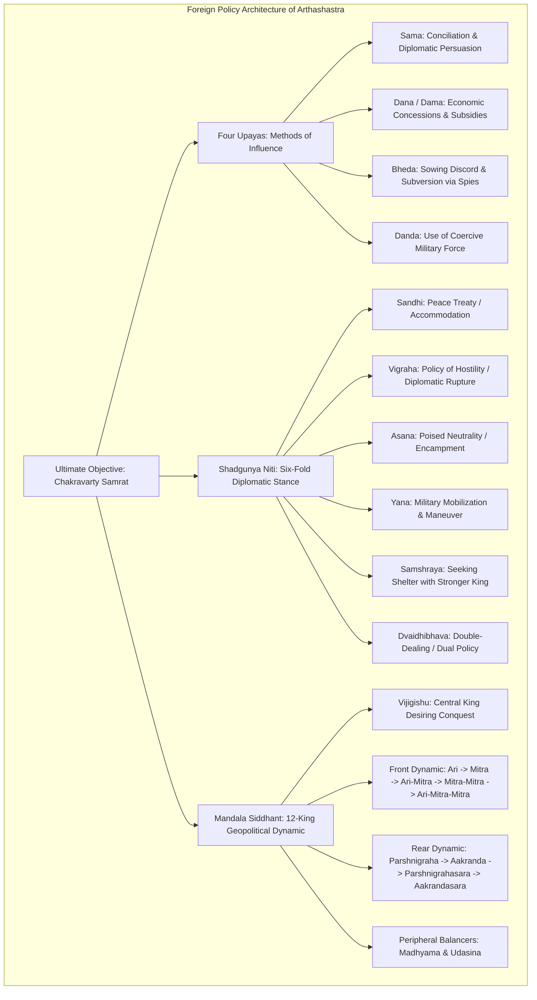
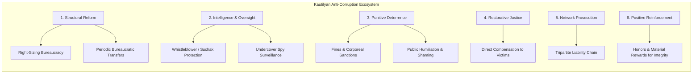
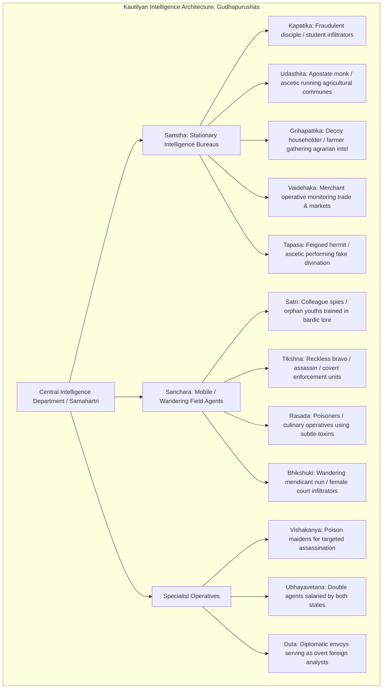

# Shubhra Ranjan PSIR Lecture Notes: Kautilya (Part 3)
## Mandala Theory, Warfare, Governance, Corruption & Comparison with Niccolò Machiavelli
### Batch 3: Pages 020 to 024 (Notebook Pages 8–10 | Lecture 51: 16/02/2017)

---

### Document Metadata
- **Subject**: PSIR (Political Science and International Relations) Paper I, Section A
- **Syllabus Sub-topics**:
  - *Indian Political Thought*: Kautilya — Arthashastra, Saptanga Theory, Mandala Theory, Statecraft, Foreign Policy, Espionage, Public Administration & Corruption.
  - *Western Political Thought*: Niccolò Machiavelli — Realism, Secularization of Politics, Statecraft, Morality vs. Politics.
  - *Comparative Analysis*: Classical Indian Realism (Kautilya) vs. Classical Western Realism (Thucydides, Machiavelli, Max Weber).
- **Faculty**: Shubhra Ranjan
- **Lecture Number**: Lecture 51
- **Lecture Date**: 16/02/2017
- **Source Files**: 
  - `page_020.png` (Lecture 51 Header, Significance of Mandala Theory, 3 Types of Wars, 3 Types of Victories, Religion in Statecraft)
  - `page_021.png` (Notebook Page 9, Kautilya on Corruption: Definition, National Security Threat, Inevitability, 40 Ways of Embezzlement, Detection Dilemma)
  - `page_022.png` (Detection Metaphors, Comprehensive 7-Tier Strategy to Tackle Corruption, Chain of Culpability: *Dayak*, *Pratigrahak*, *Nidhayak*)
  - `page_023.png` (Notebook Page 10, Comprehensive Comparison between Kautilya and Machiavelli: 10 Core Similarities & Fundamental Philosophical Divergences)
  - `page_024.png` (Max Weber's Famous Critique in *Politics as a Vocation*: "Machiavelli is Harmless Compared to Kautilya")
- **Conceptual Context Bridge**: Preceded by Pages 018–019 (Foundations of Foreign Policy, Four Upayas, Shadgunya Niti, and the 12 Kings of Raja-Mandala).

---

## 1. Contextual Bridge & Theoretical Foundation

To appreciate the lecture contents of Pages 020–024, it is essential to understand the immediate foundational framework laid down in Kautilya's foreign policy doctrine (Pages 018–019), which directly leads into the significance and operationalization analyzed in Page 020.



### The 12 Kings of the Raja-Mandala Schema (72 Prakritis / 84 Elements)
The Mandala consists of concentric and lateral strategic spheres centered around the **Vijigishu** (the aspiring hegemon):
1. **Vijigishu**: The focal sovereign whose objective is political unification and righteous hegemony.
2. **The Frontward Circle (Forward Horizon)**:
   - **Ari (Enemy)**: Immediate geopolitical neighbor sharing borders; a natural, structural enemy.
   - **Mitra (Friend)**: Neighbor of the Ari, geographically located beyond the Ari; natural ally of the Vijigishu (*"Enemy of my enemy is my friend"*).
   - **Ari-Mitra (Friend of Enemy)**: Neighbor of the Mitra; natural ally of the Ari.
   - **Mitra-Mitra (Friend of Friend)**: Ally of the Vijigishu's friend.
   - **Ari-Mitra-Mitra (Friend of the Enemy's Friend)**: Ally of the enemy's ally.
3. **The Rearward Circle (Parshva Horizon)**:
   - **Parshnigraha (Rear Enemy)**: The neighbor at the rear who threatens to attack the Vijigishu from behind when he marches forward.
   - **Aakranda (Rear Ally)**: The sovereign behind the Parshnigraha; acts as an ally checking the rear enemy.
   - **Parshnigrahasara (Ally of Rear Enemy)**: Power behind the Aakranda supporting the Parshnigraha.
   - **Aakrandasara (Ally of Rear Ally)**: Power behind the Parshnigrahasara supporting the Aakranda.
4. **The Flanking / Balancing Powers**:
   - **Madhyama (The Middle / Buffer State)**: Contiguous to both the Vijigishu and his immediate enemy; capable of helping either or resisting them individually.
   - **Udasina (The Indifferent / Neutral Superpower)**: Situated beyond the territories of all the above; extremely powerful, capable of helping or subduing any of the kings when mobilized.

> [!NOTE]
> Each of the 12 kings possesses the 6 elements of state sovereignty (Amatya, Janapada, Durga, Kosha, Danda, Mitra; excluding the Swami itself, making 6 sovereign elements per king). Thus, $12 \times 6 = 72\text{ Prakritis}$. When counting each king with all 7 Saptanga constituents, $12 \times 7 = 84\text{ sovereign elements}$. A statesman must calculate the relative power metrics of all 84 elements before undertaking military or diplomatic campaigns.

---

## 2. Detailed Page-by-Page Exhaustive Transcription

---

### Page 020 (`page_020.png` | Lecture 51: 16/02/2017)

```
[Header Banner: Join Telegram for More Update : - https://t.me/upsc_pdf]
[Top Right Box: Lecture 51 | Date: 16/02/2017]
```

```markdown
                                                    Lecture 51
                                                    16/02/2017

• Significance of Mandal Siddhant:
(i) In Academic sense -
    Mandal Siddhant is India's contribution to the discipline
    of Geopolitics. It is Indian version of Balance of Power.
(ii) Practical relevance -
    Kautilya's theory may not have relevance in present times
    in regions like Western Europe or North America. But it
    does have a significance for Regions like South Asian.

• Kautilya has given 3 types of Wars:
(i) Parakram Yudh
(ii) Kuta Yudh (Guerilla war)
(iii) Tushnim Yudh (Proxy war)

• Kautilya has mentioned 3 types of victories -
(i) Dharma Vijay (Battlefield)
(ii) Lobh Vijay (Economic)
(iii) Asur Vijay (Unfair means)

Kautilya suggest King to use religion in the affairs of the
State. King can send Sadhu to the enemy King who can
tell that his bad times have come to weaken him psy-
chologically.
He has also given importance to Ambassadors as well
as spies.
```

#### In-Depth Structural & Academic Breakdown of Page 020

##### 1. Significance of Mandala Siddhant
- **In Academic Sense (Geopolitical Contribution)**:
  - Long before modern Western theorists (such as Halford Mackinder, Nicholas Spykman, or Hans Morgenthau) formalized geopolitical theory and the **Balance of Power**, Kautilya in the 4th Century BCE developed a rigorous, mathematical, and spatial theory of structural realism.
  - The Mandala theory posits that foreign policy is determined primarily by **geography and relative power capability**, rather than sentimental or ideological ties. Proximity breeds competition; spatial distance enables alignment.
- **In Practical Relevance (Regional Dynamics)**:
  - While institutionalized, highly integrated regions (such as the European Union or post-WWII North America) operate within rules-based multilateral security regimes and complex interdependence (Keohane & Nye), traditional competitive geopolitics remains rampant in developing and non-integrated subsystems.
  - **Relevance to South Asia**: South Asia is a quintessential Kautilyan theater. India's border disputes with immediate neighbors (Pakistan and China), the strategic maneuvering of peripheral smaller states (Nepal, Sri Lanka, Bangladesh, Maldives), and extra-regional balancer interventions (USA/China as *Udasina/Madhyama*) directly mirror the competitive dynamics of the Raja-Mandala.

##### 2. Kautilya's Tripartite Typology of Warfare
Kautilya recognizes that war is not merely open combat; it is an extension of policy conducted through varied gradations of visibility and morality:
1. **Parakrama Yuddha (Open / Valorous Warfare - *Prakasha Yuddha*)**:
   - Conventional, open battlefield confrontation fought according to chivalric or established rules of engagement, fixed place, and declared time.
   - Undertaken when the Vijigishu possesses decisive military superiority in *Danda-Bala* (standing army), *Kosha* (treasury), and seasonal/topographical advantages.
2. **Kuta Yuddha (Concealed / Guerrilla / Deceptive Warfare)**:
   - Irregular, deceptive warfare characterized by ambushes, night attacks, tactical withdrawals, disinformation, psychological warfare, and unconventional operations.
   - Adopted when parity exists or when the king's direct conventional strength is insufficient to risk open engagement.
3. **Tushnima Yuddha (Silent / Proxy / Clandestine Warfare)**:
   - Covert, invisible warfare executed through espionage networks, poison, assassination of enemy commanders, inciting domestic insurrections, sabotaging infrastructure, and funding disgruntled factions (*Bheda*).
   - Equivalent in 21st-century terminology to **hybrid warfare, gray-zone aggression, proxy conflict, and cyber/cognitive subversion**.

##### 3. Kautilya's Tripartite Typology of Conquest & Victory (*Vijaya*)
1. **Dharma Vijaya (Righteous / Battlefield Victory)**:
   - The conqueror satisfies himself with the formal submission, political allegiance, and tribute of the defeated sovereign, restoring the king or his heir to the throne rather than annexing the kingdom or slaughtering the populace.
2. **Lobha Vijaya (Greedy / Economic Conquest)**:
   - The conqueror seeks economic gain—plundering territory, seizing treasury, levying exorbitant indemnities, confiscating land and precious natural resources—leaving the native ruler stripped of material power.
3. **Asura Vijaya (Demonic / Annihilative Conquest)**:
   - Total warfare characterized by the complete overthrow and liquidation of the enemy dynasty, destruction of cities, enslavement or execution of populations, and outright annexation of territories through unfair and ruthless means.

##### 4. Instrumentalization of Religion & Subversive Psychology
- **Secular Realism in Sacral Garb**: Kautilya instructs the monarch to consciously weaponize religious beliefs, superstition, omens, and astrology for state security.
- **Sadhus and Soothsayers as Psychological Operatives**: Secret agents disguised as ascetics (*Tapasa*), monks, or hermits infiltrate the enemy court. By staging fake miracles or proclaiming that planetary alignments signal the inevitable doom of the adversary, they undermine the enemy monarch's psychological resolve, demoralize his soldiers, and induce surrender without firing a single arrow.
- **Integration of Dutas (Ambassadors) and Charas (Spies)**: Kautilya explicitly recognizes that ambassadors are essentially *open spies* (*Prakasha Chara*) shielded by diplomatic immunity, whose core duty is collecting military intelligence, assessing court rivalries, and cultivating subversive alliances inside the host state.

---

### Page 021 (`page_021.png` | Notebook Page 9)

```
[Header Banner: Join Telegram for More Update : - https://t.me/upsc_pdf]
[Page Number at Bottom-Right: 9]
```

```markdown
                                                                 9

• Kautilya on corruption -
  According to Kautilya corruption is use of public office
  for private ends.
  Why corruption is to be tackled?
  Corruption will make state weak internally as vulnerable
  externally. Corruption impacts the morale of the
  people. Foreign powers can manipulate disaffection
  towards the king and provoke his subjects for rebellion.
  According to Kautilya, corruption is inevitable fact of the
  political-administrative life.
  Why?
  Honey on the tongue, it is not possible not to taste it.
  Public officials deal with public resources that we cannot
  assume them not to use resources for their personal
  ends. At times they themselves may not be aware.
  According to Kautilya the ways embezzlement are forty.
  It means there are many ways officials can do corruption.
  Kautilya himself listed at least 40 ways eg.
  Eg. (i) Public officials may take money out of public fund
          but they may not enter it.
     (ii) they make take money earlier but do entries later.
    (iii) they may purchase goods at a lesser price but may
          enter higher price.
     (iv) They may sale states resources at lesser price than
          the actual value.
      (v) They can manipulates weights & measures.
  Why it is difficult to tackle corruption?
  It is difficult to deal with corruption because it is very
  difficult to detect [शोधन] corruption & establish corruption.
  According to him it is easy to detect the movement of
  birds flying in sky but it is not easy to detect the
  misappropriation of funds.
```

#### In-Depth Structural & Academic Breakdown of Page 021

##### 1. Definition & Strategic Danger of Corruption
- **Modernity of Definition**: Kautilya's formulation—*"use of public office for private ends"*—is nearly identical to the definitions adopted millennia later by the World Bank, Transparency International, and modern political sociologists.
- **National Security & External Vulnerability**: Kautilya does not treat corruption merely as an ethical or fiscal lapse; he treats it as an existential **existential national security vulnerability**:
  - Internal administrative corruption impoverishes the treasury (*Kosha*).
  - It destroys public morale and loyalty toward the king.
  - A disaffected, economically exploited citizenry becomes fertile ground for foreign adversaries (*Ari*) to cultivate fifth-column networks, instigate revolts, and subvert the state from within without an open war.

##### 2. The Inevitability of Corruption: Human Psychology & Structural Temptation
- **The Famous Aphorism of Honey**: 
  > *"Just as it is impossible not to taste honey (or poison) that finds itself at the tip of the tongue, so it is impossible for a government servant dealing with government funds not to taste, at least a little, of the king's wealth."*
- **Administrative Agency Problem**: State officials operate with asymmetrical information and direct control over vast royal revenues, warehouses, mines, and forests. Human self-interest naturally inclines individuals toward resource appropriation, sometimes through unconscious rationalization or institutionalized creep.

##### 3. The 40 Modes of Embezzlement (*Chatvarimshat Kautilyan Upayah*)
Kautilya's *Arthashastra* (Book II, Chapter 8) details forty specific techniques of bureaucratic embezzlement. The five classic archetypes transcribed in the notes reflect standard fraudulent procurement, creative accounting, and revenue skimming:
1. **Unrecorded Appropriations**: Direct extraction of state revenue without logging it into the state ledger (off-the-books theft).
2. **Delayed Accounting (Temporal Arbitrage)**: Collecting revenues on time but recording them much later, using the interest or capital float for private speculative trade in the interim.
3. **Over-invoicing / Procurement Fraud**: Purchasing commodities for the king's stores at low market rates while billing the royal treasury at inflated rates, pocketing the discrepancy.
4. **Under-valuation of State Assets (Asset Stripping)**: Selling state monopoly commodities, timber, gems, or public lands to favored private syndicates at artificially depressed prices in exchange for illicit kickbacks.
5. **Manipulation of Weights, Measures, and Standards**: Using dual measurement instruments—heavy weights when collecting tax-in-kind from agrarian cultivators, and light weights when disbursing grain or salary to soldiers and workers.

##### 4. The Epistemological Challenge of Detection: The Sky-Birds Metaphor
- Handwritten marginalia: Above the word "detect", the Hindi term **शोधन (Shodhan)** is inscribed, denoting rigorous investigation, audit, forensic examination, and bureaucratic purification.
- **The Bird Analogy**:
  > *"It is possible to mark the movement of birds flying high through the sky, but it is impossible to ascertain the hidden movements of government servants when they conceal their fraudulent misappropriations."*

---

### Page 022 (`page_022.png` | Continuation of Governance & Anti-Corruption)

```
[Header Banner: Join Telegram for More Update : - https://t.me/upsc_pdf]
```

```markdown
According to Kautilya, Fish swimming in the water
we cannot say it has taken/drank water inside.
-> should corruption be tackled?
How to tackle corruption?
(i) Right sizing the Bureaucracy
(ii) Transfers at regular intervals before person under-
     stands all the loopholes of his office.
(iii) Kautilya mentions about whistle blowers or Suchak's
     (Informers). Kautilya suggest King should grant protec-
     tion and reward the informers.
(iv) Fine and punishment of the corrupt officials.
     He also suggest public humiliation.
(iv) compensation to the person whose interest has been
     impacted because of the corrupt officials.
(v) Dont punish just the official, punish the entire chain.
     Chain means Dayak - one who gives money.
     Pratigraha - one who recieves money.
     Nidhayak - one who keeps the money.
(vi) Kautilya suggest reward honest officials, strengthen
     surveillance mechanism.
```

#### In-Depth Structural & Academic Breakdown of Page 022

##### 1. The Metaphor of the Swimming Fish
- Kautilya remarks:
  > *"Just as fish moving under water cannot possibly be identified as drinking water or not drinking water, so government servants employed in government work cannot be detected while taking government money."*
- Officials are completely immersed in the fiscal machinery of the state; distinguishing between administrative processing and illicit siphoning requires sophisticated external audit mechanisms.

##### 2. Comprehensive 7-Tier Strategy to Tackle Corruption



1. **Right-Sizing the Bureaucracy**:
   - Eliminating redundant bureaucratic intermediaries and bloated offices. An excessively oversized administrative apparatus creates multiple tollbooths for rent-seeking and dilutes accountability.
2. **Periodic Rotational Transfers**:
   - Bureaucrats must be transferred at regular intervals before they become entrenched in a specific department, build local collusive networks, and master the structural loopholes of their office.
3. **Whistleblower Protection & Incentivization (*Suchaks*)**:
   - Formal institutional recognition of informers (*Suchakas*).
   - The King must guarantee **state physical protection** against retaliation and provide a **statutory reward** (a designated percentage of the recovered illicit assets) to whistleblowers who uncover graft.
4. **Graduated Punitive Deterrence & Public Shaming**:
   - Heavy financial penalties, confiscation of ill-gotten wealth, stripping of official titles, and imprisonment.
   - **Public Humiliation**: Smearing corrupt officials with cow dung, parading them publicly on donkeys, or shaving their heads to destroy their social standing and create intense psychological deterrence.
5. **Restorative Justice & Citizen Compensation**:
   - Remarkably progressive governance measure: Fining the corrupt official is insufficient. The state must provide direct financial restitution and compensation to common citizens or traders whose commercial interests were damaged by the official's extortion.
6. **Strict Liability Across the Entire Corruption Chain (*Tripartite Criminal Culpability*)**:
   - Kautilya mandates that prosecution must not terminate at the public clerk; the law must dismantle the entire institutional conspiracy:
     - **Dayak (दायक)**: The bribe-giver / corporate corrupter who offers the illicit inducement.
     - **Pratigrahak / Pratigraha (प्रतिग्राहक)**: The public official who demands or receives the bribe.
     - **Nidhayak (निधायक)**: The intermediary, banker, benamidar, or accomplice who conceals, launders, or holds custody of the illicit wealth.
7. **Positive Reinforcement & Systemic Surveillance**:
   - Counterbalancing punishment with public honors, royal promotions, and material bonuses for honest, diligent magistrates, combined with constant vetting by undercover intelligence agents (*Gudhapurushas*).

---

### Page 023 (`page_023.png` | Notebook Page 10)

```
[Header Banner: Join Telegram for More Update : - https://t.me/upsc_pdf]
[Page Number at Bottom-Right: 10]
```

```markdown
                                                                10

• Comparison between Kautilya & Machiavelli
  There has been a tradition to compare Kautilya with
  Machiavelli. Even Pandit Nehru in his book discovery
  of India called Kautilya as Indian Machiavelli.
  Scholars like Bottazi, Winternitz, has compared Kautilya's
  thought with realist thinkers of west like Thucydides
  and Machiavelli.
-> Points of similarities
(i) Both had similar concern about their motherland.
(ii) Both wanted Improvement in internal conditions and
     protection from foreign invasions.
(iii) Both belong to realist tradition
(iv) Whether it is Prince or Arthashastra the subject matter
     is statecraft, both internal as well as external.
(v) Both explain politics in terms of power.
(vi) Both suggest that human nature is selfish.
(vii) Both want king to rule with iron hand.
(viii) Both permit king to use religion
(ix) Both believe that material welfare is a supreme goal.
(x) Both supports expansionists policies.

For above reasons we can say that there are lot of
similarities between Kautilya & Machiavelli. However, it is
to be noted that they differ in time and space. Kautilya
belong to east & Machiavelli belongs to west. In Kautilya
King is never above Dharma on the other hand the
Prince is above morality. Machiavelli was unfortunate
that he could not find his prince who could implement
his ideas into practice. Kautilya was fortunate to find
his Vijigishu & Kautilya could see his ideas being imple-
mented during his time.
```

#### In-Depth Structural & Academic Breakdown of Page 023

##### 1. Historiography of the Comparison
- **Pandit Jawaharlal Nehru's Appraisal in *The Discovery of India* (1946)**:
  - Nehru famously referred to Chanakya/Kautilya as the *"Indian Machiavelli"*, noting that while he lived eighteen centuries before the Florentine thinker, his intellect was far more comprehensive, operating simultaneously as a prime minister, empire-builder, scholar, and professor of statecraft.
- **Western Scholarly Perspectives**:
  - **Giambattista Bottazzi**: Italian scholar who explicitly drew systematic parallels between Kautilya's *Arthashastra* and Machiavelli's *Il Principe*, highlighting their ruthless realpolitik.
  - **Moriz Winternitz**: Celebrated Indologist who situated Kautilya alongside classic Western realists such as Thucydides and Machiavelli, emphasizing their objective treatment of state survival unclouded by theological illusions.

##### 2. The 10 Core Pillars of Congruence (Similarities)

| # | Dimension | Kautilya (*Arthashastra*) | Niccolò Machiavelli (*The Prince*) |
|---|-----------|---------------------------|-----------------------------------|
| **1** | **National Concern** | Deeply distressed by the fragmented, quarreling Janapadas of ancient India vulnerable to Macedonian / Greek invasions. | Tormented by the disunity and moral degeneration of Italian city-states victimized by French, Spanish, and German armies. |
| **2** | **Strategic Goal** | Unification of the subcontinent (*Chakravarty Kshetra*) and preservation against external invasion. | Unification of Italy under a singular patriotic monarch and expulsion of foreign barbarians (*"Liberate Italy"*). |
| **3** | **Intellectual School** | Pioneer of classical Indian Political Realism (*Arthashastra* tradition over *Dharmashastra* idealism). | Founder of modern Western Political Realism (empirical observation of *"how men do live, rather than how they ought to live"*). |
| **4** | **Central Subject Matter** | Statecraft (*Rajaneeti*), governance, administrative efficiency, public finance, intelligence, and war. | Art of acquiring, consolidating, expanding, and defending state power (*Ragione di Stato* / Reason of State). |
| **5** | **Ontology of Politics** | Politics understood as a relentless struggle for power, security, and territorial survival (*Matsyanyaya*). | Politics understood as a dynamic contest of power, interests, *virtù*, and *fortuna*. |
| **6** | **View of Human Nature** | Inherently selfish, fickle, corruptible, and driven by material desires (*Artha* and *Kama*); necessitates *Danda*. | Naturally ungrateful, fickle, false, cowardly, and covetous of gain (*The Prince*, Ch. XVII). |
| **7** | **Governing Style** | Advocate of a resolute, stern monarch who enforces the rule of law using judicious force (*Danda-niti*). | Advocate of the ruler embodying both the Lion (coercive terror) and the Fox (cunning craftiness). |
| **8** | **Instrumentalization of Religion** | Treats religion, rituals, ascetics, and omens as strategic tools for psychological control and covert intelligence. | Treats Christian religion instrumentally as a civic glue to maintain public order and military discipline. |
| **9** | **Material Welfare** | *Artha* (material wealth/economic security) is declared the supreme pillar upon which *Dharma* and *Kama* depend. | Economic prosperity, commercial vigor, and security of private property are primary requisites for political stability. |
| **10** | **Expansionist Foreign Policy** | The Vijigishu must constantly seek expansion; stagnation is decay. Mandatory doctrine of imperial enlargement. | A healthy republic or principality must expand its dominions (*Accrescimento*); inability to expand leads to internal ruin. |

##### 3. Critical Philosophical Divergences: Time, Space, Dharma, and Historical Outcome
- **Contextual Context (Space & Time)**:
  - Kautilya: Ancient East (Magadha Empire, 4th Century BCE), writing in an agrarian, imperial setting.
  - Machiavelli: Renaissance West (Florence/Italy, 16th Century CE), writing in an urban, commercial, republican/princely setting.
- **The Ultimate Normative Horizon: King Under Dharma vs. Prince Above Morality**:
  - **In Machiavelli**: The Prince is completely autonomous from and **above conventional morality**. Machiavelli enacts a radical separation of politics from ethics, establishing **dual morality**—the private citizen is bound by Christian virtues, but the sovereign ruler must learn *"how not to be good"* for the preservation of the state.
  - **In Kautilya**: The King is **NEVER above Dharma**. While Kautilya allows deceptive means (*Kuta Yuddha, Asura Vijaya*) against external enemies and internal traitors, the king's overarching purpose is **Rajadharma**—the protection of moral order, social stability (*Varnashrama Dharma*), and the welfare of the people:
    > *"Prajasukhe sukham rajnah, prajanam cha hite hitam"*
    > (*"In the happiness of his subjects lies the king's happiness; in their welfare his welfare; whatever pleases himself he shall not consider as good, but whatever pleases his subjects he shall consider as good."*)
  - The Kautilyan King who violates Dharma or oppresses his subjects causes *Kopa* (popular revolt) and loses legitimacy.
- **Historical Realization of Doctrine**:
  - **Machiavelli was historically frustrated**: His appeals to Lorenzo de' Medici went unheeded; Cesare Borgia failed; Machiavelli died in 1527 without seeing a unified Italian nation-state (which materialized only in the 19th Century under Cavour and Garibaldi).
  - **Kautilya was historically triumphant**: Kautilya discovered his ideal *Vijigishu* in **Chandragupta Maurya**, overthrew the corrupt Nanda dynasty, repelled the Seleucid Greek forces, and constructed the vast, centralized Mauryan Empire, witnessing the living implementation of his doctrines.

---

### Page 024 (`page_024.png` | Max Weber's Verdict on Kautilya)

```
[Header Banner: Join Telegram for More Update : - https://t.me/upsc_pdf]
```

```markdown
Max Weber in his book 'Politics as Vocation' has
mentioned that Kautilya was more Machiavellian
than Machiavelli. If we look at Kautilya's king,
Machiavelli's prince appear harmless.
```

#### In-Depth Structural & Academic Breakdown of Page 024

##### 1. Max Weber's Seminal Passage in *Politik als Beruf* (1919)
- **The Citation Context**: In his historic lecture *Politics as a Vocation* (*Politik als Beruf*, delivered at Munich University in 1919), Max Weber explored the tragic tension between the **Ethics of Ultimate Ends** (*Gesinnungsethik*) and the **Ethics of Responsibility** (*Verantwortungsethik*).
- **The Precise Quotation & Argument**:
  > *"Truly radical 'Machiavellianism', in the popular sense of the word, is classically expressed in Indian literature in the Arthashastra of Kautilya (written long before the birth of Christ, supposedly in the time of Chandragupta): compared to it, Machiavelli's The Prince is harmless."*
- **Why Does Weber Regard Machiavelli as "Harmless" in Comparison?**
  1. **Systemic Institutionalization of Realpolitik**: Machiavelli’s advice in *The Prince* consists largely of ad-hoc, intuitive maxims for a Renaissance ruler coping with unstable Italian politics. In contrast, Kautilya constructed a massive, totalizing administrative, bureaucratic, fiscal, and espionage system where statecraft is codified into a scientific discipline.
  2. **Ruthless Bureaucratic Espionage**: Machiavelli has no institutional concept of a state-wide surveillance machinery. Kautilya lays out an exhaustive, panoptic intelligence architecture involving double agents (*Ubhayavetana*), poison maidens (*Vishakanyas*), silent assassinations (*Tushnima Yuddha*), and undercover provocateurs testing the loyalty of ministers across four tests (*Upadhas*—virtue, wealth, lust, and fear).
  3. **Total Scope of State Interference**: While Machiavelli left the private economy and civil liberties largely intact as long as subjects did not conspire against the Prince (*"A prince must refrain from the property of his citizens and subjects, for men forget more quickly the death of their father than the loss of their patrimony"*), the Kautilyan state actively owns monopolies, mines, forests, liquor establishments, regulates prostitution, monitors travel via state passports (*Mudra*), and conducts institutionalized surveillance of every citizen's home through census and neighborhood spies.

---

## 3. Comprehensive Synthesis: The Kautilyan Espionage & Statecraft Matrix

### The Classification of Spies (*Charas / Gudhapurushas*)
Kautilya devotes extensive chapters of the *Arthashastra* to the institutional organization of secret services, dividing intelligence into two broad operational directorates:



1. **Sanstha (Stationary Intelligence Institutes)**:
   - Operating from fixed secret centers within the kingdom:
     - **Kapatika-Chhatra**: Infiltrators masquerading as clever pupils or students capable of reading others' minds.
     - **Udasthita**: Re-settled apostate monks possessing large estates who recruit labor and collect intelligence.
     - **Grihapattika**: Agents posing as impoverished farmers who gather intelligence on rural disputes, crop yields, and local unrest.
     - **Vaidehaka**: Operatives posing as merchants to monitor trade routes, price fixing, smuggling, and commercial loyalties.
     - **Tapasa**: Ascetics with matted hair who pretend to possess supernatural clairvoyance to extract confessions from subjects and ministers.
2. **Sanchara (Mobile / Field Operatives)**:
   - Mobile agents operating under deep cover across borders:
     - **Satri**: Operatives skilled in palmistry, sorcery, astrology, and minstrel arts to gauge public sentiment.
     - **Tikshna**: Desperados and mercenaries who undertake lethal physical assaults and covert assassinations of seditious ministers or enemy leaders.
     - **Rasada**: Chemists and poisoners deployed in royal kitchens, taverns, and palaces using delayed-action lethal toxins.
     - **Bhikshuki (or Parivrajika)**: Poor Brahmin widows or Buddhist nuns who have free access to the inner quarters (*Antahpura*) of enemy palaces and high officials.
3. **Specialized Strategic Assets**:
   - **Vishakanyas (Poison Maidens)**: Young women administered controlled doses of poison from childhood until their bodily fluids become lethal, used to assassinate rival sovereigns through intimacy.
   - **Ubhayavetana (Double Agents)**: High-level foreign diplomats or courtiers placed on the payroll of both states, providing crucial counter-intelligence while feeding deception to the enemy.

---

## 4. Analytical Comparison Matrix: Kautilya vs. Niccolò Machiavelli

```
+=========================+=======================================+=======================================+
| Dimension               | Kautilya (Arthashastra)               | Niccolò Machiavelli (The Prince)      |
+=========================+=======================================+=======================================+
| Historical Epoch        | 4th Century BCE (Ancient India,       | 16th Century CE (Renaissance Italy,   |
|                         | Mauryan Empire, Magadha)              | Florence, Early Modern Europe)        |
+-------------------------+---------------------------------------+---------------------------------------+
| Philosophical Tradition | Classical Indian Realism (Dandaniti,  | Classical Western Realism (Realpolitik,|
|                         | Artha tradition of statecraft)        | Autonomy of political science)        |
+-------------------------+---------------------------------------+---------------------------------------+
| Relationship with Ethics| Subordinated to RAJADHARMA. The king  | Radical AUTONOMY of politics from     |
|                         | is bound by moral duty to his people; | ethics. Dual morality: Prince learns  |
|                         | unrighteous kings lose legitimacy.    | "how not to be good" for state survival|
+-------------------------+---------------------------------------+---------------------------------------+
| Nature of the Sovereign | The Swami: Educated, self-controlled  | The Prince: Must balance Virtù and    |
|                         | master of senses (Jitendriya);        | Fortuna; combination of Lion (force)  |
|                         | servant of popular welfare.           | and Fox (cunning).                    |
+-------------------------+---------------------------------------+---------------------------------------+
| Human Nature            | Materially driven, selfish, prone to  | Inherently depraved, fickle, coward,  |
|                         | corrupt behavior; governed by Danda.  | covetous, ungrateful; governed by fear|
+-------------------------+---------------------------------------+---------------------------------------+
| Religious Sphere        | Pragmatic instrumentalization: Rituals| Instrumental utility: Religion as     |
|                         | and monks used for psychological war; | civic cement to maintain civic virtue |
|                         | king respects cosmic order (Dharma).  | and army morale; attacks Papacy.      |
+-------------------------+---------------------------------------+---------------------------------------+
| Economic Doctrine       | Comprehensive political economy; state| Minimal economic intervention; prince |
|                         | owns mines, forests, trade monopolies;| must not touch subjects' patrimony or |
|                         | wealth (Artha) is supreme foundation. | women to avoid hatred.                |
+-------------------------+---------------------------------------+---------------------------------------+
| Foreign Policy Theory   | Systematic, geometric Mandala Theory  | Dynamic expansionism (Accrescimento); |
|                         | (12 Kings, 72 Prakritis, 6 Policies,  | reliance on citizen militia over      |
|                         | 4 Upayas, 3 Wars, 3 Victories).       | mercenary / auxiliary armies.         |
+-------------------------+---------------------------------------+---------------------------------------+
| Espionage Machinery     | Institutional, panoptic intelligence  | Minimal institutional intelligence;   |
|                         | apparatus (Sanstha & Sanchara spies,  | relies on personal astuteness, rumors,|
|                         | Vishakanyas, double agents).          | and diplomatic ambassadors.           |
+-------------------------+---------------------------------------+---------------------------------------+
| Historical Fruition     | Completely realized: Installed        | Unrealized in lifetime: Exiled from   |
|                         | Chandragupta Maurya and built the     | public office; Italy remained         |
|                         | pan-Indian Mauryan Empire.            | fractured until Risorgimento in 1861. |
+=========================+=======================================+=======================================+
```

---

## 5. Critical Evaluation & 21st-Century Strategic Relevance

### A. Relevance to Indian Foreign Policy & Contemporary Geopolitics
1. **Mandala Theory in the Indo-Pacific & South Asia**:
   - **Immediate Periphery (*Ari*)**: Pakistan and China occupy the position of structural adversaries with contiguous disputed borders.
   - **Forward Balancing (*Mitra*)**: India's deepening strategic partnerships with Japan, Vietnam, and Australia represent classic Kautilyan alignments with states situated beyond the immediate adversary.
   - **The Extended Balancer (*Udasina*)**: The United States acts as the modern *Udasina* superpower, engaging with India through the Quad to balance regional hegemony in Eurasia and the Indo-Pacific.
   - **Buffer States (*Madhyama*)**: Nepal, Bhutan, Sri Lanka, and the Maldives represent crucial buffer spaces where India must counter competitive Chinese strategic encroachment.
2. **Hybrid, Cyber, and Cognitive Warfare as *Kuta* and *Tushnima Yuddha***:
   - Modern disinformation campaigns, weaponized cyber-intrusions, deepfakes, cognitive warfare, and targeted proxy terrorism directly embody Kautilya's doctrine of *Tushnima Yuddha* (silent war) and the use of ascetics for psychological subversion.

### B. Relevance to Modern Public Administration & Anti-Corruption Frameworks
1. **The Three-Tiered Prosecution Model (*Dayak, Pratigrahak, Nidhayak*)**:
   - Modern anti-corruption legislation reflects Kautilya's realization that targeting only the recipient clerk fails:
     - India’s **Prevention of Corruption (Amendment) Act, 2018** criminalized the bribe-giver (*Dayak*) as a direct offender.
     - The **Benami Transactions (Prohibition) Amendment Act, 2016** targets the proxy holders and launderers of illicit wealth (*Nidhayak*).
     - The **Whistleblowers Protection Act, 2014** provides the legal architecture for the protection and statutory incentivization of informers (*Suchakas*).
2. **Administrative Reforms**:
   - Kautilya’s prescription of **periodic transfers** remains the bedrock of civil service cadre management (preventing vested interests).
   - **Right-sizing bureaucracy** mirrors modern administrative doctrines of "Minimum Government, Maximum Governance" and digital governance platforms (e-procurement, DBT) that eliminate rent-seeking bureaucratic touchpoints.

---

## 6. UPSC PSIR Examination Questions & Analytical Framework

### Question 1 (UPSC 2016)
> *"Examine the relevance of Kautilya's Mandala Siddhant in contemporary inter-state relations with special reference to India's neighbourhood."*

**Model Structure**:
- **Introduction**: Define Mandala Theory as an ancient spatial paradigm of structural realism and the Indian precursor to modern Balance of Power.
- **Core Concepts**: The 12 Kings, the structural logic of border-sharing states (*Ari*), and non-contiguous natural allies (*Mitra*).
- **Application to South Asia**:
  - Contiguous rivalries: India–Pakistan, India–China borders.
  - Strategic encirclement & counter-encirclement: China's "String of Pearls" vs. India's "Necklace of Diamonds" and "Act East" policy (aligning with Vietnam, Japan, South Korea).
  - Buffer diplomacy (*Madhyama*): The struggle for influence in Nepal, Bhutan, Sri Lanka, and Maldives.
  - Extra-regional balancing (*Udasina*): Indo-US strategic convergence.
- **Limitations**: Nuclear deterrence, complex economic interdependence, global multilateral regimes (UN, WTO) modifying pure territorial expansionism.
- **Conclusion**: Kautilya remains indispensable for understanding regional sub-systemic balance-of-power maneuvers.

### Question 2 (UPSC 2012 / 2019)
> *" 'Machiavelli's Prince appears harmless when compared to Kautilya's King.' (Max Weber). Critically evaluate."*

**Model Structure**:
- **Introduction**: Contextualize Max Weber’s assertion in *Politics as a Vocation* (1919) reflecting on classical realpolitik.
- **Arguments Supporting Weber**:
  - Panoptic surveillance state: Total institutionalization of *Gudhapurushas* (stationary and wandering spies, *Vishakanyas*, undercover provocateurs).
  - Ruthless clandestine methods: *Tushnima Yuddha* (silent assassination, secret poisonings, using fake sadhus and religion for psychological warfare).
  - Total economic regulation: State control over markets, mines, taverns, and citizen movements.
- **Counter-Arguments / Critical Distinction**:
  - **Ethical Foundation (Rajadharma)**: Kautilya's king is fundamentally bound by *Dharma* and servant to public welfare (*Prajasukhe sukham rajnah*), whereas Machiavelli's Prince is completely autonomous from moral law.
  - Tyrannical kings in Kautilya invite *Kopa* (rebellion) and ruin; Machiavelli advises fear over love.
- **Conclusion**: Kautilya's realpolitik was technically more sophisticated, pervasive, and institutionalized than Machiavelli’s, but it was anchored in an overarching normative duty to the welfare and moral order of the political community.
