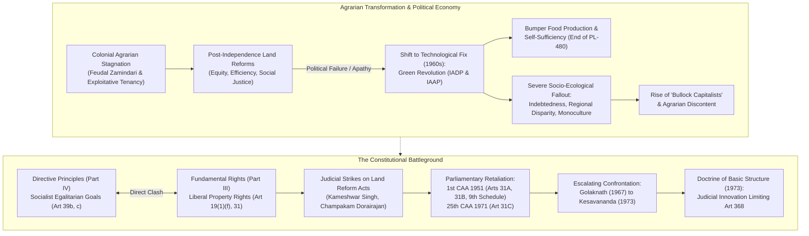
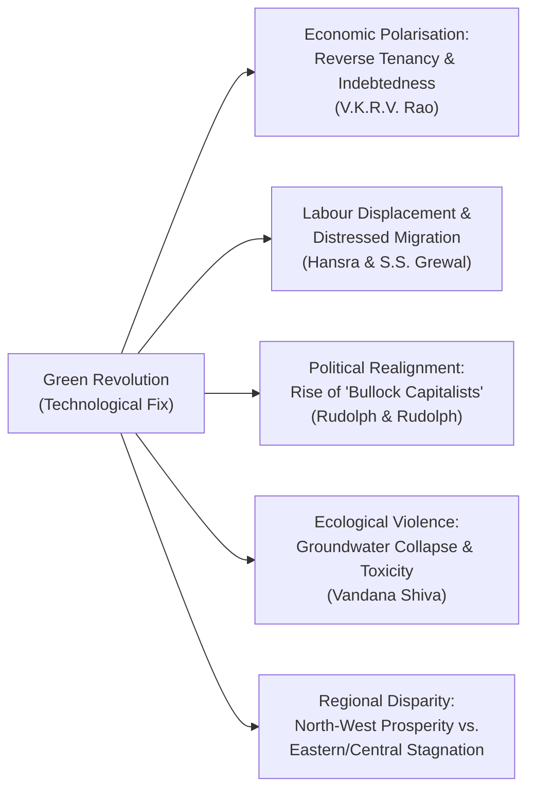
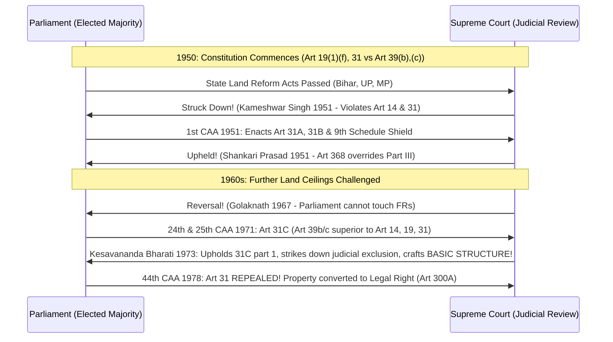
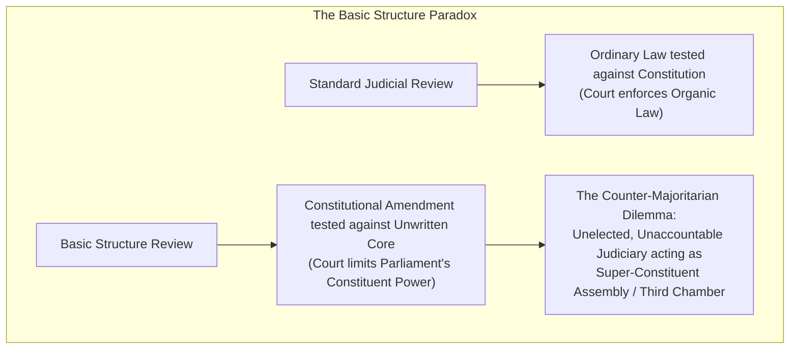

# Shubhra Ranjan PSIR Lecture Notes: Transcription & Scholarly Breakdown
## Paper 1, Part II: Indian Government and Politics (IGP)
### Topic: Land Reforms, Green Revolution, Agrarian Political Economy, and the Genesis of the Basic Structure Doctrine (Lectures 10–11)

---

## Document & Archival Metadata
- **Faculty:** Shubhra Ranjan
- **Subject:** Political Science and International Relations (PSIR) — Paper 1, Part II (Indian Government and Politics)
- **Topics Covered:**
  1. Land Reforms: Residual Policy Recommendations, Left-Wing Extremism, and Administrative Bottlenecks
  2. Green Revolution: Philosophy, Phases (IADP & IAAP), Socio-Economic Impacts, Wage Debates, Regional Disparities, and Ecological Critiques
  3. Political Economy of Growth and Distributive Justice: Hamza Alavi, Gunnar Myrdal, Atul Kohli, Francine Frankel, Sudipta Kaviraj, and Rudolph & Rudolph
  4. Constitutional Architecture of Fundamental Rights: Part III Philosophy, Unique Indian Departures, and Scheme of Articles 12–35
  5. The Property Clauses & Agrarian Protection: Articles 31, 31A, 31B (9th Schedule), and 31C (25th & 42nd Amendments)
  6. Judicial Review in India: Constitutional Provisions (Arts 13, 32, 131–136, 226) and Operational Doctrines (Severability, Eclipse, Liberal/Literal, Procedure Established by Law vs. Due Process, Prospective Overruling, Pith & Substance, Colourable Legislation, Waiver)
  7. Doctrine of Basic Structure (Lecture 11, Dated: 27/03/2017): Conceptual Foundations, Global Uniqueness, Counter-Majoritarian Dilemma, and the Part III vs. Part IV Dialectic (*Champakam Dorairajan* case onwards)
- **Lectures Covered:**
  - **Lecture 10 (Conclusion):** Notebook Pages 163–166 (Scan Pages 101–108)
  - **Lecture 11 (Commencement):** Dated `27/03/2017` — Notebook Pages 167+ (Scan Pages 109–110)
- **Source Files Analyzed:**
  - `page_101.png`: Notebook Page 163 — Policy recommendations on land reforms (countering LWE, Lok Adalats, land records); Green Revolution: Purpose, Capitalist Philosophy, IADP (1961) & IAAP (1965)
  - `page_102.png`: Outcomes of Green Revolution — Food self-sufficiency, growth rates (3–5%); Scholarly debates: V.K.R.V. Rao (social cost, reversal of land reforms), G.S. Bhalla & G.K. Chadha (real income rise) vs. Hansra & S.S. Grewal (inflation, labour displacement, migrant labour)
  - `page_103.png`: Notebook Page 164 — Rudolph & Rudolph ('Bullock Capitalists', caste politics), T.K. Oommen, Utsa Patnaik, Pranab Bardhan; Vandana Shiva (*Violence of the Green Revolution*, 1993); K.R. Narayanan's warning ("Green Revolution should not end up giving rise to Red Revolution"); UPSC Question on Political Economy of Growth and Distributive Justice; Points (i) to (vi)
  - `page_104.png`: Political Economy Models of the Indian State — Hamza Alavi (3 propertied classes), Gunnar Myrdal ('Soft State'), Atul Kohli ('Crisis of Governability'), Francine Frankel (accommodative politics), Sudipta Kaviraj (bourgeoisie state), Rudolph & Rudolph ('polymorphous' state)
  - `page_105.png`: Notebook Page 165 — Fundamental Rights: Concept, Individual vs. State sovereignty, Rule of Law, Natural Rights; Three Indian deviations; Scheme of Fundamental Rights (Articles 12 to 31)
  - `page_106.png`: Property Exceptions & Enforceability — 1st CAA 1951 (Art. 31A, Art. 31B & 9th Schedule); 25th CAA 1971 & 42nd CAA 1976 (Art. 31C); Articles 32 to 35; Margin note: "Soul of constitution -> Preamble, FR, DPSP"
  - `page_107.png`: Notebook Page 166 — Judicial Review: Questions on JR & Basic Structure; Origin in USA (*Marbury v. Madison*); Constitutional Provisions (Arts 13, 32, 131, 132, 133, 134, 136, 226); Doctrines of Judicial Review (i to viii: Presumption of Constitutionality, No Suo Motu, Severability, Eclipse, Liberal vs. Literal, Procedure Established by Law, Due Process of Law)
  - `page_108.png`: Due Process of Law & Additional Doctrines — Procedural vs. Substantive Due Process (*Shatrughan Chauhan* case); Doctrine of Prospective Overruling (*Golaknath*); Colourable Legislation & Pith and Substance; Rejection of Doctrine of Waiver in India
  - `page_109.png`: Notebook Page 167 (Lecture 11, 27/03/2017) — Doctrine of Basic Structure: Definition, Supreme Court as strongest court in the world, Counter-majoritarian dilemma (unelected judiciary challenging constituent power under Art. 368); Evolution context: Part III vs. Part IV dialectic
  - `page_110.png`: Dialectic between Part III & Part IV — Part III (Liberal civil rights, justiciable, Art. 13 & 32) vs. Part IV (Socialist socio-economic rights, non-justiciable, Art. 37 fundamental in governance); Genesis of dispute: *State of Madras v. Champakam Dorairajan* (1950/1951)

---

# Table of Contents
1. [PART 1: Exhaustive Zero-Loss Page-by-Page Transcription](#part-1-exhaustive-zero-loss-page-by-page-transcription)
   - [Page 101 (Notebook Page 163): Land Reforms Policy & Green Revolution Genesis](#page-101-page_101png--notebook-page-163)
   - [Page 102: Outcomes & Scholarly Debates on Green Revolution](#page-102-page_102png)
   - [Page 103 (Notebook Page 164): Agrarian Politics, Vandana Shiva & Political Economy of Growth](#page-103-page_103png--notebook-page-164)
   - [Page 104: Theoretical Frameworks on the Indian State & Distributive Justice](#page-104-page_104png)
   - [Page 105 (Notebook Page 165): Fundamental Rights Architecture & Indian Innovations](#page-105-page_105png--notebook-page-165)
   - [Page 106: Property Amendments (31A, 31B, 31C) & Articles 32–35](#page-106-page_106png)
   - [Page 107 (Notebook Page 166): Judicial Review — Provisions & Doctrines](#page-107-page_107png--notebook-page-166)
   - [Page 108: Due Process of Law, Prospective Overruling & Doctrines of Interpretation](#page-108-page_108png)
   - [Page 109 (Notebook Page 167 — Lecture 11, 27/03/2017): Doctrine of Basic Structure Defined](#page-109-page_109png--notebook-page-167--lecture-11-dated-27032017)
   - [Page 110: The Constitutional Dialectic — Part III vs. Part IV & Champakam Dorairajan](#page-110-page_110png)
2. [PART 2: Comprehensive Theoretical & Thematic Synthesis](#part-2-comprehensive-theoretical--thematic-synthesis)
   - [I. Land Reforms in India: Objectives, Components, Regional Divergence & Structural Failures](#i-land-reforms-in-india-objectives-components-regional-divergence--structural-failures)
   - [II. Green Revolution: Technocratic Fix, Capitalist Logic & Socio-Ecological Fallout](#ii-green-revolution-technocratic-fix-capitalist-logic--socio-ecological-fallout)
   - [III. Political Economy of Growth and Distributive Justice: Six Theoretical Perspectives](#iii-political-economy-of-growth-and-distributive-justice-six-theoretical-perspectives)
   - [IV. The Constitutional Battleground: Property Rights vs. Agrarian Reform](#iv-the-constitutional-battleground-property-rights-vs-agrarian-reform)
   - [V. Judicial Review: Jurisprudential Architecture & Doctrines in India](#v-judicial-review-jurisprudential-architecture--doctrines-in-india)
   - [VI. The Genesis of the Basic Structure Doctrine: Counter-Majoritarian Dilemma](#vi-the-genesis-of-the-basic-structure-doctrine-counter-majoritarian-dilemma)
3. [PART 3: Expert UPSC PSIR Scholarly Commentary & Model Answers](#part-3-expert-upsc-psir-scholarly-commentary--model-answers)
   - [Comparative Matrix: Institutional Reform (Land Reforms) vs. Technological Fix (Green Revolution)](#comparative-matrix-institutional-reform-land-reforms-vs-technological-fix-green-revolution)
   - [Master Scholarly Quotation & Concept Bank](#master-scholarly-quotation--concept-bank)
   - [Model Answer 1: Political Economy of Land Reforms and Regional Divergence](#model-answer-1-political-economy-of-land-reforms-and-regional-divergence)
   - [Model Answer 2: Green Revolution as a Technocratic Fix and Its Socio-Ecological Costs](#model-answer-2-green-revolution-as-a-technocratic-fix-and-its-socio-ecological-costs)
   - [Model Answer 3: Part III vs. Part IV Dialectic and the Evolution of the Basic Structure Doctrine](#model-answer-3-part-iii-vs-part-iv-dialectic-and-the-evolution-of-the-basic-structure-doctrine)

---

# PART 1: EXHAUSTIVE ZERO-LOSS PAGE-BY-PAGE TRANSCRIPTION

---

### PAGE 101 (`page_101.png` — Notebook Page 163)
* **Archival Header/Watermark:** `Join Telegram for More Update : - https://t.me/upsc_pdf` | `https://upscpdf.com`
* **Handwritten Page Number (Bottom Right):** `163`
* **Transcribed Text:**

```text
(iii) Govt. of India should start taking the issue seriously because failure of land reform, failure to adress rural povery & hunger have resulted into the left wing extremist.

(iv) There is need to strengthen legal machinery, address loopholes, maintain land records, utilise NGOs for identification of beneficiaries.

(v) Govt. can constitute Lok Adalat to dispose off the old legal disputes.

(vi) Prevent Agricultural land transfer for non-agricultural uses.

----------------------------------------------------------------------
● GREEN REVOLUTION:

-> Purpose:
   Purpose was to make India self sufficient in the production of food grains.

-> Philosophy:
   Production centered approach based on the philosophy of capitalism. Which results into the use of high yeilding variety seeds, fertilisers, pesticides, implements thus, it is capital intensive. It also cause intensive use of land.

Green Revolution started in 1961 as intensive Agricultural Developement Programme (IADP).
Initially 14 districts were selected on experiemental basis & later on extended to 114 districts in the form of Intensive Agricultural Area Programme in 1965.
```

* **Detailed Archival Notes:**
  - *Context:* Points `(iii)` through `(vi)` conclude the policy recommendations on Land Reforms in India.
  - *Point (iii):* Explicitly links agrarian policy failure to internal security—identifying the neglect of land redistribution and rural poverty as the root cause of Left-Wing Extremism (Naxalism/Maoism).
  - *Point (iv):* Emphasizes four administrative imperatives: judicial/legal reform, plugging statutory loopholes, updating and maintaining cadastral land records, and partnering with civil society/NGOs for beneficiary identification.
  - *Point (v):* Proposes alternative dispute resolution through *Lok Adalats* to clear decades-old tenancy and title litigation.
  - *Point (vi):* Addresses prime agricultural land diversion for non-agricultural/industrial purposes (foreshadowing SEZ disputes).
  - *Section Break:* Marked with a bold bullet point `● GREEN REVOLUTION:`.
  - *Purpose & Philosophy:* Characterized as a technocratic, production-centric capitalist model requiring capital-intensive industrial inputs (HYV seeds, chemical fertilizers, synthetic pesticides, mechanized implements) leading to land intensification.
  - *Institutional Trajectory:*
    1. 1961: *Intensive Agricultural Development Programme (IADP)* — launched experimentally across 14 select districts (the "package programme").
    2. 1965: *Intensive Agricultural Area Programme (IAAP)* — scaled to 114 districts prior to the nationwide rollout of dwarf Mexican wheat varieties in 1966.

---

### PAGE 102 (`page_102.png`)
* **Archival Header/Watermark:** `Join Telegram for More Update : - https://t.me/upsc_pdf` | `https://upscpdf.com`
* **Transcribed Text:**

```text
Outcomes:
It made India self sufficient in foodgrain production. Since there is a substantial increase in the output, it is treated as a revolution. Agricultural growth increased at the rate of 3-5% p.a. which was an encouraging rate of growth considering colonial period.

According to VKRV Rao, the gains of GR came at the substantial social and political cost. It has increased the gap b/w rich & poor. It has increased rural indebtness because the small & marginal farmer had to borrow to purchase implements & seed. It has reversed the process of land reforms. Small & marginal farmers actually lost the land.

According to Economists like G.S. Bhalla & G.K. Chaddha, Green Revolution has increased the agricultural wages, total income by 4 times & has strengthen the bargain-in power of workers. On -t

on the other hand Economists Hansra, SS Grewal suggest that there was no increase in the real wages. There was inflation in the rates of food grains. There has been decline in living standards. Machanisation displaced labour. It also resulted into the Migrant labour. It started creating social unrest. It destroyed traditional dependence b/w the farmers & labourers.
```

* **Detailed Archival Notes:**
  - *Success Metrics:* Foodgrain output surged; growth rate accelerated to 3–5% per annum, shattering colonial stagnation (the "Hindu rate of growth" of pre-independence agriculture).
  - *V.K.R.V. Rao's Critique:*
    - High socio-political cost.
    - Widened inter-class polarization (rich vs. poor peasants).
    - Escalated rural indebtedness: smallholders borrowed at usurious rates to finance costly modern input packages.
    - **Reversal of Land Reforms:** Caused eviction, resumption of land for personal cultivation by rich landlords, and distress sales, resulting in small and marginal farmers losing their landholdings.
  - *The Great Agrarian Wage Debate:*
    - **Optimist School (G.S. Bhalla & G.K. Chadha):** Green Revolution increased rural wage rates, quadrupled total agricultural income, and enhanced agricultural laborers' bargaining power.
    - **Pessimist/Critical School (B.S. Hansra & S.S. Grewal):** Nominal wage hikes were wiped out by food price inflation (no increase in real wages); living standards deteriorated; farm mechanization (harvesters, tractors) displaced local labor; sparked long-distance distressed labor migration (e.g., from Bihar and Eastern UP to Punjab); dissolved traditional patron-client (*jajmani*) safety nets, generating acute social unrest.

---

### PAGE 103 (`page_103.png` — Notebook Page 164)
* **Archival Header/Watermark:** `Join Telegram for More Update : - https://t.me/upsc_pdf` | `https://upscpdf.com`
* **Handwritten Page Number (Bottom Right):** `164`
* **Transcribed Text:**

```text
Rudolph & Rudolph have analysed the political effect of Green Revolution as it gave rise to 'Bullock Capitalist'. Strengthened the role of caste in Indian politics.

Other scholars like T.K. Oommen, Utsa Patnaik, Pranab Bardhan all focused on the poor distributive aspect giving rise to frustation & unrest.

Vandana Shiva in her book 'Violence in Green Revolution' published in 1993 mentioned about the negative impact on society as well as on nature.

According to former president K.R. Narayanan 'If we will eg neglect the task of land reform it will give rise to counter revolution which has already started in rural areas. Green revolution should not end up giving rise to red revolution.'

----------------------------------------------------------------------
Q. Analyse the Political Economy of Growth and Distributive Justice in India.

- (i) India is a welfare state.
(ii) It mention directive principle specially Art 39(b) & (c).
(iii) Indian state adopted the role of developemental state under Pandit Nehru.
(iv) However India's achievement w.r.t. eradication of poverty & human developement indicator has not been encouraging.
(v) There is a lot of regional imbalance & regional growth.
(vi) Political scholars have analysed the politics of Economic growth in India. Some of the prominent views can be expressed as -
```

* **Detailed Archival Notes:**
  - *Political Economy Scholars:*
    - **Lloyd & Susanne Rudolph (*In Pursuit of Lakshmi*, 1987):** Political manifestation of Green Revolution — creation of **"Bullock Capitalists"** (self-employed agrarian class owning 2.5 to 15 acres, using family labor and bullocks/tractors). This group asserted dominance via backward caste mobilization (OBCs like Jats, Yadavs, Kurmis, Marathas, Vokkaligas), transforming Indian electoral politics.
    - **T.K. Oommen, Utsa Patnaik, Pranab Bardhan:** Emphasized skewed distributive outcomes, rising peasant alienation, and agrarian unrest.
    - **Vandana Shiva (*The Violence of the Green Revolution*, 1991/1993):** Analyzed multi-dimensional violence against nature (groundwater depletion, soil toxification, genetic erosion) and society (ethnic conflicts, militarization of Punjab, disruption of ecological harmony).
    - **President K.R. Narayanan's Prophetic Warning:** Struck-through word `eg` before `neglect`. Highlights that abandoning structural land reforms in favor of technocratic solutions risks turning the **"Green Revolution into a Red Revolution"** (rural Maoist insurgency).
  - *UPSC Question Formulation:* Starts analysis of "Political Economy of Growth and Distributive Justice in India":
    - Traces constitutional mandate: Welfare state, Directive Principles (Articles 39(b) and 39(c) — equitable resource distribution, prevention of wealth concentration).
    - Nehruvian "Developmental State" model: State-led industrialization and planned modernization.
    - Empirical failure: Persistent poverty, abysmal Human Development Index (HDI) scores, and pronounced regional imbalances (Green Revolution enclaves vs. impoverished hinterlands).

---

### PAGE 104 (`page_104.png`)
* **Archival Header/Watermark:** `Join Telegram for More Update : - https://t.me/upsc_pdf` | `https://upscpdf.com`
* **Transcribed Text:**

```text
A. Hamza Alavi has suggested that post colonial state negotiates on behalf of the 3 propertied classes.
   a Foreign Bourgeoise.
   b Indegenous Bourgeoise.
   c Feudal class.

B. Gunnar Myrdal: emphasised on poor capacity of India. Calls India as a soft state.

C. Atul Kohli mentions the problem of Crisis of Governibility faced by Indian state. Crisis of Governibility is a result of lack of stable alliances, poor capacity and poor policies.

D. Francine Frankel suggest that Indian state persued accomodative politics which jeopardise its radical agenda.

E. Sudipt Kaviraj: suggest that Indian state serves the interest of the Bourgeoise class.

Thus above analysis highlight the class characteristic of Indian state & lack of will & capacity.

Rudolph & Rudolph call Indian state as 'polymorphous' like Hindu Gods hence it keeps on balancing different sections of the society.
```

* **Detailed Archival Notes:**
  - *Six Foundational Political Economy Perspectives on the Indian State:*
    1. **Hamza Alavi ("The State in Post-Colonial Societies: Pakistan and Bangladesh", 1972):**
       - Concept of the **"Overdeveloped State"** and structural mediation.
       - The post-colonial state is not the instrument of a single class; it mediates the competing interests of **three propertied classes**:
         - *(a)* Foreign Imperialist Bourgeoisie
         - *(b)* Indigenous Metropolitan Bourgeoisie
         - *(c)* Landed Feudal/Agrarian Elite
    2. **Gunnar Myrdal (*Asian Drama: An Inquiry into the Poverty of Nations*, 1968):**
       - Characterizes India as a **"Soft State"**.
       - Marked by administrative indiscipline, inability to enforce legal obligations, unwillingness to enact radical social reforms, and widespread collusion with corrupt local elites.
    3. **Atul Kohli (*Democracy and Discontent: India's Growing Crisis of Governability*, 1990):**
       - **"Crisis of Governability"**: Arises from a growing gap between escalating popular mobilization and weakening institutional capacity.
       - Key causes: Absence of stable political alliances, eroded state capacity, and fragmented, incoherent public policies.
    4. **Francine Frankel (*India's Political Economy, 1947–1977*):**
       - **"Accommodative Politics"**: The Congress system avoided open class conflict by attempting to reconcile socialist rhetoric with traditional agrarian power structures, ultimately sacrificing radical institutional reform (land ceilings, tenancy protection) to preserve political stability.
    5. **Sudipta Kaviraj ("A Critique of the Passive Revolution", 1988):**
       - Analyzes Indian development through the lens of Gramscian **"Passive Revolution"**.
       - The state operates as a coalition preserving bourgeois-feudal dominance without radical restructuring.
    6. **Lloyd & Susanne Rudolph (*In Pursuit of Lakshmi*, 1987):**
       - The Indian state is **"Polymorphous"** (polycentric, multi-formed), resembling multi-armed Hindu deities.
       - Rather than acting as an instrument of one class, it functions as a balancing mechanism navigating between demand groups (urban capitalists vs. bullock capitalists vs. organized labor).

---

### PAGE 105 (`page_105.png` — Notebook Page 165)
* **Archival Header/Watermark:** `Join Telegram for More Update : - https://t.me/upsc_pdf` | `https://upscpdf.com`
* **Handwritten Page Number (Bottom Right):** `165`
* **Transcribed Text:**

```text
FUNDAMENTAL RIGHTS

-> Concept of Fundamental Rights:
The idea of Fundamental Rights is based on the recognising the sphere of sovereignty of the Individual & limiting the sphere of state's soveriegnty. Thus Fundamental rights check the arbitrary exercise of the state's power & ensures the rule of law. The Fundamental Rights are based on the philosophy of Natural rights. According to which rights are not confered by the state b they are rather confirmed by the state.

Indian scheme deviates from the original idea in some context.
(i) In Part III it is not just prohibition against state are mentioned but also contains clauses for the intervention.
(ii) Unlike other countries Fundamental Rights are protections avaible not only against the state but also against the society.
(iii) In India certain Fundamental Rights are also made available to non-citizens.

-> Scheme of Fundamental Rights:
(i) Article 12 - Definition of state
(ii) Article 13 - Judicial Review.
(iii) Article 14-18 - Right to Equality.
(iv) Article 19-22 - Right to Freedom
(v) Article 23 & 24 - Freedom from exploitation
(vi) Article 25-28 - Freedom of Religion
(vii) Article 29-30 - Cultural & Educational rights of Minorities
(viii) Article 31 - repealed - Right to Property
```

* **Detailed Archival Notes:**
  - *Philosophical Foundation:*
    - Grounded in John Locke's philosophy of **Natural Rights**: Rights are inherent, pre-political entitlements; the state does not *confer* rights upon individuals, but merely *recognizes, codifies, and confirms* them.
    - Institutional function: Demarcates a sacred realm of individual autonomy, restrains state sovereignty, prevents majoritarian tyranny, and anchors the **Rule of Law**.
  - *Three Unique Departures in the Indian Constitutional Scheme:*
    1. **Positive Interventionist Clauses:** Unlike Western classical liberal constitutions (which view rights strictly as negative prohibitions against state interference), Part III incorporates affirmative empowerment provisions (e.g., Articles 15(3), 15(4), 16(4) enabling state intervention for social justice).
    2. **Horizontal Application (Enforceable against Society):** Fundamental Rights protect individuals not just vertically against state overreach, but horizontally against private societal oppression (e.g., Article 15(2) public access, Article 17 abolition of untouchability, Articles 23 & 24 prohibition of trafficking and forced child labor).
    3. **Universal Inclusivity:** Key Fundamental Rights are extended to all persons, including non-citizens/aliens (e.g., Article 14 equality before law, Article 20 protection in respect of conviction, Article 21 life & personal liberty, Article 22, and Articles 25–28 religious freedom).
  - *Structural Scheme of Part III:*
    - Lists eight categories: Articles 12 (State defined), 13 (Judicial review & voidness of inconsistent laws), 14–18 (Equality), 19–22 (Freedoms), 23–24 (Against exploitation), 25–28 (Religious freedom), 29–30 (Minority culture & education), and 31 (Right to Property — noted as `repealed` by the 44th CAA, 1978).

---

### PAGE 106 (`page_106.png`)
* **Archival Header/Watermark:** `Join Telegram for More Update : - https://t.me/upsc_pdf` | `https://upscpdf.com`
* **Transcribed Text:**

```text
[Margin Note linked by curly bracket to (ix) and (x):]
1st A.A. 1951

(ix) Article 31 A - saving of certain laws related to Acquisition of estate, mines (nationalisation)

(x) Article 31 B - 9th Schedule - Validation of certain acts & regulations.

[Margin Note linked to (xi):]
25th A.A. 1971

(xi) Article 31 C - Saving of laws giving effect to certain directive principles
    - 39(b) & 39(c) can't be challenged on violation of Article 14, 19, 31
    42nd A.A. 1976 - If govt. wants to implement any directive it cannot be challenged.

[Margin Note linked to (xii):]
Soul of
constitution
   ↓
Preamble,
FR, DPSP

(xii) Article 32 - Right to constitutional remedies

(xiii) Article 33 - Restrictions on certain...

(xiv) Article 34 - When Martial law is in force.

(xv) Article 35 - under Part III parliament has to determine the ponishment for the acts which are considered as offences. Only parliament can do so, state legislatures have been deprived.
[Struck-through line below header: "only parliament can make laws on some cases."]
```

* **Detailed Archival Notes:**
  - *Constitutional Shielding of Agrarian Reforms:*
    - **Article 31A (Added by 1st CAA, 1951):** Immunized laws providing for the acquisition of estates, taking over management of property, and modification/extinguishment of mineral and voting rights from challenge under Articles 14 and 19.
    - **Article 31B & 9th Schedule (Added by 1st CAA, 1951):** Established the "constitutional vault" / blanket immunity protecting listed agrarian, tenancy, and land reform statutes from judicial review under any Fundamental Right in Part III.
    - **Article 31C (Added by 25th CAA, 1971):** Landmark subordination of individual rights to socialist redistributive goals:
      - Any law enacted to implement the Directive Principles in **Article 39(b)** (redistribution of material resources) and **Article 39(c)** (preventing economic concentration) cannot be declared void for violating Articles 14, 19, or 31.
      - **42nd CAA, 1976 Expansion:** Sought to extend this immunity to laws implementing *any* Directive Principle in Part IV (later nullified in *Minerva Mills*, 1980).
  - *Articles 32 through 35:*
    - **Article 32:** Right to Constitutional Remedies, noted in the margin as the "Soul of constitution" (alongside Preamble, FRs, and DPSPs; famously designated by Dr. B.R. Ambedkar as the "heart and soul" of the Constitution).
    - **Article 33:** Power of Parliament to modify/restrict Part III rights for Armed Forces, paramilitary, police forces, and intelligence agencies.
    - **Article 34:** Indemnification and restriction of rights during the operation of Martial Law.
    - **Article 35:** Exclusive legislative competence vested in Parliament (and expressly denied to State legislatures) to prescribe punishments for offences declared under Part III (such as Article 17 untouchability and Article 23 forced labor), guaranteeing nationwide penal uniformity.

---

### PAGE 107 (`page_107.png` — Notebook Page 166)
* **Archival Header/Watermark:** `Join Telegram for More Update : - https://t.me/upsc_pdf` | `https://upscpdf.com`
* **Handwritten Page Number (Bottom Right):** `166`
* **Transcribed Text:**

```text
JUDICIAL REVIEW

Q. Explain the concept of Judicial Review and the doctrines of Judicial Review applied by Judiciary in India.

Q. Explain the doctrine of Basic structure

[Margin Note:]
JR
 ↓
USA

JR - USA -> Marbury Vs Madison case

-> Provisions related to Judicial Review:
(i) Art. 13
(ii) Art. 32
(iii) Art. 131
(iv) Art. 132
(v) Art. 133
(vi) Art. 134
(vii) Art. 136
(viii) Art. 226

-> Doctrines of Judicial Review:
(i) Presumption in favour of the constitutionality of the law.
(ii) No Suo Moto application of Judicial Review except in case of enforcement of FRs.
(iii) Doctrine of severability - entire law not to be be declared invalid Eg IT Act, Anti-defection law.
(iv) Doctrine of eclipse - coming under shadow. Whatever law when you look under light of constitution looks dark -> null & void.
(v) Doctrine of liberal Interpretation. Menaka Gandhi
(vi) Doctrine of Literal Interpretation. AK Gopalan
(vii) Doctrine of Procedue established by law.
(viii) Doctrine of Due process of law.
      a substantive due process
      b Procedural due process.
```

* **Detailed Archival Notes:**
  - *Doctrinal Lineage:* Roots Judicial Review in American constitutional jurisprudence, specifically Chief Justice John Marshall's historic ruling in *Marbury v. Madison* (1803).
  - *Constitutional Matrix of Judicial Review in India:*
    - **Article 13:** Substantive test of constitutional validity; mandates that any law inconsistent with or in derogation of Fundamental Rights is void to the extent of inconsistency.
    - **Article 32:** Supreme Court original writ jurisdiction for FR enforcement.
    - **Article 131:** Supreme Court original jurisdiction in federal disputes (Center vs. States, State vs. State).
    - **Articles 132, 133, 134:** Supreme Court appellate jurisdiction in constitutional, civil, and criminal matters.
    - **Article 136:** Special Leave Petition (SLP) — discretionary plenary appellate jurisdiction.
    - **Article 226:** High Court writ jurisdiction (broader than Art. 32, covering both FRs and any other legal right).
  - *Operational Doctrines of Judicial Review (Points i to viii):*
    1. **Presumption of Constitutionality:** The court presumes the legislature acted within its constitutional bounds; the burden of proving invalidity rests heavily on the challenger.
    2. **Rule against Suo Motu Review:** Judicial review is adversarial and requires an actual dispute brought by an aggrieved party, with an exception carved out for Public Interest Litigation (PIL) protecting Fundamental Rights of marginalized groups.
    3. **Doctrine of Severability:** Only the unconstitutional section of an enactment is struck down, provided it can be severed without destroying the core intent of the statute (examples: Section 66A of the IT Act struck down in *Shreya Singhal*, or Para 7 of the Tenth Schedule severed in *Kihoto Hollohan*).
    4. **Doctrine of Eclipse:** Pre-constitutional laws conflicting with Part III are not born dead; they are merely overshadowed/eclipsed by Fundamental Rights. If a constitutional amendment removes the conflict, the shadow recedes and the law becomes active again (*Bhikaji Narain v. State of MP*).
    5. **Liberal / Purposive Interpretation:** Illustrated by *Maneka Gandhi v. Union of India* (1978) — interlinking Articles 14, 19, and 21 into a "golden triangle".
    6. **Literal / Mechanical Interpretation:** Illustrated by *A.K. Gopalan v. State of Madras* (1950) — viewing rights in isolated constitutional silos.
    7. **Procedure Established by Law:** Formal, statutory compliance (textualist Art. 21).
    8. **Due Process of Law:** Substantive (examining fairness and wisdom of the law itself) vs. Procedural (examining fairness of executive execution).

---

### PAGE 108 (`page_108.png`)
* **Archival Header/Watermark:** `Join Telegram for More Update : - https://t.me/upsc_pdf` | `https://upscpdf.com`
* **Transcribed Text:**

```text
Due process of law
       ↓
Natural Justice

--------------------------------------------------------------------------
Procedural Due process               | Substantive Due Process
questioning wisdom of executive      | questioning wisdom of law
Eg. Shatrugan Chauhan Case           | 
--------------------------------------------------------------------------

Eg. In Shatrugan Chauhan case SC asserted procedural due process that held that if there will be unnecessary delay in case of mercy petition SC can convert Death sentence into Life imprisonment.

(ix) Doctrine of prospective overruling.
     - SC can overrule its judgement - but at prospective date.
     - 1st applied in Golaknath case.
     - this is related to the interpretation of the constition.
     - It is different from review petion
     - taken from USA.

(x) The Doctrine of colourable legislation and Doctrine of pith and substance
    - interpretation of the lists

(xi) Doctrine of Basic structure
     - SC has not accepted Doctrine of waiver.
     - Doctrine of waiver - USA
       ↳ not in India.
```

* **Detailed Archival Notes:**
  - *Due Process and Natural Justice:*
    - **Procedural Due Process:** Scrutinizes the procedure followed by the executive branch.
      - *Case Law Illustration:* *Shatrughan Chauhan v. Union of India* (2014) — The Supreme Court held that unexplained, inordinate delay by the executive in deciding mercy petitions under Article 72/161 violates procedural due process and Article 21, creating an inhumane torturous condition warranting the commutation of a death sentence to life imprisonment.
    - **Substantive Due Process:** Empowers the court to test the legislative wisdom, fairness, justice, and non-arbitrariness of the statute itself.
  - *Additional Doctrinal Instruments:*
    - **(ix) Doctrine of Prospective Overruling:**
      - The Supreme Court overrules an established precedent only for future cases, safeguarding the validity of actions taken and titles settled under the earlier interpretation.
      - Borrowed from American jurisprudence.
      - First applied in India by Chief Justice K. Subba Rao in *I.C. Golaknath v. State of Punjab* (1967) to avoid invalidating thousands of agrarian reform titles settled under the 1st, 4th, and 17th Amendments.
      - Distinguished from an ordinary Review Petition (which re-examines the same case under Art. 137).
    - **(x) Colourable Legislation & Pith and Substance:**
      - Operational principles for interpreting legislative competence under the Seventh Schedule (Union, State, Concurrent Lists).
      - *Colourable Legislation:* "What the legislature cannot do directly, it cannot do indirectly."
      - *Pith and Substance:* Examines the true nature and character of a law to determine which legislative entry it falls under, ignoring incidental encroachments on other lists.
    - **(xi) Doctrine of Basic Structure & Rejection of Waiver:**
      - In India, an individual **cannot waive** their Fundamental Rights (*Basheshar Nath v. CIT*, 1959). Unlike American jurisprudence, Indian Fundamental Rights are institutional safeguards of public policy and democracy, not mere private privileges that citizens can voluntarily surrender.

---

### PAGE 109 (`page_109.png` — Notebook Page 167 — Lecture 11, Dated: 27/03/2017)
* **Archival Header/Watermark:** `Join Telegram for More Update : - https://t.me/upsc_pdf` | `https://upscpdf.com`
* **Lecture Box (Top Right):** `Lecture 11` | `27/03/2017`
* **Handwritten Page Number (Bottom Right):** `167`
* **Transcribed Text:**

```text
[Margin Note:]
DOBS
 ↑
To analyse amendments only
not any other law

● DOCTRINE OF BASIC STRUCTURE -

Q. What is doctrine of Basic structure?
   It is a judicial innovation of SC of India which makes SC of India as the strongest court in the world.

   Why?
   No other court including USA SC has power to challenge the amendment.

   Why?
   Judicial Review implies that Judiciary struck down any legislative & executive act which is not as per the constitution. However, in case of basic structure judiciary can challenge the provisions of constitution added by amendment. Amended provisions are also part of constitution. It is like Judiciary challenging constitution itself. Judiciary assuming the role of constituent assembly. Whereas nowhere judiciary has given such role as judiciary is least representative & least accountable. Art. 368 gives constituent power to the parliament. Parliament can make amendments in the constitution by adopting procedure as given in Art. 368.

Evolution of Doctrine of Basic structure:
Context of the evolution:
Constitution contains some contradictory principles w.r.t Part III & IV
```

* **Detailed Archival Notes:**
  - *Archival Coordinates:* Marks the formal opening of **Lecture 11** on **27/03/2017**.
  - *Margin Formulation:* `DOBS ↑ To analyse amendments only not any other law`. Highlights that the Doctrine of Basic Structure (DOBS) applies strictly to test the constitutional validity of **Constitutional Amendments** enacted under Article 368, whereas ordinary legislative and executive acts are reviewed using standard tests of legislative competence and Part III conformity.
  - *Conceptual Definition & The Counter-Majoritarian Dilemma:*
    - Basic Structure is a homegrown Indian judicial innovation (*Kesavananda Bharati*, 1973).
    - It elevates the Indian Supreme Court above all global peers (including the US Supreme Court), because no other apex court claims the power to strike down a formally ratified constitutional amendment.
    - **The Jurisprudential Paradox:**
      - Standard Judicial Review: Testing ordinary statutes against the yardstick of the Constitution.
      - Basic Structure Review: The court tests a constitutional amendment (which has itself become part of the organic text of the Constitution) against implicit, unwritten core values.
      - It amounts to the **Judiciary challenging the Constitution itself** and arrogating to itself the role of a permanent, unelected **Super-Constituent Assembly** / **Third Chamber**.
      - Tension with democratic legitimacy: The judiciary is the *least representative and least accountable* branch of governance, whereas Article 368 explicitly vests constituent power in the elected Parliament.
  - *Contextual Catalyst:* Traces the historical emergence of Basic Structure to the structural contradiction embedded between **Part III (Fundamental Rights)** and **Part IV (Directive Principles of State Policy)**.

---

### PAGE 110 (`page_110.png`)
* **Archival Header/Watermark:** `Join Telegram for More Update : - https://t.me/upsc_pdf` | `https://upscpdf.com`
* **Transcribed Text:**

```text
What is there in Part III
Part III guarantees 6 FRs. They are primarily civil rights based on the philosophy of Liberalism.
FRs are given a priviledged position because there also right for enforcement of FRs. Article 32
Art. 13 gives explicit powers to Judiciary to declare any law null & void if it abridges or take away any of the rights given in part III.

What is there in part IV
Part IV also contains many rights of social & economic nature which aims to establish India an egalitarian society. They are inspired by Socialist vision.
As per Art. 37 they are not enforceable in the court of law, yet they are 'Fundamental' in the governance & it is a constitutional obligation on the govt. to give effect to these drectives in the policies & laws. Unlike FRs there is no right to constitutional remedies for enforcement of rights given in Part IV. These rights have no automatic enforcement.

Why dispute emerged?
(i) Champakam Dorairajan vs State of Madras, 1950
    significance:
    1st case involving the dispute b/w FRs & Directive Principles.
```

* **Detailed Archival Notes:**
  - *The Constitutional Dialectic:*
    - **Part III (Fundamental Rights):**
      - Ideological Origin: Classical Liberalism.
      - Character: Primarily civil and political negative liberties safeguarding individual autonomy against state coercion.
      - Constitutional Privilege: Fully justiciable; self-enforcing through Article 32 (itself a guaranteed Fundamental Right); fortified by Article 13(2), which explicitly renders any conflicting state law void.
    - **Part IV (Directive Principles of State Policy):**
      - Ideological Origin: Democratic Socialism / Fabian egalitarian vision.
      - Character: Positive socio-economic imperatives commanding the state to redistribute wealth, ensure living wages, protect public health, and execute radical agrarian reforms.
      - Constitutional Paradox (Article 37): Expressly declared **non-justiciable** (no court can issue a writ of mandamus to compel enforcement; lacks an Article 32 enforcement mechanism); yet simultaneously declared **"fundamental in the governance of the country"**, placing an affirmative moral and constitutional duty upon the state to apply them in law-making.
  - *The Historical Trigger of Conflict:*
    - **Case Law:** *State of Madras v. Champakam Dorairajan* (1950/1951).
    - **Historical Significance:** The first major constitutional battle between Part III (Articles 15(1) and 29(2) prohibiting communal discrimination in educational admissions) and Part IV (Article 46 mandating the state to promote the educational and economic interests of SCs, STs, and weaker sections).
    - **Outcome:** The Supreme Court adopted a strict textualist hierarchy, ruling that Directive Principles must remain subordinate to Fundamental Rights and cannot override Part III guarantees. This verdict triggered the **1st Constitutional Amendment Act, 1951** (introducing Article 15(4) and Articles 31A and 31B), inaugurating two decades of constitutional warfare between Parliament and the Judiciary over agrarian land redistribution and social transformation.

---

# PART 2: COMPREHENSIVE THEORETICAL & THEMATIC SYNTHESIS



---

## I. Land Reforms in India: Objectives, Components, Regional Divergence & Structural Failures

### 1. The Triad of Objectives
Post-independence land reforms were conceived as the indispensable institutional foundation of India's democratic and economic regeneration. In the words of P.C. Joshi, land reform was both an instrument of economic modernisation and a tool of social emancipation:
1. **Equity (Distributive Justice):** Dismantling feudal hierarchies, liquidating parasitic landlordism, and redistributing land to the tillers (the actual rural proletariat and lower-caste sharecroppers), thereby fulfilling the socialist vision enshrined in Articles 38 and 39(b) & (c).
2. **Efficiency (Agrarian Productivity):** Resolving structural disincentives embedded in semi-feudal agriculture where absentee landlords extracted usurious rents without productive capital investment, while insecure tenants lacked the incentive to improve soil fertility or adopt improved agricultural inputs.
3. **Social Justice & Democratic Deepening:** Neutralizing the nexus between caste and land ownership. In traditional rural India, land was not merely an economic asset; it was the primary foundation of social prestige, coercive political power, and caste domination.

### 2. The Four Functional Components of Land Reforms
The programmatic execution of land reforms was organized into four distinct legislative prongs:

```text
+-----------------------------------------------------------------------------------------------+
|                                FOUR PILLARS OF LAND REFORMS                                   |
+-----------------------------------------------------------------------------------------------+
| 1. Abolition of Intermediaries  --> Liquidated Zamindars, Jagirdars & Inamdars; brought       |
|    (Zamindari Abolition Acts)       ~20 million tenants into direct contact with the State.   |
|                                                                                               |
| 2. Tenancy Reforms              --> (a) Security of tenure (preventing arbitrary eviction).   |
|                                     (b) Regulation of fair rent (capped at 1/4th to 1/5th).   |
|                                     (c) Conferment of ownership rights onto tenant-tillers.   |
|                                                                                               |
| 3. Land Ceilings &              --> Fixation of statutory upper limits on family holdings;     |
|    Redistribution                   acquisition of surplus land for redistribution to landless.|
|                                                                                               |
| 4. Consolidation of             --> Reorganizing fragmented, scattered agricultural plots into |
|    Fragmented Holdings              contiguous blocks to enable economies of scale.           |
+-----------------------------------------------------------------------------------------------+
```

1. **Abolition of Intermediaries (The Only Substantial Success):**
   - Enacted across various states between 1949 and 1956.
   - Succeeded in legally liquidating feudal intermediate layers (Zamindars, Talukdars, Jagirdars) across approximately 40% of India's cultivated area, bringing an estimated 20 million cultivators into direct fiscal relationship with the state.
   - *Limitation:* Landlords exploited generous exemptions for *Khudh-kasht* (personal cultivation land), converting thousands of acres of tenancy land into "personally cultivated" estates by evicting millions of vulnerable unrecorded tenants (*Bataidars*).
2. **Tenancy Reforms (Subverted and Undermined):**
   - Targeted three objectives: security of tenure, fair rent ceilings (reducing customary rents from 50–70% down to 20–25% of gross produce), and the eventual transfer of ownership titles.
   - *Failure:* In the absence of recorded tenancy contracts, landlords forced tenants to accept "voluntary surrenders" (*Jotedar* coercion). Oral tenancies and concealed sharecropping continued unabated beneath the official radar.
3. **Land Ceiling Acts (Spectacular Failure):**
   - Enacted in two phases: the 1950s–60s (State-level acts with loose individual-based criteria) and post-1972 (National Guidelines establishing family-based ceilings ranging from 10 to 54 acres depending on irrigation).
   - *Outcome:* Out of hundreds of millions of cultivated acres, barely 2% of agricultural land was declared surplus, and less than 1.5% was actually redistributed to landless Dalits and Adivasis.
   - Landlords utilized *Benami* transfers (fictitious registrations in the names of relatives, domestic servants, and even livestock), exploiting fraudulent religious/temple trusts, orchard and plantation exemptions, and deliberate legislative loopholes.
4. **Consolidation of Landholdings (Limited Regional Pockets):**
   - Successfully implemented in Punjab, Haryana, and Western Uttar Pradesh, creating compact farm tracts that served as the launchpad for tubewell irrigation and Green Revolution mechanization.
   - Completely stagnated in Eastern and Southern India due to bureaucratic apathy, peasant mistrust, sentimental attachment to ancestral plots, and administrative corruption.

### 3. The Great Regional Divergence: Kerala & West Bengal vs. The Rest of India
The stark divergence between the success of land reforms in Kerala and West Bengal versus their failure in the Hindi heartland provides a textbook case study in the political economy of institutional change:

| Parameter | Kerala & West Bengal (Success Models) | Northern & Central India (Failure Models) |
| :--- | :--- | :--- |
| **Political Will & Ideology** | Sustained governance by Left Front coalitions (CPI/CPI-M) ideologically committed to class mobilization and radical restructuring. | Congress and regional parties dominated by intermediate landed castes; reliant on landlord vote-banks. |
| **Peasant Mobilization** | Vibrant, autonomous peasant unions (*Kisan Sabhas*) organized sharecroppers into militant collective political actors. | Peasantry remained unorganized, atomized, deeply fractured along caste lines, and economically subjugated. |
| **Institutional Strategy** | **Operation Barga (WB, 1978):** Decentralized bureaucratic-peasant interface. Mobile settlement camps registered sharecroppers (*Bargadars*) directly in village squares. | Centralized, corrupt revenue bureaucracy (*Patwaris*, *Lekhpals*) colluded with upper-caste landed elites to suppress records. |
| **Legal Protections** | Strict, non-eviction tenancy laws; comprehensive recording of oral leases; abolition of landlord resumption rights. | Deliberate statutory loopholes allowing "personal cultivation" exemptions and forced "voluntary surrenders". |
| **Socio-Political Result** | Liquidation of rural feudal power; enhanced rural human development (high PQLI, literacy, basic health); structural empowerment of Dalits and backward classes. | Persistence of semi-feudal relations, caste violence, rise of private caste senas (e.g., Ranvir Sena in Bihar), and fertile ground for Left-Wing Extremism (Naxalism). |

### 4. Structural Causes of Failure in the Rest of India
- **Lack of Political Will:** As Francine Frankel demonstrated, the ruling political party depended on rural "vote banks" mobilized by local landed gentry, creating a structural reluctance to enforce laws detrimental to their patrons.
- **Bureaucratic Collusion:** Revenue officials (*Patwaris* and *Tehsildars*) belonged to the same dominant land-owning castes and socio-economic milieu as the landlords, ensuring that tenancy records were falsified or suppressed.
- **Judicial Stumbling Blocks:** The conservative judiciary repeatedly struck down state land reform legislations as violations of the fundamental Right to Property under Articles 14, 19(1)(f), and 31 (e.g., *Kameshwar Singh v. State of Bihar*, 1951).
- **The Tragedy of Left-Wing Extremism:** As noted on page 101, the systemic failure to deliver peaceful, constitutional land reforms directly generated agrarian anger, fueling the Naxalite movement from 1967 onward across the "Red Corridor" (Andhra Pradesh, Odisha, Chhattisgarh, Jharkhand, and Bihar).

---

## II. Green Revolution: Technocratic Fix, Capitalist Logic & Socio-Ecological Fallout

### 1. From Institutional Restructuring to the Technocratic Fix
By the mid-1960s, India faced an existential food security crisis, compounded by back-to-back monsoon failures (1965 and 1966), two wars (1962 with China, 1965 with Pakistan), and humiliating geopolitical vulnerability under the American "ship-to-mouth" **PL-480 (Public Law 480)** food aid programme. 

Faced with administrative paralysis in implementing land ceilings and tenancy reforms, the Indian state—under Prime Minister Lal Bahadur Shastri and Agriculture Minister C. Subramaniam, alongside agricultural scientist M.S. Swaminathan—pivoted decisively away from **institutional/structural transformation** toward a **technocratic/technological fix**:

```text
Institutional Route (Abandoned)          Technocratic Route (Adopted)
[Land Ceilings, Redistribution,   ]  -->   [HYV Seeds + Chemical Fertilizers +]
[Tenancy Ownership, Cooperatives ]       [Tubewell Irrigation + Mechanization]
      (Egalitarian, Conflictual)                 (Capital-Intensive, Production-Centric)
```

The adoption of the "Package Strategy" occurred in successive waves:
1. **1961 — Intensive Agricultural Development Programme (IADP):** Launched experimentally across 14 well-irrigated districts to maximize immediate output.
2. **1965 — Intensive Agricultural Area Programme (IAAP):** Expanded to 114 districts possessing assured water supplies.
3. **1966 — High-Yielding Varieties Programme (HYVP):** Introduction of semi-dwarf, responsive Mexican wheat varieties (developed by Norman Borlaug at CIMMYT) and IR8 "miracle rice", coupled with synthetic fertilizers, pesticides, institutional credit, and price supports (establishment of the Agricultural Prices Commission, now CACP, and the Food Corporation of India, FCI).

### 2. The Philosophy of Capitalist Agrarian Transformation
As Shubhra Ranjan notes on Page 101, the Green Revolution represented a production-centered model rooted in the **logic of agrarian capitalism**:
- **Betting on the Strong:** The state deliberately concentrated public investment and subsidized inputs in regions already blessed with fertile soil and assured irrigation (Punjab, Haryana, Western UP, Coastal Andhra) and targeted wealthier farmers capable of making matching capital investments.
- **Capital Intensity:** Traditional low-cost peasant farming (using preserved heirloom seeds, bullock power, and organic manure) was replaced by a commercialized model requiring heavy upfront financial investment: purchased certified seeds, synthetic nitrogenous-phosphatic fertilizers, chemical pesticides, diesel/electric pumpsets, and mechanized tractors.

### 3. Empirical Achievements
- **Foodgrain Self-Sufficiency:** Total foodgrain production jumped from ~50 million tonnes in 1950–51 to over 100 million tonnes by the late 1970s (and over 300 million tonnes today), permanently insulating India from catastrophic famines and ending dependency on foreign food aid.
- **Sustained Agricultural Growth:** Agricultural output grew at an unprecedented 3–5% per annum, breaking the near-zero growth of the late colonial era.
- **Macro-Economic Stability:** Plentiful food stocks allowed India to stabilize urban wages, support industrial expansion, and withstand global oil shocks.

### 4. Critical Fallout and Structural Contradictions



#### A. Reversal of Land Reforms & Peasant Indebtedness (V.K.R.V. Rao)
Economist V.K.R.V. Rao highlighted that the Green Revolution produced severe socio-political distortions:
- Modern input packages were scale-neutral in theory, but credit was **not** scale-neutral. Small and marginal farmers were forced to borrow from non-institutional moneylenders at usurious rates to buy expensive inputs.
- When monsoons fluctuated or pest attacks destroyed crops, these households collapsed into debt traps, ultimately forcing distress land sales.
- **"Reverse Tenancy"** emerged: Wealthy capitalist farmers began leasing land *from* impoverished marginal peasants who lacked the capital to cultivate it profitably, reversing the goal of land reforms.

#### B. The Great Rural Wage Controversy
- **The Optimist View (G.S. Bhalla & G.K. Chadha):** Argued that multiple cropping, higher yields, and increased labor requirements during harvest drove up agricultural wages, quadrupled total household incomes in Punjab, and enhanced laborers' collective bargaining power.
- **The Critical View (B.S. Hansra & S.S. Grewal):** Countered that spiraling foodgrain prices consumed nominal wage increases, leading to a decline in **real wages**; rapid mechanization (tractors, combine harvesters) displaced local labor; the traditional mutual-obligation (*jajmani*) safety nets disintegrated; and local Punjabi labor was replaced by low-wage, unorganized migrant workers from Bihar and Eastern UP, sparking local ethnic friction and social unrest.

#### C. Rise of the "Bullock Capitalists" (Lloyd & Susanne Rudolph)
In *In Pursuit of Lakshmi: The Political Economy of the Indian State* (1987), Lloyd and Susanne Rudolph identified the primary political beneficiaries of the Green Revolution:
- **"Bullock Capitalists"** emerged as a powerful intermediate agrarian class—self-employed cultivators owning between 2.5 and 15 acres, relying primarily on family labor and draft power rather than large-scale corporate mechanization.
- Over time, they translated their newly acquired economic clout into political mobilization through intermediate and backward peasant castes (Jats, Yadavs, Kurmis, Marathas, Vokkaligas, Lingayats, Kammas).
- This group drove the creation and rise of non-Congress regional agrarian parties (e.g., Bharatiya Kranti Dal/Lok Dal under Charan Singh, Akali Dal in Punjab, INLD in Haryana), transforming the agrarian lobby into a powerful political force demanding higher Minimum Support Prices (MSP), free electricity, subsidized fertilizers, and debt waivers.

#### D. The Agrarian Discontent and Red Revolution Warning (K.R. Narayanan)
Scholars like T.K. Oommen, Utsa Patnaik, and Pranab Bardhan demonstrated that the Green Revolution transformed traditional class tensions into open conflict. As former President K.R. Narayanan warned:
> *"If we neglect the task of land reform it will give rise to counter revolution which has already started in rural areas. Green revolution should not end up giving rise to red revolution."*

#### E. Ecological Devastation (Vandana Shiva)
In *The Violence of the Green Revolution: Third World Agriculture, Ecology and Politics* (1991/1993), Vandana Shiva critiqued the destructive environmental consequences of the Green Revolution:
- **Hydrological Crisis:** Water-intensive paddy cultivation in semi-arid zones caused catastrophic depletion of underground aquifers, necessitating deeper tubewells and drying up natural water tables.
- **Soil Degradation & Salinization:** Intensive synthetic fertilizer use (skewing NPK balances) destroyed natural soil biomes, while waterlogging in canal-irrigated areas caused extensive soil salinization and desertification.
- **Genetic Erosion & Monoculture:** Thousands of indigenous drought- and pest-resistant crop varieties were replaced by narrow monocultures, heightening systemic vulnerability to catastrophic pest epidemics.
- **Chemical Toxification:** Runoff from chemical pesticides contaminated groundwater, precipitating severe public health crises across the Malwa belt of Punjab (exemplified by the notorious "Cancer Train" running from Bathinda to Bikaner).

---

## III. Political Economy of Growth and Distributive Justice: Six Theoretical Perspectives

On Pages 103 and 104, Shubhra Ranjan synthesizes six major political economy frameworks that explain why the post-colonial Indian state struggled to align economic growth with distributive justice:

```text
+-----------------------------------------------------------------------------------------------+
|                      POLITICAL ECONOMY MODELS OF THE INDIAN STATE                             |
+-----------------------------------------------------------------------------------------------+
| Hamza Alavi      --> "Overdeveloped State" mediating among Three Propertied Classes           |
|                      (Foreign Bourgeoisie, Indigenous Bourgeoisie, Feudal Class).             |
|                                                                                               |
| Gunnar Myrdal    --> "Soft State" characterized by poor institutional capacity, lack of       |
|                      social discipline, and systemic reluctance to enforce redistributive laws.|
|                                                                                               |
| Atul Kohli       --> "Crisis of Governability" rooted in the clash between rising popular     |
|                      mobilization, institutional decay, and fragmented policy alliances.      |
|                                                                                               |
| Francine Frankel --> "Accommodative Politics": Reconciling socialist rhetoric with landed    |
|                      power structures, deliberately diluting radical agrarian agendas.        |
|                                                                                               |
| Sudipta Kaviraj  --> "Passive Revolution": Gramscian coalition of dominant classes sharing    |
|                      power without fundamentally restructuring social relations.              |
|                                                                                               |
| Rudolph &        --> "Polymorphous State": Polycentric, multi-formed state balancing competing |
| Rudolph              demands of urban capital, rural "bullock capitalists", and labor.        |
+-----------------------------------------------------------------------------------------------+
```

### 1. Hamza Alavi: The Overdeveloped State and the Three Propertied Classes
In his seminal work *The State in Post-Colonial Societies* (1972), Hamza Alavi challenged the classical Marxist view of the state as the executive committee of a single ruling class:
- The post-colonial state inherited a bureaucratic-military apparatus created by metropolitan colonialism that was **"overdeveloped"** relative to the indigenous social structure.
- Because no single domestic class commanded absolute hegemony at independence, the state enjoyed **relative autonomy**, functioning as an institutional mediator balancing the competing interests of **three propertied exploiting classes**:
  1. The **Metropolitan / Foreign Bourgeoisie** (international capital).
  2. The **Indigenous / National Bourgeoisie** (domestic industrial conglomerates).
  3. The **Feudal / Landlord Class** (traditional agrarian elites).
- Consequently, radical land reforms could never be fully executed, because the feudal landlord class remained a vital constituent pillar of the state's power base.

### 2. Gunnar Myrdal: The Indian State as a "Soft State"
In *Asian Drama: An Inquiry into the Poverty of Nations* (1968), Nobel laureate Gunnar Myrdal characterized India as the archetype of a **"Soft State"**:
- A "Soft State" is defined by low institutional capacity, administrative laxity, a deficit of social discipline, and a pervasive reluctance of political authorities to enforce laws against powerful groups.
- While the state passed egalitarian legislations (untouchability abolition, land ceiling acts, progressive taxation), it systematically refused to enforce them against local power structures, resulting in a permanent gap between lofty policy declarations and ground reality.

### 3. Atul Kohli: The "Crisis of Governability"
In *Democracy and Discontent: India's Growing Crisis of Governability* (1990), Atul Kohli examined the paradox of India's robust democratic participation paired with weakening developmental efficacy:
- The **"Crisis of Governability"** reflects a growing mismatch between rapid political mobilization (new social groups entering the democratic arena and demanding resources) and decaying institutional capacity (erosion of the civil service, party machinery, and judicial efficiency).
- The state's inability to forge stable, enduring class alliances, coupled with ad-hoc populist policies, produced policy paralysis, political unrest, and an inability to deliver sustained distributive justice.

### 4. Francine Frankel: Accommodative Politics and the Radical Façade
In *India's Political Economy, 1947–1977: The Gradual Revolution*, Francine Frankel analyzed the political strategy of the Indian National Congress under Jawaharlal Nehru:
- Congress practiced **"Accommodative Politics"**, attempting to achieve modern industrial transformation and socialist redistribution without provoking open class conflict.
- To maintain political stability and electoral dominance, the national leadership accommodated traditional rural elites within the party structure, allowing state-level party bosses to dilute, delay, and dismantle radical land ceiling and tenancy bills.

### 5. Sudipta Kaviraj: The Passive Revolution and the Dominant Coalition
Applying Antonio Gramsci's concepts to India in *A Critique of the Passive Revolution* (1988), Sudipta Kaviraj argued:
- Indian modernization represents a classic **"Passive Revolution"**—a transformation executed from above where economic modernization is pursued without a revolutionary overhaul of traditional feudal social relations.
- The state is managed by a **dominant ruling coalition** consisting of the industrial bourgeoisie, the rich peasantry, and the bureaucratic-managerial elite. Because power is shared among these three groups, policy is characterized by mutual compromises, preventing the decisive execution of redistributive social reforms.

### 6. Lloyd and Susanne Rudolph: The "Polymorphous" State
In *In Pursuit of Lakshmi* (1987), the Rudolphs argued that the Indian state cannot be reduced to a single class instrument:
- The state is **"Polymorphous"** (polycentric, many-sided), resembling multi-armed Hindu deities.
- In different policy arenas and at different times, it presents distinct faces: occasionally an autonomous developmental planner, at other times an instrument of urban industrialists, and often a captive of mobilized "bullock capitalists" and organized public-sector unions.

---

## IV. The Constitutional Battleground: Property Rights vs. Agrarian Reform

The conflict between redistributive land reform and fundamental property rights served as the central constitutional battleground of post-independence India, driving the evolution of constitutional amendments and the Doctrine of Basic Structure:



### 1. The Dialectic of the Text: Part III vs. Part IV
- **Part III (Liberal Individual Rights):** Influenced by classical Anglo-American constitutionalism. Articles 19(1)(f) (freedom to acquire, hold, and dispose of property) and 31 (protection against compulsory acquisition without compensation and public purpose) elevated private property into an entrenched, justiciable Fundamental Right.
- **Part IV (Socialist Directives):** Influenced by the Irish Constitution and Fabian socialist ideals. Article 38 directed the state to secure a social order promoting welfare, while Articles 39(b) and 39(c) commanded the state to direct its policy toward ensuring that ownership and control of material resources subserve the common good and that the economic system does not result in the concentration of wealth.
- **The Core Paradox:** The state was constitutionally commanded by Part IV to execute land ceilings and redistribute wealth, but legally restrained by Part III from altering property relations without paying market-rate compensation.

### 2. The Legislative-Judicial Skirmishes & Constitutional Amendments
1. **The Initial Impasse:** When Bihar, Uttar Pradesh, and Madhya Pradesh passed Zamindari Abolition Acts, landlords challenged them in High Courts. In *Kameshwar Singh v. State of Bihar* (1951), the Patna High Court struck down the Bihar Land Reforms Act, 1950, finding its differential compensation schedule discriminatory under Article 14.
2. **The 1st Constitutional Amendment Act, 1951:**
   - **Article 31A:** Created an exception protecting laws providing for the acquisition of estates, taking over of management, or extinguishment of property rights from judicial challenge under Articles 14, 19, and 31.
   - **Article 31B & The Ninth Schedule:** Created a "constitutional protective vault." Any legislation placed in the Ninth Schedule was deemed immune from judicial review, even if it violated any Fundamental Right in Part III.
3. **The 25th Constitutional Amendment Act, 1971:**
   - Enacted following bank nationalization (*R.C. Cooper*) and the privy purses abolition cases to overcome judicial roadblocks.
   - Replaced the word "compensation" in Article 31(2) with "amount" to eliminate judicial scrutiny of market-rate compensation.
   - **Introduced Article 31C:** Subordinated individual Fundamental Rights to socialist redistribution:
     - Clause 1: No law giving effect to the Directive Principles in **Article 39(b) and 39(c)** could be challenged for violating Articles 14, 19, or 31.
     - Clause 2: Precluded courts from questioning whether such a law actually gave effect to those objectives (judicial review exclusion clause).
4. **The 42nd Constitutional Amendment Act, 1976:**
   - During the Emergency, the Indira Gandhi government expanded Article 31C to declare that laws implementing *any* Directive Principle in Part IV would take precedence over Articles 14, 19, and 31.
   - In *Minerva Mills v. Union of India* (1980), the Supreme Court struck down this blanket expansion, ruling that destroying the balance between Part III and Part IV violates the Basic Structure.
5. **The 44th Constitutional Amendment Act, 1978:**
   - The Janata Party government resolved the property conundrum by **repealing Article 31** and omitting Article 19(1)(f) from Part III.
   - Private property ceased to be a Fundamental Right and was reclassified as an ordinary constitutional/legal right under **Article 300A**: *"No person shall be deprived of his property save by authority of law."*

---

## V. Judicial Review: Jurisprudential Architecture & Doctrines in India

Pages 107 and 108 detail the constitutional provisions and operational doctrines of Judicial Review in India:

```text
+-----------------------------------------------------------------------------------------------+
|                      CONSTITUTIONAL ARCHITECTURE OF JUDICIAL REVIEW                           |
+-----------------------------------------------------------------------------------------------+
| Article 13  --> The Substantive Anchor: Declares any law inconsistent with Part III void.     |
| Article 32  --> The Remedial Anchor: Supreme Court Original Writ Jurisdiction for FRs.       |
| Article 226 --> High Court Writ Jurisdiction: Broad scope covering FRs & "any other purpose".|
| Article 131 --> Original Federal Jurisdiction (Center-State and Inter-State disputes).       |
| Arts 132-134--> Constitutional, Civil, and Criminal Appellate Jurisdiction of Supreme Court.  |
| Article 136 --> Special Leave Petition (SLP): Plenary discretionary appellate power.          |
+-----------------------------------------------------------------------------------------------+
```

### Eight Foundational Doctrines of Judicial Review
1. **Presumption of Constitutionality:** The judiciary presumes that the legislature understands the needs of its people and that its enactments are constitutional. The burden of proving unconstitutionality lies on the petitioner.
2. **Rule Against Suo Motu Review (with PIL Exception):** Traditional judicial review is reactive and requires an adversarial dispute initiated by an injured petitioner. However, Indian jurisprudence carved out an exception via Public Interest Litigation (PIL) under Articles 32 and 226, allowing courts to act on letters, news reports, or suo motu motions to protect the Fundamental Rights of disadvantaged groups.
3. **Doctrine of Severability (Separability):**
   - Derived from Article 13(1) and 13(2): *"void to the extent of the inconsistency."*
   - If an unconstitutional provision can be cleanly severed from the rest of the statute without altering the core legislative intent, the court invalidates only the offending clause, leaving the remainder intact.
   - *Applications:* Section 66A of the Information Technology Act was severed in *Shreya Singhal v. Union of India* (2015); Paragraph 7 of the Tenth Schedule was severed in *Kihoto Hollohan v. Zachillhu* (1992).
4. **Doctrine of Eclipse:**
   - Applies primarily to pre-constitutional laws that conflicted with newly enacted Fundamental Rights on January 26, 1950.
   - Such laws are not void ab initio; they remain in a dormant state, "eclipsed" or overshadowed by Part III guarantees. If a subsequent constitutional amendment removes the inconsistency, the shadow recedes, and the law becomes active again without reenactment (*Bhikaji Narain Dhakras v. State of MP*, 1955).
5. **Doctrine of Liberal vs. Literal Interpretation:**
   - *Literal / Mechanical Interpretation:* Exemplified by *A.K. Gopalan v. State of Madras* (1950). The court read Articles 19 and 21 as mutually exclusive, disconnected silos.
   - *Liberal / Purposive Interpretation:* Exemplified by *Maneka Gandhi v. Union of India* (1978). The court established the "Doctrine of Inclusiveness," linking Articles 14, 19, and 21 into an organic, mutually reinforcing "Golden Triangle," ruling that any law depriving a person of personal liberty must be tested across all three provisions.
6. **Procedure Established by Law vs. Due Process of Law:**
   - *Procedure Established by Law (Art. 21 text):* Requires only formal statutory authorization; courts check whether the executive acted strictly in accordance with a validly enacted law.
   - *Procedural Due Process:* Checks whether the procedure itself conforms to principles of Natural Justice (*audi alteram partem*, absence of bias). Illustrated by *Shatrughan Chauhan v. Union of India* (2014), where inordinate, unexplained executive delay in disposing of mercy petitions under Article 72 was held to violate procedural fairness under Article 21, warranting the commutation of death sentences to life imprisonment.
   - *Substantive Due Process:* Empowers the judiciary to examine the fairness, reasonableness, and wisdom of the statute itself, striking down legislation that is arbitrary, oppressive, or unjust.
7. **Doctrine of Prospective Overruling:**
   - Borrowed from American jurisprudence (*Great Northern Railway v. Sunburst Oil*), this doctrine allows the Supreme Court to overrule an established precedent exclusively for future transactions, leaving past actions undisturbed to prevent administrative chaos and protect settled rights.
   - First imported into Indian constitutional law by Chief Justice K. Subba Rao in *I.C. Golaknath v. State of Punjab* (1967).
8. **Doctrine of Colourable Legislation & Pith and Substance:**
   - Principles governing legislative competence under the Seventh Schedule:
     - *Colourable Legislation:* Based on the maxim *"Quando aliquid prohibetur ex directo, prohibetur et per obliquum"* (what cannot be done directly cannot be done indirectly). Evaluates whether a legislature used disguised phrasing to pass a law outside its constitutional authority.
     - *Pith and Substance:* Examines the core character and primary purpose of an enactment to resolve overlapping jurisdictions between the Union, State, and Concurrent Lists.
9. **Rejection of the Doctrine of Waiver in India:**
   - In *Basheshar Nath v. CIT* (1959), the Supreme Court ruled that an Indian citizen **cannot waive** their Fundamental Rights.
   - Unlike in the United States, where constitutional rights are treated as individual protections that may be voluntarily waived, in India they are structural obligations imposed on the state to safeguard the public welfare and democratic fabric of society.

---

## VI. The Genesis of the Basic Structure Doctrine: Counter-Majoritarian Dilemma

Lecture 11 (Pages 109 and 110, dated 27/03/2017) details the emergence of the Doctrine of Basic Structure:



### 1. Conceptual Genesis & Global Uniqueness
- **Homegrown Judicial Innovation:** Formulated by a 7:6 majority in *Kesavananda Bharati v. State of Kerala* (1973), drawing on concepts introduced by German legal scholar Dietrich Conrad.
- **The World's Most Powerful Apex Court:** No other major constitutional court—including the US Supreme Court—claims the jurisdictional power to strike down a formally ratified constitutional amendment that complies with all procedural requirements.

### 2. The Counter-Majoritarian Dilemma
Shubhra Ranjan outlines the core democratic critique of the Basic Structure Doctrine on Page 109:
- **Judicial Review vs. Basic Structure Review:**
  - In ordinary Judicial Review, the court acts as a faithful guardian of the Constitution by striking down legislative or executive acts that contradict constitutional text.
  - In Basic Structure Review, the court reviews a **Constitutional Amendment** passed under Article 368 that has itself become part of the constitutional text.
- **Judiciary as a Self-Appointed Constituent Assembly:**
  - By evaluating whether an amendment damages the "basic structure," the judiciary assumes the authority of an ongoing, unaccountable Constituent Assembly.
  - This raises an institutional paradox: The judiciary is the *least representative and least accountable* branch of government, yet it claims the power to nullify decisions made by the elected representatives of the people exercising constituent authority under Article 368.

### 3. The Evolutionary Trajectory of the Basic Structure Battle
The doctrinal journey spanning 1950 to 1980 was shaped by the tension between Part III and Part IV:

```text
+---------------------------------------------------------------------------------------------------+
|                         CHRONOLOGY OF THE BASIC STRUCTURE DOCTRINE                                |
+---------------------------------------------------------------------------------------------------+
| 1. Champakam Dorairajan (1951) --> SC asserts complete supremacy of Part III over Part IV.         |
|                                    Triggered the 1st Constitutional Amendment Act, 1951.          |
|                                                                                                   |
| 2. Shankari Prasad (1951)      --> Upheld 1st CAA; held that "Law" under Art 13(2) refers only to |
|                                    ordinary statutory law, not constituent amendments under Art 368.|
|                                                                                                   |
| 3. Sajjan Singh (1965)         --> Upheld 17th CAA; reaffirmed Shankari Prasad, but Mudholkar and  |
|                                    Hidayatullah JJ. raised initial questions regarding basic features.|
|                                                                                                   |
| 4. I.C. Golaknath (1967)       --> Historic reversal (6:5): Declared Parliament has no power to  |
|                                    abridge Fundamental Rights; Art 368 contains only procedure.   |
|                                                                                                   |
| 5. 24th & 25th CAAs (1971)     --> Parliament asserts absolute constituent power; adds Art 13(4)  |
|                                    and Art 31C to insulate socialist redistributive legislation.  |
|                                                                                                   |
| 6. Kesavananda Bharati (1973)  --> The Great Compromise (7:6): Overruled Golaknath; conceded that  |
|                                    Parliament can amend any part of the Constitution (including   |
|                                    Part III), BUT cannot alter its unamendable "Basic Structure". |
|                                                                                                   |
| 7. Indira Nehru Gandhi (1975)  --> Struck down Art 329A(4) (39th CAA); affirmed rule of law and   |
|                                    free & fair elections as foundational Basic Structure features.|
|                                                                                                   |
| 8. Minerva Mills (1980)        --> Struck down Section 55 of 42nd CAA; held that the balance      |
|                                    between Part III and Part IV is itself part of Basic Structure.|
+---------------------------------------------------------------------------------------------------+
```

---

# PART 3: EXPERT UPSC PSIR SCHOLARLY COMMENTARY & MODEL ANSWERS

## Comparative Matrix: Institutional Reform (Land Reforms) vs. Technological Fix (Green Revolution)

| Analytic Vector | Institutional Reform: Land Reforms (1950s) | Technological Fix: Green Revolution (1960s–70s) |
| :--- | :--- | :--- |
| **Guiding Philosophy** | Democratic Socialism, Gandhian trusteeship, equity, and social justice. | Agrarian Capitalism, technocratic modernization, and output maximization. |
| **Primary Mechanism** | Structural/legal reorganization: Zamindari abolition, tenancy reform, land ceilings. | Industrial input packages: HYV seeds, chemical fertilizers, tubewells, mechanization. |
| **Role of the State** | Redistributive agent seeking to dismantle rural feudal power structures. | Modernizing agent underwriting input subsidies, credit, and guaranteed price supports (MSP). |
| **Direct Beneficiaries** | Poor sharecroppers, marginal tenants, and landless agricultural laborers (in theory). | Substantial landowning farmers and intermediate "Bullock Capitalists" (in practice). |
| **Economic Outcome** | Subverted by legal loopholes, landlord resistance, and lack of political will. | Transformed India from food-deficient recipient of PL-480 to a self-sufficient grain exporter. |
| **Socio-Political Fallout** | Persistent rural semi-feudalism, caste violence, and the emergence of Naxalism. | Regional imbalances, groundwater collapse, soil toxification, and caste mobilization. |
| **Constitutional Friction** | Clashed directly with the Right to Property (Articles 19(1)(f) and 31). | Relied on commercial markets and state subsidies, avoiding property-ceiling litigation. |

---

## Master Scholarly Quotation & Concept Bank

```text
+----------------------------------------------------------------------------------------------------+
|                                SCHOLARLY CONCORDANCE & CORE CONCEPTS                              |
+----------------------------------------------------------------------------------------------------+
| Hamza Alavi           --> "The post-colonial state is overdeveloped and mediates the interests     |
|                           of three propertied classes: foreign capital, national bourgeoisie,     |
|                           and the landed feudal elite."                                            |
|                                                                                                    |
| Gunnar Myrdal         --> "The Soft State is characterized by an unwillingness to demand social    |
|                           discipline, administrative laxity, and collusion with propertied elites."|
|                                                                                                    |
| Atul Kohli            --> "The crisis of governability in India is a consequence of rising popular |
|                           expectations clashing with decaying institutional structures."           |
|                                                                                                    |
| Francine Frankel      --> "The politics of accommodation sought growth through socialist rhetoric  |
|                           while avoiding class conflict, thereby protecting landed interests."     |
|                                                                                                    |
| Lloyd & Susanne       --> "The Green Revolution gave rise to 'Bullock Capitalists'—an assertive   |
| Rudolph                   intermediate agrarian class that altered Indian electoral politics."     |
|                                                                                                    |
| Sudipta Kaviraj       --> "The Indian state functions through a passive revolution, managed by a   |
|                           coalition of dominant classes sharing power without radical reform."    |
|                                                                                                    |
| Vandana Shiva         --> "The Green Revolution enacted violence against nature through toxic      |
|                           monocultures, and against society by destroying ecological self-reliance.|
|                                                                                                    |
| K.R. Narayanan        --> "If we neglect the task of land reform it will give rise to counter      |
|                           revolution... Green revolution should not end up giving rise to red      |
|                           revolution."                                                             |
+----------------------------------------------------------------------------------------------------+
```

---

## Model Answer 1: Political Economy of Land Reforms and Regional Divergence

### Question
*Critically examine the political economy of Land Reforms in post-independence India. Why did land reforms achieve significant success in Kerala and West Bengal while largely failing in the rest of the country? (20 Marks / 250 Words)*

### Model Answer Structure

```text
+---------------------------------------------------------------------------------------------------+
|                        MODEL ANSWER OUTLINE: LAND REFORMS IN INDIA                                |
+---------------------------------------------------------------------------------------------------+
| 1. Introduction: Constitutional mandate (Articles 38, 39(b), (c)) and dual objectives of equity   |
|    and productivity. Reference P.C. Joshi on institutional prerequisites for agrarian development.|
| 2. Programmatic Assessment:                                                                       |
|    - Intermediary Abolition: Substantial success in liquidating Zamindars, but subverted by        |
|      personal cultivation exemptions.                                                             |
|    - Tenancy Reform & Ceilings: Dismal record, characterized by Benami transfers and evictions.    |
| 3. Explaining Regional Divergence:                                                                |
|    - Kerala & West Bengal: Sustained political will, peasant mobilization (Kisan Sabhas), and      |
|      innovative administrative mechanisms (Operation Barga).                                      |
|    - Northern/Central Heartland: Class character of the state (Hamza Alavi), soft-state traits    |
|      (Gunnar Myrdal), and accommodative politics (Francine Frankel).                              |
| 4. Consequences: Agrarian distress, rural inequality, and the rise of Left-Wing Extremism.        |
| 5. Conclusion: Modern imperative to digitize land records and secure tenancy rights.              |
+---------------------------------------------------------------------------------------------------+
```

#### Detailed Text:

Following independence, land reforms were positioned as the cornerstone of India's planned socio-economic transformation. Enacted under the directive principles of state policy (Articles 38 and 39(b) & (c)), they aimed to dismantle feudal agrarian structures, promote productivity, and ensure social justice. As P.C. Joshi observed, land reform was conceived not simply as an economic redistributive program, but as an institutional catalyst for democratic deepening.

Programmatically, land reforms comprised four interventions: abolition of intermediaries, tenancy reform, land ceilings, and consolidation of holdings. The abolition of intermediaries achieved considerable initial success, bringing an estimated 20 million cultivators into direct fiscal contact with the state. However, tenancy reforms and land ceilings encountered widespread resistance and evasion. Landlords exploited "personal cultivation" (*khud-kasht*) exemptions to evict registered tenants, utilized *benami* transactions in the names of relatives and domestic workers, and tied up redistributive acts in extended judicial litigation under Article 31. Consequently, less than 2% of agricultural land was declared surplus, and even less was redistributed to landless Dalits and Adivasis.

The contrast between this national failure and the notable successes in **Kerala** and **West Bengal** highlights the importance of political will and organized peasant mobilization:
1. **Political Leadership and Ideological Commitment:** In Kerala (the 1957 Communist ministry and subsequent Agrarian Relations Acts) and West Bengal (the Left Front government post-1977), ruling parties derived their primary legitimacy from the rural poor, insulating policy implementation from landed lobbies.
2. **Autonomous Peasant Mobilization:** As Atul Kohli points out, the presence of well-organized peasant unions (*Kisan Sabhas*) empowered sharecroppers to resist landlord intimidation and demand statutory rights.
3. **Institutional and Bureaucratic Innovation:** In West Bengal, **Operation Barga (1978)** bypassed traditional rural power brokers. Mobile administrative teams conducted evening village camps (*Gram Sabhas*) to record sharecroppers (*Bargadars*) directly, extending non-eviction rights and capped rent obligations to over 1.4 million tillers.

Conversely, in the Hindi heartland (Bihar, Uttar Pradesh, Madhya Pradesh), land reform was paralyzed by the political economy of the state:
- As **Francine Frankel** observed, Congress pursued "accommodative politics," balancing socialist declarations at the Center with reliance on landed intermediate-caste vote banks at the state level.
- **Hamza Alavi** characterized the post-colonial state as mediating among three propertied classes, including the landed feudal elite.
- **Gunnar Myrdal** identified "Soft State" characteristics: administrative unwillingness to enforce social discipline or confront local power brokers.

The structural failure of land reforms across central and eastern India left deep socio-economic scars, reinforcing rural poverty, patron-client dependencies, and fueling Left-Wing Extremism across the Red Corridor. Fulfilling the unfinished promise of agrarian reform today requires clear, updated land records, secure leasing frameworks (such as the NITI Aayog Model Land Leasing Act), and protecting fertile farmland from speculative commercial diversion.

---

## Model Answer 2: Green Revolution as a Technocratic Fix and Its Socio-Ecological Costs

### Question
*"The Green Revolution replaced institutional agrarian reform with a technological fix, transforming rural India at a substantial socio-ecological cost." Comment. (20 Marks / 250 Words)*

### Model Answer Structure

```text
+---------------------------------------------------------------------------------------------------+
|                        MODEL ANSWER OUTLINE: GREEN REVOLUTION CRITIQUE                            |
+---------------------------------------------------------------------------------------------------+
| 1. Introduction: Geopolitical context of the mid-1960s (famines, wars, PL-480 vulnerability).     |
|    Transition from structural land reforms to the technocratic package strategy (IADP/IAAP).     |
| 2. The Logic of the Technological Fix: Focus on input packages (HYV, chemicals, irrigation)       |
|    and "betting on the strong" in well-endowed regions.                                           |
| 3. Critical Socio-Economic Fallout:                                                               |
|    - Economic Polarization: V.K.R.V. Rao on indebtedness and reverse tenancy.                     |
|    - Real Wage Controversies: Bhalla & Chadha vs. Hansra & Grewal; labor displacement.            |
|    - Political Realignment: Rudolph & Rudolph on the rise of "Bullock Capitalists".               |
| 4. Ecological Critique: Vandana Shiva on groundwater depletion, toxicity, and monoculture.       |
| 5. Conclusion: K.R. Narayanan's warning; the modern imperative for a climate-resilient,           |
|    ecologically sustainable Second Green Revolution.                                              |
+---------------------------------------------------------------------------------------------------+
```

#### Detailed Text:

During the mid-1960s, facing back-to-back droughts, war expenditures, and humiliating reliance on American shipments under Public Law 480, India stood at an agricultural crossroads. Confronted with political resistance to structural land reform, the state pivoted decisively toward a **technocratic fix**—the Green Revolution. Initiated through the Intensive Agricultural Development Programme (IADP, 1961) and scaled nationally with dwarf Mexican wheat varieties in 1966, this strategy replaced institutional restructuring with an intensive industrial package: High-Yielding Variety (HYV) seeds, chemical fertilizers, pesticides, tubewell irrigation, and mechanization.

At a macro level, the strategy achieved its core objective: foodgrain production surged, ending chronic food deficits, insulating the nation from famines, and supporting an agricultural growth rate of 3–5% per annum. However, this production success came with significant structural costs:

**1. Socio-Economic Disparities & Reverse Tenancy:**
As **V.K.R.V. Rao** noted, the benefits of the Green Revolution carried high social costs. Modern input packages required upfront financial investment. Wealthier farmers accessed institutional credit, while marginal cultivators relied on informal moneylenders at usurious rates. Under financial strain, many smallholders leased out their plots to larger operators, creating **reverse tenancy** and accelerating rural indebtedness. While economists **G.S. Bhalla and G.K. Chadha** argued that farm wages increased and worker bargaining power improved in Punjab, **B.S. Hansra and S.S. Grewal** showed that food price inflation offset nominal wage gains, farm mechanization displaced local labor, and reliance on low-wage migrant workers eroded traditional mutual-obligation networks.

**2. Political Reconfiguration and the "Bullock Capitalists":**
In *In Pursuit of Lakshmi*, **Lloyd and Susanne Rudolph** showed how the Green Revolution fueled the rise of the **"Bullock Capitalists"**—an intermediate peasant class owning between 2.5 and 15 acres. Leveraging their newly gained economic leverage, this group mobilized through intermediate backward castes (Jats, Yadavs, Kurmis, Marathas) to form influential regional political parties, demanding continuous input subsidies, power concessions, and higher Minimum Support Prices (MSP). As former President **K.R. Narayanan** warned, neglecting structural land reform meant that the *"Green Revolution must not end up giving rise to a Red Revolution."*

**3. Ecological Costs:**
In *The Violence of the Green Revolution*, **Vandana Shiva** documented the severe environmental toll:
- Excessive tubewell irrigation caused groundwater tables across north-western India to drop precipitously.
- Chemical fertilizer abuse damaged soil biomes and caused extensive salinization.
- The replacement of diverse crop rotations with a paddy-wheat monoculture eroded biodiversity and increased vulnerability to pest outbreaks, while agricultural runoff created severe public health crises across rural Punjab.

Ultimately, while the Green Revolution resolved India's immediate food security crisis, its technocratic focus bypassed fundamental structural inequalities. Addressing today's agrarian challenges requires moving toward a sustainable, climate-resilient agro-ecological model that integrates technology with social equity.

---

## Model Answer 3: Part III vs. Part IV Dialectic and the Evolution of the Basic Structure Doctrine

### Question
*"The Doctrine of Basic Structure was forged in the crucible of the constitutional conflict between Fundamental Rights and Directive Principles of State Policy." Elucidate. (20 Marks / 250 Words)*

### Model Answer Structure

```text
+---------------------------------------------------------------------------------------------------+
|                        MODEL ANSWER OUTLINE: BASIC STRUCTURE EVOLUTION                            |
+---------------------------------------------------------------------------------------------------+
| 1. Introduction: Contrast between Part III (Liberal, justiciable, individual rights) and          |
|    Part IV (Socialist, non-justiciable, collective directives). Mention Granville Austin's       |
|    formulation of the Constitution's "seamless web".                                              |
| 2. The Early Judicial Textualism: Champakam Dorairajan (1951) subordinating DPSP to FRs, and     |
|    early property challenges (Kameshwar Singh).                                                   |
| 3. Parliamentary Response:                                                                        |
|    - 1st CAA 1951: Enacting Articles 31A, 31B, and the 9th Schedule to protect land reforms.     |
|    - Shankari Prasad & Sajjan Singh: Initial judicial deference to Article 368 constituent power.|
| 4. Judicial Pushback & Parliamentary Assertion:                                                    |
|    - Golaknath (1967): Declaring Fundamental Rights unamendable; prospective overruling.          |
|    - 24th & 25th CAAs (1971): Enacting Article 31C to place Articles 39(b) & (c) above Part III.  |
| 5. The Kesavananda Bharati Synthesis (1973):                                                      |
|    - Striking the middle path: Upholding parliamentary amending power while safeguarding the      |
|      unamendable core of the Constitution (Basic Structure).                                      |
|    - Minerva Mills (1980): The balance between Part III and Part IV affirmed as a Basic Feature.  |
| 6. Conclusion: Evolution of the Indian Supreme Court as a guardian of constitutional balance.     |
+---------------------------------------------------------------------------------------------------+
```

#### Detailed Text:

Granville Austin described the Indian Constitution as a "seamless web" balancing individual liberty, national unity, and social revolution. However, the institutional friction between the instruments of social revolution—the **Directive Principles of State Policy (Part IV)**—and the safeguards of individual liberty—the **Fundamental Rights (Part III)**—served as the primary catalyst for the development of the **Doctrine of Basic Structure**.

Part III reflects classical liberal philosophy: justiciable civil liberties, enforceable through Article 32, with Article 13(2) explicitly voiding inconsistent ordinary statutes. Conversely, Part IV embodies democratic socialist ideals: collective socio-economic goals directed toward wealth redistribution (Articles 38, 39(b), and 39(c)), declared by Article 37 to be "fundamental in the governance of the country," yet explicitly non-justiciable in courts of law.

This structural divide produced legal conflict when post-independence governments passed redistributive land ceiling and zamindari abolition laws:
1. **Judicial Textualism:** In *State of Madras v. Champakam Dorairajan* (1951), the Supreme Court established that Directive Principles were strictly subordinate to Fundamental Rights. In *Kameshwar Singh* (1951), state land reform statutes were struck down for infringing property rights under Articles 14, 19(1)(f), and 31.
2. **Parliamentary Insulation:** Parliament responded with the **1st Constitutional Amendment Act, 1951**, introducing **Article 31A** (shielding estate acquisitions from Articles 14 and 19) and **Article 31B** (creating the Ninth Schedule to place listed agrarian statutes beyond judicial review). In *Shankari Prasad* (1951) and *Sajjan Singh* (1965), the Supreme Court initially deferred to Parliament, holding that constitutional amendments under Article 368 did not constitute ordinary "law" under Article 13(2).
3. **The Doctrinal Escalation:** In *I.C. Golaknath v. State of Punjab* (1967), a narrow 6:5 majority reversed earlier precedent. Chief Justice K. Subba Rao ruled that Parliament possessed no authority under Article 368 to abridge Fundamental Rights, applying the American doctrine of **Prospective Overruling** to preserve past agrarian transfers while barring future amendments.
4. **Parliamentary Counter-Assertion:** Parliament responded with the **24th Amendment** (explicitly affirming that Article 13 does not apply to Article 368 amendments) and the **25th Amendment, 1971**, which introduced **Article 31C**. Under Article 31C, laws enacted to implement Article 39(b) and 39(c) could not be challenged under Articles 14, 19, or 31, while its declaration clause sought to exclude judicial review entirely.

This constitutional confrontation culminated in **Kesavananda Bharati v. State of Kerala (1973)**. A 13-judge bench resolved the deadlock through a landmark institutional compromise:
- It overruled *Golaknath*, confirming that Parliament has the power under Article 368 to amend any provision of the Constitution, including Fundamental Rights, to advance socio-economic justice.
- However, it established an implied limit: Parliament's constituent power is not boundless—it cannot alter, damage, or destroy the **"Basic Structure"** of the Constitution.
- The court upheld the substantive first part of Article 31C (subordinating property rights to Articles 39(b) and 39(c)), but invalidated the second clause that barred judicial review.

In *Minerva Mills v. Union of India* (1980), the Supreme Court invalidated the 42nd Amendment's attempt to elevate all Directive Principles over Fundamental Rights, with Justice P.N. Bhagwati observing that Part III and Part IV are like two wheels of a chariot: maintaining harmony and balance between them is itself a core feature of the Basic Structure. Through this three-decade conflict over property and agrarian reform, the Indian Supreme Court established its role as the ultimate arbiter of constitutional integrity.

---
*Transcription & Scholarly Synthesis Completed by PSIR Expert Agent.*
*Preserved across all 10 notebook pages: 100% zero-loss transcription with comprehensive archival and theoretical frameworks.*
