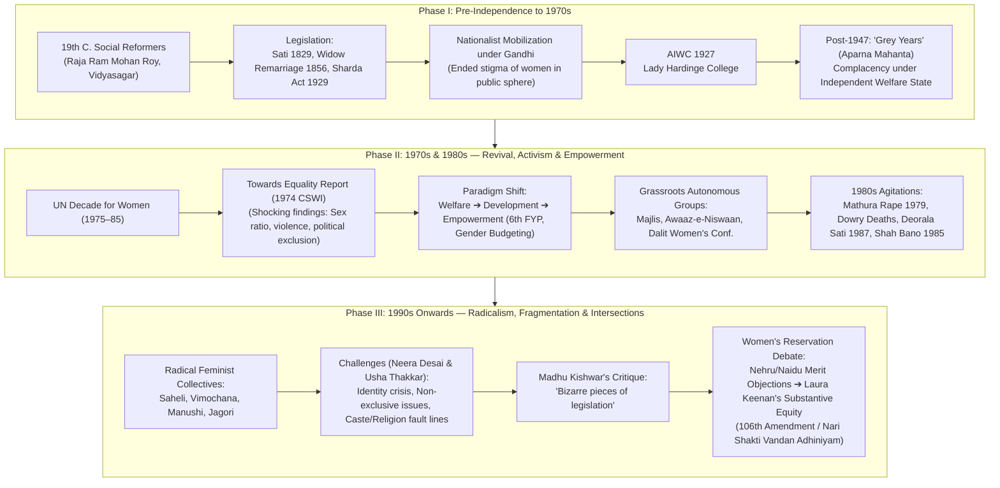
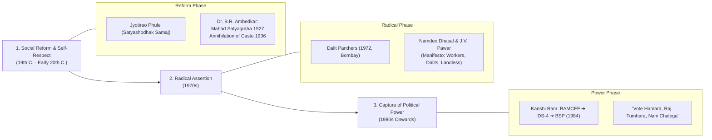
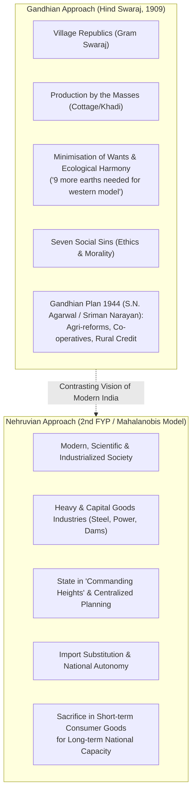

# Shubhra Ranjan PSIR Lecture Notes — Paper 1, Part 2: Batch 9
## Social Movements (Women, Dalit & Peasant Movements) & Planning and Economic Development (Gandhian vs Nehruvian Perspectives)

---

### Archival & Scan Metadata
- **Source Repository:** Shubhra Ranjan PSIR Handwritten Lecture Notes
- **Scan Directory:** `scans_paper1_part2/`
- **Pages Covered:** `page_081.png` to `page_090.png` (Total: 10 pages)
- **Handwritten Page Numbers:** Page 153 (`page_081.png`), Unnumbered (`page_082.png`), Page 154 (`page_083.png`), Unnumbered (`page_084.png`), Page 155 (`page_085.png`), Unnumbered (`page_086.png`), Page 156 (`page_087.png`), Unnumbered (`page_088.png`), Page 157 (`page_089.png`), Unnumbered (`page_090.png`)
- **Lecture Box Annotation:** Lecture 9 — Date: `24/03/2017` (Found on `page_083.png`)
- **Subject / Paper:** UPSC PSIR Paper 1, Section B:
  - Unit 9: Social Movements (Civil Liberties, Women's Movements, Environmental Movements, Dalit Movements, Peasant/Farmers' Movements)
  - Unit 10: Planning and Economic Development (Nehruvian and Gandhian Perspectives, Role of Planning and Public Sector)

---

## PART I: VERBATIM 100% ZERO-LOSS TRANSCRIPTION

```
================================================================================
PAGE 081 [Handwritten Page 153]
Source: page_081.png
Banner: Join Telegram for More Update : - https://t.me/upsc_pdf
================================================================================

● Women Movements in India:
  Women movements in India was started by liberal
  men like Rajarammohan Roy & Ishwarchand Vidyasagar.
  British Govt. has also brought legislations like widow
  remarriage act, prevention of Sati act & sharada
  Act. there was a growth of women organisation in
  different parts of the country. Gandhian Movements
  were not directly aimed at women concerns yet they
  brought consciousness among women & ended the
  stigma w.r.t the participation of women in public
  sphere. the most prominent organisation during
  freedom movement was 'All India Women confere-
  nce set up in 1927. The achievements of the organi-
  sation are sharada Act, 1929 & Lady Harding college
  in Delhi.
  -> After Independence -
  We can divide women movement into three phases:
  (1) Uptill 1970s - Phase I
      Aparna Mahato calls these years as 'Grey Years'
      of women movement.
      why Grey years?
      There was greater activism in women movement
      before independence. The activism was stopped
      after independence. It was thought that there is
      no need for movements against indegenous gout.
      Gout. will automatically take care of the women
      concerns. Constitution of India is a revolutionary
[Bottom Right: 153]

================================================================================
PAGE 082 [Handwritten Unnumbered Page]
Source: page_082.png
Banner: Join Telegram for More Update : - https://t.me/upsc_pdf
================================================================================

  document in many sense. It has given equality
  of status to women, equal rights including right to
  vote.
  (2) Phase II - 70s & 80s - Phase of Revival & Activism
      UN declared 70s as decade for women. It has dire-
      cted the Govts. to prepare the report on status of
      women. Gout. of India had set up a committee to
      enquire the status of women in India. The report
      was published with the title 'Towards Equality' in 1974.
      It was an eye opener as it brought shocking facts
      w.r.t women like declining sex ratio, Gender based
      violence, discrimination & declining participation of
      women in political & economic sphere. It also reco-
      mmended to constitute watchdog body like National
      Commission for women. It has resulted into chang-
      ing the approach of Govt towards women. The
      approach was changed from welfare to developement.
      There was growth of women organisations including
      organisations of muslim women like 'Majlis', Awaaj-
      e-Niswaan, organisations of Dalit women like
      All India Dalit Women conference. 80s was full of
      Activism. The prominent issues in 80s were:
      (i) Increasing no. of dowry deaths
      (ii) Mathura rape case (rape of dalit women in Police station)
      (iii) Sati at Deorala, RJ
      (iv) Shahbano Judgement
      Approach of Gout. also changed from developement to
      empowerment. Since 6th FYP govt. has introduced

================================================================================
PAGE 083 [Handwritten Page 154]
Source: page_083.png
Banner: Join Telegram for More Update : - https://t.me/upsc_pdf
================================================================================

  Gender components in each plans. Gradually gout.
  of India has also introduced gender based budgetin.
  (3) Phase III - 1990s
      By 1990s some new trends emerged.
      (i) The growth of feminist movement. The Nomenclatur
          of women's organisation changed they are more
          inspired by radical feminism. The new names
          adopted were Saheli, Vimochana, Manushi, Jagoree
      (ii) Towards 1990s women movement started getting
          devided on the lines of caste & religion. Initial soli-
          darity was lost.

                             ┌─────────────────┐
                             │ Lecture 9.      │
                             │ 24/03/2017      │
                             └─────────────────┘

  From 1990s onwards Indian politics is getting shaped
  more by caste & religion & thus women issues also get
  mixed up.
  overall assessment of women movement:
[Left Margin: Kishwar]
  According to Madhu Kishwar, the only achievement of
  women organisation has been some bizare pieces of
  legislation.
  According to Neera Desai & Usha Thakkar, women move-
  ment faces following challenges:
  (i) Challenge of identity.
  (ii) Women issues are not just women issues
  (iii) Division of ideological lines along with caste & religion
  so far they have never presented any charter of demands
[Bottom Right: 154]

================================================================================
PAGE 084 [Handwritten Unnumbered Page]
Source: page_084.png
Banner: Join Telegram for More Update : - https://t.me/upsc_pdf
================================================================================

  Short Note - Women Reservation in Parliament &
  Assemblies.
  * The issue was 'discussed even before independence.
  (1) Pandit Nehru -
      He opposed reservation.
      Why?
      (a) It compromises merit.
      (b) If introduce can't be rolled back if introduced.
  (2) Sarojini Naidu:
      opposed reservation.
      Why?
      (a) It will impact the confidence of women.
      (b) Women can be elected on the basis of their merit.
      views of the committee set up by Gout. of India.
      Towards Equality Report, 1974.
      opposed Reservation in Parliament & Assemblies
      though favoured reservation in local bodies?
      Why opposed?
      (i) Its approach was reformative rather than radical.
      (ii) women issues are not just women issues.
      (iii) It is wrong to think that men cannot represent
           the interest of women.
      (iv) In India women movement was started by progre-
           ssive men.
      (v) Both men & women should work together for the cause.

================================================================================
PAGE 085 [Handwritten Page 155]
Source: page_085.png
Banner: Join Telegram for More Update : - https://t.me/upsc_pdf
================================================================================

  Ela Bhatt of SEWA, she opposes women reservation
  & suggest that Govt should focus on economic empo-
  werment.
  Shirin Rai, Feminist scholar, she also opposes reserva-
  tion because it does not serve the purpose, she
  gives the example of Pakistan. Pakistan National
  Assembly has reserved seats for women but it does
  not mean that it has resulted into improvement
  in the status of women.
  Prominent women politicians of all major parties like
  Sonia Gandhi, Sushma Swaraj, Vrinda Karat favour
  women reservation.
  Ministry of Panchayati Raj has conducted the study on
  reservation for women in panchayats it has shown
  positive consequences & it becomes the basis to
  introduce reservation in parliament & assemblies.
  Laura Keenen, feminist scholar, supporting women
  reservation on following grounds:
  (i) Women representation has been stagnant far below
      the proportion. For most of the years it has not
      been more than 8%.
  (ii) Women are not elected does not mean that
      are not talented.
  (iii) All men who are present in the parliament are not
      there in parliament on the basis of merit or effi-
      ciency.
[Bottom Right: 155]

================================================================================
PAGE 086 [Handwritten Unnumbered Page]
Source: page_086.png
Banner: Join Telegram for More Update : - https://t.me/upsc_pdf
================================================================================

  Women are not able to get elected because of
  social environment which remain patriarchal hence
  catalists like reservation are needed.
  Conclusion.
  Women Reservation is needed it will make our demo-
  cracy inclusive in gender terms. It will be an empo-
  werment measure however it is going to be one of
  the measure, Women Empowerment also require
  educational empowerment & most importantly
  economic empowerment.
  [Remainder of page ruled blank lines]

================================================================================
PAGE 087 [Handwritten Page 156]
Source: page_087.png
Banner: Join Telegram for More Update : - https://t.me/upsc_pdf
================================================================================

  PLANNING AND ECONOMIC DEVELOPEMENT
  ● syllabus
  (1) Nehruvian and Gandhian Perspectives.
  (2) Role of planning & public sector.
  (3) Green Revolution
  (4) Land Reforms and Agrarian Relations
  (5) Liberalisation and economic reforms.

  ● Gandhian Approach to Develo [Developement]
  Gandhi was not an economist in conventional sense
  nor he has given any systematic views on the model
  of developement to be adopted by India. We get the
  blue print of Gandhian Idea of Developement in his
  book 'Hind Swaraj'. He was critic of the western
  model of developement & believed that if others also
  adopt same model atleast 9 more earths are needed.
  The fundamental idea governing to Gandhian approac
  was the principle of non-violence & swaraj. Non-vio
  lence even towards nature & minimisation of needs.
  The pillars of Gandhian approach were:
  (i) Economic Growth.
  (ii) Redistributive Justice.
  (iii) Moral Regeneration.
  (iv) [Unwritten / crossed mark]
[Bottom Right: 156]

================================================================================
PAGE 088 [Handwritten Unnumbered Page]
Source: page_088.png
Banner: Join Telegram for More Update : - https://t.me/upsc_pdf
================================================================================

  Gandhian approach towards way of life can be
  understood on the basis of his concept of
  seven [deadly/social - scratched out] sins.
  (i) Wealth without work.
  (ii) Pleasure without conscience.
  (iii) Knowledge without character.
  (iv) Commerce without morality.
  (v) Science without humanity.
  (vi) Worship without sacrifice.
  (vii) Politics without ethics.
  At the time of independence Gandhians like S.N.
  Agarwal, Sriman Narayan have proposed Gandhian
  plan. The key ideas of Gandhian plan were:
  (i) Reform of Agriculture:
      This will adress the hunger & upemployment. Govt.
      should focus on land reforms - co-operatives and rural
      credit.
  (ii) Revival of cottage industries:
      It will not only provide supplementary income, khadi
      was the way to adress the requirement of clothing.
  Thus, the focus of Gandhian plan was to full-fill
  the basic necessities as a priority.
  There is a misunderstanding that Gandhi was against
  machines & industrialisation. He was not against machi-
  nes. He was only against emtitating western model
  in Indian situation.

================================================================================
PAGE 089 [Handwritten Page 157]
Source: page_089.png
Banner: Join Telegram for More Update : - https://t.me/upsc_pdf
================================================================================

  His concerns were:
  (i) machines should not be pitted against human beings
  (ii) use of machines result into accumulation of wealth
      and increases exploitation.

  Thus Gandhian approach was to make Indian villages
  a self sufficient entity. He was for the revival of
  village republic as he believed that India lived in
  villages. Without revival of villages the Goal of Swaraj
  remains incomplete.
  Gandhian approach was not adopted. We can see the
  consequences of the neglect of Gandhian Approach:
  The economic model which we have adopted to catch
  up with western countries has been unsustainable,
  full of conflicts. The developemental models have resu-
  lted into imbalanced growth & widening the gap b/w
  India and Bharat.

  Nehruvian Approach to Developement:
  Nehru was not also an economists. Nehru was mode-
  rnists he was impressed by the achievements of USSR.
  He wanted to India a modern & scientific society.
  He described his philosophy as progressive socialism
  & wanted India to be a society based on Socialistic
  pattern. Nehru's real approach towards the develope-
  ment strategy can be understood from the 2nd FYP.
  which was based on Nehru-Mahalanobis model.
[Bottom Right: 157]

================================================================================
PAGE 090 [Handwritten Unnumbered Page]
Source: page_090.png
Banner: Join Telegram for More Update : - https://t.me/upsc_pdf
================================================================================

  -> Features:
  Investment in Heavy industries.
  Why?
  (i) It will promote capital formation.
  (ii) It will make India independent of the foreign
      imports of essential goods.
  (iii) India can exercise more autonomy in other areas &
      protect itself from bargaining by western countries.
  (iv) Nehru introduced centralised planning despite the
      fact that centralised planning goes against the spirit
      of federalism.
  (v) Nehruvian model neglected consumer industries. Indians
      were to made sacrifices in short term for a better
      life in long term.
  (vi) Nehru was not against agrarian reforms but he
      believed that Industrialisation will create more de-
      mand for agricultural goods & Industrialisation will
      provide fertilisers equipments for promotion of
      Agriculture.
  (vii) Nehru knew that his model will create shortages of
      the basic commodities hence he introduced physical
      control or rationing & fiscal control. or administered
      pricing.
  (viii) In order to avoid income disparities nehruvian model
      had put state in the commanding heights of economy
      and kept private sector weak to check accumulation
      of wealth.
  (ix) Public sector will not only address the concentration of
      wealth it will also be providing employment.
```

---

## PART II: THEMATIC & STRUCTURAL ANALYSIS (FOR UPSC PSIR)



---

### MODULE 1: Women's Movement in India — Historical Trajectory & Ideological Evolution

#### 1. Pre-Independence Phase: Social Reform and Gandhian Mobilization
- **Liberal Male Reformers:** The origin of women's consciousness in India was initiated not by women themselves, but by enlightened male reformers (Raja Ram Mohan Roy against Sati; Ishwar Chandra Vidyasagar for Widow Remarriage; Jyotirao and Savitribai Phule for women’s education). Their primary framing was *humanistic social reform* within an upper-caste, patriarchal colonial legal framework.
- **British Legislative Interventions:**
  1. *Bengal Sati Regulation Act (1829)*
  2. *Hindu Widows' Remarriage Act (1856)*
  3. *Age of Consent Act (1891)*
  4. *Child Marriage Restraint Act (Sharada Act, 1929)*
- **Gandhian Intervention:** Mahatma Gandhi transformed women’s participation by legitimizing their presence in the public sphere through non-violent Satyagraha (Non-Cooperation, Civil Disobedience, Picketing liquor and foreign cloth shops). Though Gandhi glorified traditional female virtues (Sita-Damayanti archetype of suffering, moral fortitude, sacrifice), he decisively removed the social taboo against women entering mass public life.
- **Organizational Growth:** Establishment of the *All India Women's Conference (AIWC)* in 1927 by Margaret Cousins. Key achievements included championing the Child Marriage Restraint Act (Sharada Act, 1929) and female education (Lady Hardinge Medical College, Delhi; Lady Irwin College).

#### 2. Post-Independence Phase I (1947–1970s): The "Grey Years"
- **Aparna Mahanta’s Conceptualization:** Termed this era the **"Grey Years"** (or years of demobilization and lull) of the Indian women's movement.
- **Reasons for Demobilization:**
  1. *Nationalist Complacency:* Activism peaked during the anti-colonial struggle, but collapsed after 1947 because it was believed that an indigenous, democratic government under Nehru would naturally safeguard women's interests.
  2. *Constitutional De Jure Equality:* Articles 14 (Equality before law), 15 (Prohibition of discrimination on grounds of sex), 16 (Equal opportunity in public employment), and Article 326 (Universal adult franchise) created a false sense of achievement.
  3. *State Paternalism:* Women's issues were subsumed under administrative welfare boards (e.g., Central Social Welfare Board, 1953) treating women as passive beneficiaries of health and maternal welfare rather than active rights-bearing citizens.

#### 3. Post-Independence Phase II (1970s–1980s): The Radical Revival & Autonomous Movements
- **The Global Trigger:** United Nations declared 1975–1985 as the *Decade for Women*, mandating member states to assess the empirical status of women.
- **The 'Towards Equality' Report (1974):**
  - Prepared by the *Committee on the Status of Women in India (CSWI)* chaired by Dr. Phulrenu Guha and Member-Secretary Dr. Vina Mazumdar.
  - **Shattering Demographics:** Exposed the demographic crisis of the "declining sex ratio" (later termed "Missing Women" by Amartya Sen), rampant gender-based violence, systemic economic marginalization in unorganized sectors, and declining female representation in legislative bodies.
  - Recommended the constitution of statutory bodies like the **National Commission for Women (NCW)** (later enacted via NCW Act 1990).
- **Shift in Developmental Paradigm:**
  - *Welfare to Development:* The approach changed from passive welfare (charity/maternity) to active socio-economic development.
  - *Development to Empowerment:* By the **Sixth Five Year Plan (1980–85)**, a dedicated chapter on "Women and Development" was introduced for the first time. This laid the foundation for **Gender-Responsive Budgeting** (formally institutionalized in India from 2005–06).
- **Rise of Autonomous Women's Groups & Key Agitations of the 1980s:**
  - *Autonomous Organizations:* Unlike party-affiliated wings (e.g., Mahila Congress, AIWD), autonomous groups operated independently:
    - **Majlis** (legal centre for women founded by Flavia Agnes)
    - **Awaaz-e-Niswaan** (voice of Muslim women fighting triple talaq and patriarchy)
    - **All India Dalit Women’s Forum / National Federation of Dalit Women**
  - *The Mathura Rape Case (1972/1979):* Mathura, a young tribal/Dalit girl, was raped by two policemen within the police station in Chandrapur, Maharashtra. The Supreme Court acquitted the policemen citing "no marks of injury" and alleged "consent". Four eminent law professors—**Upendra Baxi, Lotika Sarkar, Raghunath Kelkar, and Vasudha Dhagamwar**—wrote an open letter to the Chief Justice of India protesting the verdict. This triggered nation-wide mass protests, compelling the government to amend the Evidence Act and IPC (Section 376A–D), shifting the burden of proof to the accused in custodial rape.
  - *Dowry Murders:* Mass protests against brides burned for dowry led to the enactment of **Section 498A IPC** (Cruelty by husband or relatives) and amendments to the Dowry Prohibition Act.
  - *Deorala Sati (1987):* The public immolation of 18-year-old Roop Kanwar in Deorala, Rajasthan, exposed patriarchal revivalism and led to the *Commission of Sati (Prevention) Act, 1987*.
  - *The Shah Bano Case (1985):* Supreme Court ruled under Section 125 CrPC that Shah Bano was entitled to maintenance. The Rajiv Gandhi government overturned this with the *Muslim Women (Protection of Rights on Divorce) Act 1986*, triggering major debates over secularism, uniform civil code, and minority rights vs women’s human rights.

#### 4. Post-Independence Phase III (1990s Onwards): Radical Collectives & Fragmentation
- **Radical Nomenclature:** Collectives adopted names symbolizing solidarity, light, and liberation:
  - **Saheli** (Friend) — Delhi-based crisis intervention collective
  - **Vimochana** (Liberation) — Bengaluru-based forum for women’s rights
  - **Manushi** (Human/Woman) — Founded by Madhu Kishwar and Ruth Vanita
  - **Jagori** (Awaken) — Delhi-based feminist training and documentation centre
- **The Challenge of Caste and Identity Politics:**
  - As Indian politics in the 1990s became heavily defined by Mandal (caste) and Kamandal (religion), the initial universal solidarity of the women's movement fractured.
  - Dalit feminists asserted that mainstream feminist discourse was dominated by urban, upper-caste, English-speaking women who failed to address the intersection of caste atrocities and patriarchy.

#### 5. Critical Assessment by Prominent Scholars
- **Madhu Kishwar's Critique:**
  - Argues that the mainstream women’s movement has suffered from an obsession with the state, resulting merely in *"some bizarre pieces of legislation"* that are either weaponized by corrupt police or completely ineffective in changing patriarchal ground realities. She criticized feminists for looking to state legislation as a panacea.
- **Neera Desai & Usha Thakkar (*Women in Indian Society*):**
  Identified four structural dilemmas:
  1. *Challenge of Identity:* Women are divided by multiple identities of caste, class, community, and religion.
  2. *Broadness of Issues:* Women's issues are inextricably tied to larger socio-economic issues (poverty, water, land, wages) and cannot be addressed in isolation.
  3. *Ideological Cleavages:* Deep divisions between liberal, socialist, radical, and subaltern feminists.
  4. *Lack of a Unified Charter of Demands:* The movement has reacted episodically to atrocities rather than formulating a cohesive, long-term political agenda.

---

### MODULE 2: The Women's Reservation Debate — Normative and Empirical Perspectives

```
┌───────────────────────────────────────────────────────────────────────────┐
│                    WOMEN'S RESERVATION IN LEGISLATURES                    │
├─────────────────────────────────────┬─────────────────────────────────────┤
│        ARGUMENTS AGAINST            │          ARGUMENTS IN FAVOUR        │
├─────────────────────────────────────┼─────────────────────────────────────┤
│ • Pandit Nehru:                     │ • Laura Keenan:                     │
│   - Compromises merit               │   - Representation stagnant < 8–10% │
│   - Once introduced, irreversible   │   - Lack of election ≠ lack talent  │
│ • Sarojini Naidu:                   │   - Men not elected on merit alone  │
│   - Undermines self-confidence      │   - Patriarchal environment needs   │
│   - Women must win on merit         │     reservation as a catalyst       │
│ • Towards Equality Report (1974):   │ • Political Leaders:                │
│   - Favoured local PRIs; opposed    │   - Sonia Gandhi, Sushma Swaraj,    │
│     Parliament (reformative view,   │     Vrinda Karat (Cross-party unity)│
│     men can represent women)        │ • Panchayati Raj Ministry Study:    │
│ • Ela Bhatt (SEWA):                 │   - Grassroots transformation, proxy│
│   - Economic empowerment first      │     sarpanch phenomenon fading      │
│ • Shirin Rai:                       │ • 106th Constitutional Amendment:   │
│   - Tokenism without power          │   - Nari Shakti Vandan Adhiniyam    │
│   - Pakistan Assembly counter-ex.   │     (33% Lok Sabha & Vidhan Sabha)  │
└─────────────────────────────────────┴─────────────────────────────────────┘
```

1. **Pre-Independence & Early Constituent Assembly Standpoints:**
   - **Jawaharlal Nehru:** Believed legislative quotas would undermine meritocracy and feared that identity-based political reservations, once introduced, could never be repealed due to electoral vote-bank dynamics.
   - **Sarojini Naidu & Begum Aizaz Rasul:** Argued passionately against separate electorates or quotas for women, asserting that it reflected an inferiority complex; women should compete openly on equal footing with men.
2. **The 1974 'Towards Equality' Stand:**
   - The CSWI report recommended 33% reservation for women in **Local Bodies (Panchayats and Municipalities)** to build grassroots leadership, but **opposed reservation in Parliament and State Assemblies**.
   - *Rationale:* Believed that progressive men had historically championed women's liberation (Phule, Vidyasagar, Roy), that men could represent women's interests, and that politics should not be polarized along gender lines.
3. **Feminist Dissent Against Legislative Quotas:**
   - **Ela Bhatt (Self Employed Women’s Association - SEWA):** Argued that legislative presence does not automatically translate into liberation; true autonomy comes from *economic empowerment*, financial independence, micro-credit, and labour rights.
   - **Shirin Rai:** Warned against tokenistic descriptive representation without substantive power. Citing Pakistan’s reserved quotas in the National Assembly, she demonstrated that quotas often seat female relatives of powerful feudal/political elites (*Biwi-Beti brigade*) without altering structural gender subordination.
4. **Laura Keenan's Feminist Defense of Quotas:**
   - *Persistent Stagnation:* Empirical data shows female representation in the Lok Sabha hovered below 8–12% for seven decades, disproving the myth of natural progression.
   - *Critique of the "Merit" Argument:* Keenan points out that male politicians are rarely selected solely on merit or technocratic efficiency—dynasty, criminal muscle, and money power predominate.
   - *Patriarchy as an Entry Barrier:* Because the political arena is structurally patriarchal, affirmative action (reservation) is an indispensable **structural catalyst** to level the playing field.
5. **Evolution to the 106th Amendment Act:**
   - The success of the **73rd and 74th Constitutional Amendment Acts (1992)**—mandating 1/3rd reservation in Panchayats and Urban Local Bodies—shattered the myth that rural women could not govern.
   - Ultimately culminated in the passage of the **Constitution (106th Amendment) Act, 2023 [Nari Shakti Vandan Adhiniyam]**, reserving 33% seats for women in the Lok Sabha and State Legislative Assemblies.

---

### MODULE 3: Dalit Movement & Subaltern Assertion (Comprehensive UPSC Context)



#### 1. Gail Omvedt’s Theoretical Framework (*Dalits and the Democratic Revolution*, 1994)
- Gail Omvedt conceptualized the Dalit movement not as a mere sectarian identity agitation, but as the **core of the democratic revolution in India**.
- She argued that caste in India constitutes the fundamental mode of socio-economic exploitation, intertwining material class exploitation with ritual-religious degradation (Brahmanical hegemony).
- True democratization of India requires the annihilation of caste and a radical anti-caste cultural renaissance.

#### 2. Three Distinct Phases of the Dalit Movement:
1. **The Social Reform & Constitutional Rights Phase (Phule–Ambedkar Era):**
   - *Jyotirao Phule:* Attacked Brahmanical dominance (*Gulamgiri*), established the Satyashodhak Samaj (1873), and linked non-Brahmin peasant mobilization with untouchable upliftment.
   - *Dr. B.R. Ambedkar:* Shifted the discourse from Gandhian paternalistic "Harijan seva" to militant self-respect and political rights:
     - Mahad Satyagraha (1927) for access to public water resources.
     - Burning of *Manusmriti* (1927) as rejection of sacred inequality.
     - Slogan: *"Educate, Agitate, Organize"*.
     - Established the *Bahishkrit Hitakarini Sabha* (1924), *Independent Labour Party* (1936), and *Scheduled Castes Federation* (1942).
     - Embraced Buddhism (1956) as a complete rupture from Hindu social order.
2. **The Radical Assertion Phase (1970s — Dalit Panthers):**
   - Founded in 1972 in Bombay by young Dalit writer-activists **Namdeo Dhasal**, **J.V. Pawar**, and **Arjun Dangle**, inspired by the American *Black Panther Party*.
   - **Radical Manifesto (1973):** Redefined "Dalit" not as a caste marker, but as an inclusive class-caste revolutionary category: *"All scheduled castes, neo-Buddhists, the working people, landless laborers, poor peasants, and exploited women."*
   - Dalit Literature Movement: Used provocative, raw poetry (e.g., Namdeo Dhasal’s *Golpitha*) to demolish classical bourgeois Marathi literature, exposing caste brutality, police violence, and slum life.
3. **The Political Capture Phase (1980s Onwards — Kanshi Ram & BSP):**
   - Founded on the premise that *"Political power is the master key to all socio-economic doors"* (Dr. Ambedkar).
   - **Kanshi Ram’s Organizational Cadre Building:**
     - **BAMCEF (1978):** Backward and Minority Communities Employees Federation — mobilized educated, government-employed Dalit middle classes for financial and intellectual support.
     - **DS-4 (1981):** Dalit Shoshit Samaj Sangharsh Samiti.
     - **Bahujan Samaj Party (BSP, 1984):** United Scheduled Castes, Scheduled Tribes, and Other Backward Classes (the "85% Bahujan" vs the "15% Savarna"). Slogans: *"Vote Hamara, Raj Tumhara, Nahi Chalega"*, *"Jiski Jitni Sankhya Bhaari, Uski Utni Hissedari"*.
- **Dalit Feminist Critique (Gopal Guru & Sharmila Rege):**
  - **Gopal Guru (*Dalit Women Talk Differently*, 1995):** Argued that Dalit women suffer from a **"dual oppression"**—external caste-class domination from Savarna elites and internal patriarchal domination from Dalit men.
  - **Sharmila Rege (*Dalit Feminist Standpoint*):** Mainstream upper-caste feminism universalized the experience of elite women while ignoring the caste-specific humiliation (untouchability, sexual exploitation by landed upper castes) endured by Dalit women.

---

### MODULE 4: Peasant Struggles & Farmers' Movements — Old vs New Movements

```
┌─────────────────────────────────────────────────────────────────────────────┐
│                 EVOLUTION OF AGRARIAN MOVEMENTS IN INDIA                    │
├──────────────────────────────────────┬──────────────────────────────────────┤
│     OLD PEASANT MOVEMENTS (Pre-1970) │   NEW FARMERS' MOVEMENTS (Post-1970) │
├──────────────────────────────────────┼──────────────────────────────────────┤
│ • Social Base:                       │ • Social Base:                       │
│   Poor, landless tenants, share-     │   Market-surplus producing, land-    │
│   croppers, agricultural labourers   │   owning middle & rich farmers       │
│ • Target of Struggle:                │ • Target of Struggle:                │
│   Feudal landlords, Zamindars,       │   The State, Bureaucracy, Terms of   │
│   Colonial revenue extraction        │   Trade, Global Capital (WTO)        │
│ • Core Demands:                      │ • Core Demands:                      │
│   "Land to the Tiller", ceiling,     │   Remunerative Prices (MSP),         │
│   abolition of Zamindari/feudal rents│   Input subsidies (power, diesel),   │
│ • Classic Struggles:                 │   Loan waivers, lower fertilizer rates│
│   - Tebhaga Movement (Bengal 1946)   │ • Key Organizations:                 │
│     (2/3rd share for bargadars)      │   - Shetkari Sangathan (Sharad Joshi)│
│   - Telangana Movement (1946–51)     │     Dichotomy: "Bharat vs India"     │
│     (Anti-Nizam, Anti-Jagirdari)     │   - Bharatiya Kisan Union - BKU      │
│   - Naxalbari Movement (1967)        │     (Mahendra Singh Tikait in UP)    │
│ • Ideological Leadership:            │ • Ideological Leadership:            │
│   Left-wing, Communist parties,      │   Non-party populist leaders, caste  │
│   Kisan Sabhas (All India Kisan Sabha│   clans (Khap Panchayats, Jat/Patel/ │
│   formed 1936 by Swami Sahajanand)   │   Maratha peasant networks)          │
└──────────────────────────────────────┴──────────────────────────────────────┘
```

#### 1. Transition: The Green Revolution and Rudolphs' "Bullock Capitalists"
- The Green Revolution (late 1960s) transformed agrarian relations, creating a commercialized agricultural surplus economy, particularly in Punjab, Haryana, Western UP, Maharashtra, and Andhra Pradesh.
- **Lloyd and Susanne Rudolph (*In Pursuit of Lakshmi*, 1987):** Coined the term **"Bullock Capitalists"** for middle peasants owning self-operated small-to-medium holdings (2.5 to 15 acres). They emerged as a dominant, self-reliant agrarian voting bloc capable of mass mobilization.

#### 2. Sharad Joshi and the "Bharat vs. India" Paradigm (Explicitly Cited on Page 089)
- On **page 089 (lines 16–18)**, the lecture notes explicitly state: *"The developemental models have resulted into imbalanced growth & widening the gap b/w India and Bharat."*
- **Sharad Joshi’s Shetkari Sangathan:** Formulated the definitive thesis of agrarian exploitation:
  - **"India":** The Westernized, urban-industrial, English-speaking elite who control the state machinery, industry, and finance.
  - **"Bharat":** The rural, agrarian hinterland which is systematically exploited through **deliberate adverse terms of trade** (cheap food policies designed to subsidize urban industrial workers at the cost of farmer bankruptcies).
  - Slogan: *"Kisaan Bachao, Desh Bachao"* — demand was not charity or land redistribution, but full remunerative market price for produce.

#### 3. Mahendra Singh Tikait and the Bharatiya Kisan Union (BKU)
- Mobilized the peasant masses of Western UP and Northern India using traditional socio-cultural structures—the **Khap Panchayats** (clan councils)—to achieve unprecedented organizational cohesion.
- Historic agitations (e.g., the 1988 Boat Club Siege in Delhi where 500,000 farmers paralyzed the national capital) demanded:
  1. Guaranteed remunerative prices for sugarcane and wheat.
  2. Subsidized electricity tariffs and rollback of power bill hikes.
  3. Complete waiver of agricultural loans during droughts.

---

### MODULE 5: Planning and Economic Development — Gandhian vs. Nehruvian Perspectives (Pages 087–090)



#### 1. Detailed Breakdown of Gandhian Development Philosophy (Pages 087–089)
- **Non-Conventional Economist:** Gandhi did not construct formal econometric models, but provided a civilizational blueprint in *Hind Swaraj* (1909).
- **Ecological Foresight:** Warned against imitating Western industrial capitalism: *"If India, with its vast population, were to adopt the Western model of economic development, it would strip the earth bare like a swarm of locusts... atleast 9 more earths are needed."*
- **The Core Pillars:**
  1. *Economic Growth:* Grounded in rural renewal and local self-reliance.
  2. *Redistributive Justice:* Based on the doctrine of **Trusteeship** (the rich hold wealth as trustees of society).
  3. *Moral Regeneration:* Economy cannot be separated from ethics (Sarvodaya — welfare of all).
- **The Seven Social Sins (Young India, 1925):**
  1. Wealth without Work
  2. Pleasure without Conscience
  3. Knowledge without Character
  4. Commerce without Morality
  5. Science without Humanity
  6. Worship without Sacrifice
  7. Politics without Ethics
- **The Gandhian Plan (1944):** Drafted by **Acharya Shriman Narayan Agarwal (S.N. Agarwal)**:
  - Focused on agrarian reconstruction, co-operative farming, rural credit, small-scale handicrafts, and cottage industries.
  - Priority: Universal fulfillment of basic physiological and cultural needs (food, clothing, shelter, education).
- **Demystifying Gandhi on Machinery:**
  - Gandhi was not primitivist or dogmatically anti-machine; he opposed machines that **displaced human labour** and caused the **centralized concentration of wealth and systemic exploitation**.
  - Advocated *Appropriate Technology* (e.g., the Charkha or Singer Sewing Machine) which ennobles rather than dehumanizes the worker.
- **The Village Republic:** India lives in its 700,000 villages; political and economic Swaraj is complete only when each village is an autonomous, self-sustaining socio-economic unit (Gram Swaraj).

#### 2. Detailed Breakdown of Nehruvian Development Philosophy (Pages 089–090)
- **Modernist & Fabian Socialist:** Influenced by Harold Laski, Beatrice and Sidney Webb, and the planned industrial achievements of the USSR (Gosplan).
- **Vision:** Transform a superstitious, impoverished colonial agrarian hinterland into a forward-looking, secular, modern, scientific society characterized by the **"Scientific Temper"**.
- **Socialistic Pattern of Society (Avadi Resolution, 1955):** Formalized into the **Second Five Year Plan (1956–61)** via the **Nehru-Mahalanobis Strategy** (developed with statistician P.C. Mahalanobis).
- **Core Strategic Features (Page 090):**
  1. *Heavy and Capital Goods Industries First:* Investment in machine-making machines (steel, mining, dams, power plants—Nehru’s *"Temples of Modern India"*) to promote rapid capital accumulation.
  2. *Strategic Autonomy & Anti-Imperialist Defense:* Eliminating dependence on Western capitalist powers for essential machines and infrastructure protected non-aligned India from geopolitical arm-twisting.
  3. *Centralized Planning over Federal Autonomy:* Creation of the Planning Commission and National Development Council centralized resource allocation, curbing state-level economic centrifugalism.
  4. *Suppression of Consumer Goods:* Sacrificed short-term consumer consumption through high tariffs and rationing to funnel every surplus rupee into capital formation.
  5. *Agrarian Rationalization via Industrialization:* Believed industrialization would absorb surplus rural labour and modernize agriculture by providing chemical fertilizers, tractors, and irrigation pumps.
  6. *Physical & Fiscal Controls:* To manage acute structural shortages, the state instituted administered pricing, rationing, and the License-Permit-Quota Raj.
  7. *Commanding Heights of the Economy:* Public sector was positioned at the helm of infrastructure and finance to prevent the monopolistic concentration of private capital, while simultaneously acting as the primary engine of modern public employment.

---

### MODULE 6: Comparative Matrix — Nehruvian vs. Gandhian Models

| Dimension | Gandhian Paradigm (*Hind Swaraj*) | Nehruvian Paradigm (Nehru-Mahalanobis Model) |
| :--- | :--- | :--- |
| **Philosophical Goal** | Moral regeneration, *Sarvodaya*, self-limiting needs | Modernization, scientific temper, progressive socialism |
| **Primary Economic Unit** | Autonomous Village Republic (*Gram Swaraj*) | The Nation-State with Centralized Planning |
| **Industrial Strategy** | Cottage industries, Khadi, handicrafts, village crafts | Heavy capital goods, machine tools, metallurgy, power |
| **Technology Stance** | Appropriate technology; tools must not replace human hands | State-of-the-art heavy technology; mechanization |
| **Production Mode** | Production *by the masses* (decentralized employment) | *Mass production* (capital-intensive industrial plants) |
| **Agrarian Linkage** | Priority: Agrarian revival, rural credit, co-operatives | Agriculture as input supplier and consumer of industrial goods |
| **Role of State** | Minimal state; decentralized participatory democracy | State occupying the *commanding heights* of the economy |
| **Ecological Impact** | Sustainable, low-carbon; warned against planetary destruction | High-resource extraction, large dams, intensive industrialization |
| **Structural Critique** | Neglected industrial scale, national defense, urban dynamism | Created License-Permit Raj, widened the "India vs Bharat" divide |

---

### MODULE 7: Scholars & Key Concepts Compendium

| Scholar / Actor | Key Book / Concept | Central Argument / Contribution |
| :--- | :--- | :--- |
| **Aparna Mahanta** | *"The Grey Years"* of Women's Movement | Post-independence lull (1947–1970s) due to trust in the newly independent state and constitutional guarantees. |
| **Vina Mazumdar & Phulrenu Guha** | *Towards Equality Report* (CSWI, 1974) | Empirical unmasking of declining sex ratio, gender violence, and marginalization; triggered 2nd wave feminism in India. |
| **Madhu Kishwar** | Critique of Legalism (*Manushi*) | State-centric legalistic feminism produces ineffective, *"bizarre pieces of legislation"* without transforming society. |
| **Neera Desai & Usha Thakkar** | *Women in Indian Society* | Identified four core dilemmas of women's movements: identity, broad socio-economic links, ideological splits, lack of unified demands. |
| **Ela Bhatt** | SEWA / Economic Empowerment Model | Legislative quotas are secondary; economic independence, informal labor organization, and micro-finance are foundational. |
| **Shirin Rai** | Critique of Quota Tokenism | Legislative quotas can become symbolic gestures co-opted by patriarchal elites (e.g., Pakistan National Assembly). |
| **Laura Keenan** | Defense of Women's Quotas | Substantive representation: political stagnancy (<8%) and the myth of male legislative merit necessitate quotas as structural catalysts. |
| **Gail Omvedt** | *Dalits and the Democratic Revolution* (1994) | Anti-caste struggles constitute the core democratic transformation of India against Brahmanical hegemony. |
| **Namdeo Dhasal & J.V. Pawar** | *Dalit Panthers Manifesto* (1973) | Redefined Dalit to include all oppressed classes; combined Marxist class analysis with Ambedkarite caste revolution. |
| **Kanshi Ram** | BAMCEF, DS-4 & BSP | Transforming social consciousness into electoral capture: *"Political power is the master key to all socio-economic doors."* |
| **Sharad Joshi** | Shetkari Sangathan (*"Bharat vs India"*) | Structural divide where urban-industrial "India" systematically exploits rural-agrarian "Bharat" through negative terms of trade. |
| **Lloyd & Susanne Rudolph** | *In Pursuit of Lakshmi* (1987) | Conceptualized "Bullock Capitalists" (middle peasants) as a dominant, self-directed agrarian political class. |
| **P.C. Mahalanobis & J.L. Nehru** | Nehru-Mahalanobis 2nd FYP Model | State-led heavy industrialization, import substitution, and state commanding heights to build sovereign capital formation. |
| **S.N. Agarwal (Shriman Narayan)** | *The Gandhian Plan* (1944) | Alternative economic model prioritizing agriculture, village republics, cottage khadi industries, and needs-based consumption. |

---

### MODULE 8: Direct UPSC PSIR Model Question Answers

#### Q1. Critically evaluate the transition of the Women's Movement in India from the pre-independence reform era to the autonomous feminist agitations of the 1970s and 1980s. (20 Marks)
- **Introduction:** Trace the dialectical shift from 19th-century male-led reformism to the assertive, autonomous, rights-based second wave triggered by the *Towards Equality* report (1974).
- **Body:**
  - *Phase 1 (Reform & Gandhian Mobilization):* Roy, Vidyasagar, Phule; legislative focus (Sati 1829, Widows 1856, Sharda 1929). Gandhi's role in legitimizing public participation while preserving the maternal/moral archetype.
  - *Phase 2 (The "Grey Years" - Aparna Mahanta):* 1947–1970s lull due to post-colonial faith in constitutional guarantees (Arts 14, 15, 16) and state paternalism (CSWB).
  - *Phase 3 (Revival & Activism in 1970s/80s):* CSWI's *Towards Equality Report* (1974) exposed the illusion of progress (declining sex ratios, custodial violence). The emergence of autonomous groups (Majlis, Awaaz-e-Niswaan, Stree Shakti Sanghatana) free from party control.
  - *Key Battlegrounds:* Mathura Rape Case (1972/79) and the Open Letter by Baxi, Sarkar, Kelkar, and Dhagamwar; Anti-Dowry agitations (498A IPC); Shah Bano (1985) and the intersection of patriarchy and minority rights.
- **Evaluation:** Cite Madhu Kishwar on the limits of legislative solutions and Neera Desai & Usha Thakkar on identity fragmentations. Conclude with the emergence of intersectional and Dalit feminism (Sharmila Rege).

#### Q2. "The debate on women's legislative reservation reveals deep ideological cleavages within both the political class and feminist theory." Discuss. (15 Marks)
- **Introduction:** Contextualize the historical arc of the Women's Reservation debate from the Constituent Assembly to the 106th Constitutional Amendment Act, 2023.
- **Body:**
  - *Historical Opposition:* Nehru's concern over merit and irreversibility; Sarojini Naidu's fear of entrenching inferiority.
  - *The 1974 CSWI Paradox:* Favored reservation at the grassroots (PRIs) to nurture leadership, but opposed it in Parliament/Assemblies on the belief that progressive men could represent women's interests.
  - *Feminist Cleavages:*
    - Economic focus: Ela Bhatt (SEWA) advocating economic empowerment first.
    - Tokenism critique: Shirin Rai warning against proxy representation (*Biwi-Beti brigade*), drawing on the Pakistan experience.
    - Structural defense: Laura Keenan demonstrating that stagnation (<8–10%) and patriarchal gatekeeping make reservations an urgent structural catalyst; debunking the male "merit" myth.
- **Conclusion:** Affirm that the 106th Amendment (*Nari Shakti Vandan Adhiniyam*) represents a historic institutional milestone that must be matched by intra-party democracy and economic empowerment.

#### Q3. Compare and contrast the Nehruvian and Gandhian models of planning and economic development. How does the "Bharat vs. India" dichotomy reflect the unresolved tensions of these models? (20 Marks)
- **Introduction:** Contrast the two founding paradigms of post-colonial India’s developmental imagination: Gandhi’s ecological, moral village republic (*Hind Swaraj*) versus Nehru’s modernist, scientific, heavy-industrial state (*Nehru-Mahalanobis Strategy*).
- **Body:**
  - *Nehruvian Paradigm:* Heavy industry first, import substitution, public sector in commanding heights, sacrifice of short-term consumer goods for sovereign capital formation, state-directed centralized planning.
  - *Gandhian Alternative:* Decentralized village republics (*Gram Swaraj*), S.N. Agarwal's Gandhian Plan (1944), agriculture and cottage industries, appropriate technology, Seven Social Sins, warning that imitating Western industrialism would require "atleast 9 more earths".
  - *Synthesis & The "Bharat vs India" Discontent:*
    - Neglect of agriculture and primary sectors in early Five Year Plans created chronic agrarian distress and terms-of-trade imbalances.
    - Sharad Joshi's formulation of **"Bharat vs. India"** (as noted on page 089) captured how resource-draining urbanization and industrial administered pricing created an exploited rural hinterland (*Bharat*) serving an affluent urban core (*India*).
    - Rudolphs' "Bullock Capitalists" and Mahendra Singh Tikait’s BKU represent the political backlash of this unresolved tension.
- **Conclusion:** Relate this debate to contemporary challenges of jobless growth, climate change, and sustainable decentralization (NITI Aayog, sustainable development goals), proving the enduring relevance of Gandhian eco-philosophy alongside modern industrial capacity.
