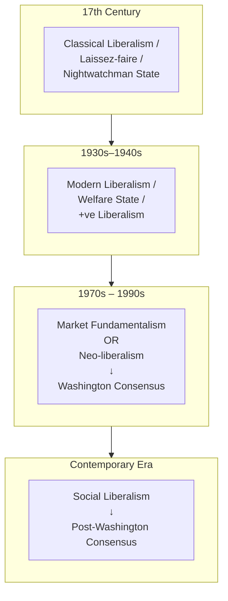
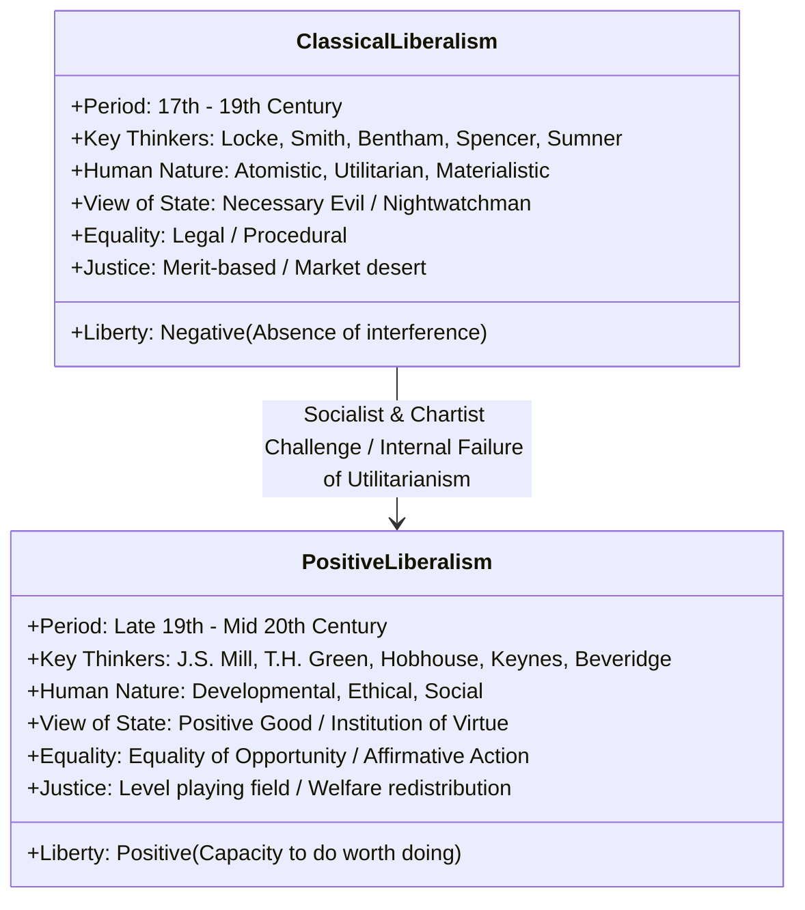
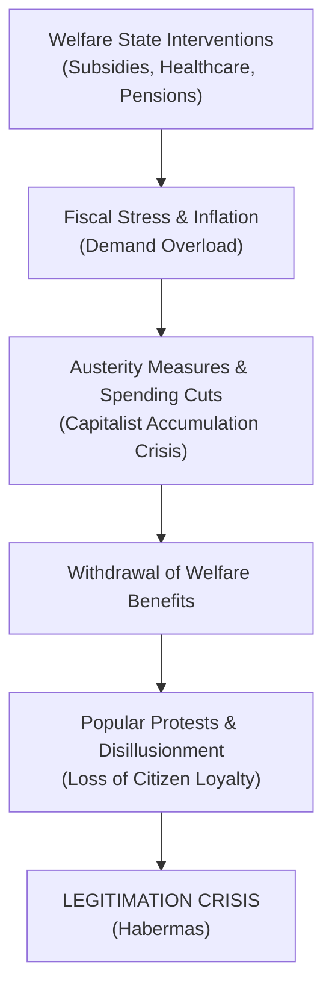

# UPSC PSIR Paper 1 (Western Political Thought & Ideologies)
## Shubhra Ranjan Handwritten Class Notes (2017) | Batch Transcription & Scholarly Analysis
### Batch 1: Political Ideologies — Idealism, Classical Liberalism & The Transition to Positive Liberalism (T.H. Green)

---

## ARCHIVAL AND DOCUMENT METADATA

- **Source Document:** Shubhra Ranjan Handwritten Class Notes (Vajiram and Ravi) — Western Political Thoughts (Part-II)
- **Year / Batch:** 2017
- **Lecture Reference:** Lecture 25th (Dated: 14/01/2017) [Recorded on Scan Page 12 / Notebook Page 91+]
- **Scan File Range:** `page_001.png` to `page_015.png` (Total 15 Pages)
- **Original Notebook Pagination:** Pages 88 to 93 (preceded by Cover Title Page, Separator, and Table of Contents)
- **Primary Subject:** Political Science and International Relations (PSIR) Paper 1, Section A:
  - 1. Political Theory: meaning and approaches.
  - 7. Political Ideologies: Idealism, Liberalism (Classical, Modern/Positive, Neo-liberalism).
  - 2. Theories of the State (Liberal, Neoliberal, Marxist, Pluralist, Post-colonial).
  - 3. Justice, 4. Equality, 5. Rights, 6. Democracy.
- **Transcriber:** Advanced Agentic AI PSIR Scholar (Zero-loss transcription, forensic layout preservation, and structural academic commentary).

---

## DETAILED PAGE-BY-PAGE SCAN BREAKDOWN

```
┌────────────┬─────────────────────────────┬────────────────────────────────────────────────────────┐
│ Scan Page  │ Original Notebook Page No.  │ Primary Subject / Core Thematic Contents               │
├────────────┼─────────────────────────────┼────────────────────────────────────────────────────────┤
│ page_001   │ Cover Page                  │ Vajiram and Ravi Cover: PSIR Part-II Notes (2017)      │
│ page_002   │ Flyleaf / Separator         │ Blank Separator Page (Watermark: upscpdf.com)          │
│ page_003   │ Table of Contents (Index)   │ Syllabus Mapping (Topics 12 to 24, Pages 88–181)       │
│ page_004   │ Separator                   │ Blank Transition Page                                  │
│ page_005   │ Notebook Page 88            │ Political Ideologies: Idealism, Exponents, Absolutism  │
│ page_006   │ [Notebook Page 88 contd.]   │ Rationalism, Modern Times, Clash of Ideologies/Civ.    │
│ page_007   │ Notebook Page 89            │ Schools of Liberalism Evolution Tree, Classical Lib.   │
│ page_008   │ [Notebook Page 89 contd.]   │ Classical Liberal State (Nightwatchman), Rights, Eq.   │
│ page_009   │ Notebook Page 90            │ Marxist Critique of Equality, Merit Justice, Liberty   │
│ page_010   │ [Notebook Page 90 contd.]   │ Modern / Positive Liberalism, Shift from Negative Lib  │
│ page_011   │ Notebook Page 91            │ Assumptions of Positive Liberalism, Kantian Dignity    │
│ page_012   │ [Notebook Page 91 contd.]   │ T.H. Green on Liberty: Capacity, Lecture 25 (14/01/17) │
│ page_013   │ Notebook Page 92            │ Green's Triad: Consciousness, Rights, and State        │
│ page_014   │ [Notebook Page 92 contd.]   │ Green on Political Obligation: "Will, not Force"       │
│ page_015   │ Notebook Page 93            │ Habermas: Legitimation Crisis in Welfare State         │
└────────────┴─────────────────────────────┴────────────────────────────────────────────────────────┘
```

---

## 1. COVER AND PRELIMINARY PAGES (SCANS 1 TO 4)

### Scan `page_001.png` — Cover Title Page
```
[Header Stamp: Join Telegram for More Update : - https://t.me/upsc_pdf]
[Top Right Handwritten Annotation: 4]

                  VAJIRAM AND RAVI
                 POLITICAL SCIENCE
                      OPTIONAL
             WESTERN POLITICAL THOUGHTS
                     (PART-II)
                    HANDWRITTEN
                    CLASS NOTES
                        2017
                 BY SUBHRA RANJAN

[Footer Watermarks: https://t.me/upsc_pdf | https://upscpdf.com | https://t.me/upsc_pdf]
```

### Scan `page_002.png` — Blank Flyleaf
- Document separator page containing diagonal watermark `upscpdf.com`.

### Scan `page_003.png` — Table of Contents / Index
```
[Header Stamp: Join Telegram for More Update : - https://t.me/upsc_pdf]

-------------------------------------------------------------------------------------
S.No. | Topic Title                                                  | Page Number
-------------------------------------------------------------------------------------
12.   | Political Ideologies                                         | 88
13.   | Schools of liberalism: \                                     | 89
14.   | Framework of multi culturalism                               | 100.
15.   | Socialism                                                    | 105
16.   | Marxism                                                      | 108
17.   | Fascism                                                      | 112
18.   | Feminism                                                     | 116
19.   | Theories of state                                            | 122
20.   | Concept of Power, Hegemony, Ideology etc.                    | 135
21.   | Democracy    .                                               | 149
22.   | Rights                                                       | 160
23.   | Justice                                                      | 165
24.   | Equality                                                     | 181
-------------------------------------------------------------------------------------
[Note: Next to 'Schools of liberalism:' there is a small pen tick mark '\']
[Footer Watermarks: https://t.me/upsc_pdf | https://upscpdf.com | https://t.me/upsc_pdf]
```

### Scan `page_004.png` — Blank Flyleaf
- Document separator page containing diagonal watermark `upscpdf.com`.

---

## 2. EXHAUSTIVE VERBATIM TRANSCRIPTION & STRUCTURAL DECONSTRUCTION

---

### SCAN `PAGE_005.PNG` (NOTEBOOK PAGE 88)

```
[Header: Join Telegram for More Update : - https://t.me/upsc_pdf]
[Left Margin: Spiral-bound perforation holes]
```

#### [Boxed Heading 1]
# POLITICAL IDEOLOGIES

#### [Boxed Heading 2]
## IDEALISM

- **Exponents of Idealism –**
  - Socrates, Plato, Aristotle, Rousseau, Hegel, I. Kant *(annotated underneath: Imanuel Kant)*, T.H. Green.
- **For idealists Man is social/moral by Nature.**
- **For idealists society is prior to Man.**
- **For idealists state is prior to Man.**
- **For idealists society & state is Natural/organic.**
- **Idealists do not give importance to the Rights they give importance to duties.**
- **In idealism we see the developement of two schools:**
  - **(i) Hegelian school (German Tradition) –**
    - German idealists gave primacy to state.
  - **(ii) Kantian school –**
    - Primacy to society not state.
  - **(iii) British School (oxford Idealists)**
- **Political idealism may result into the justification of –**
  - (i) Collectivism,
  - (ii) Totalitarianism.

---

### [Sub-Section: Historical Genealogy]
### Medieval Times
- In medieval times the **Theory of the Divine Rights of the kings** was promint *(prominent)*.
- The Theory of Divine Rights led to the justification of **state absolutism on the basis of religion**.
- **Comparison:**
  - Both Idealism & Divine Rights Theory justified state absolutism but on different grounds:
    - **Idealism** on the ground of *reason / logic*.
    - **Divine rights** on the ground of *religion*.

```
[Bottom Right Page Number: 88]
[Footer: https://t.me/upsc_pdf | https://upscpdf.com | https://t.me/upsc_pdf]
```

---

### SCAN `PAGE_006.PNG` (NOTEBOOK PAGE 88 CONTD.)

```
[Header: Join Telegram for More Update : - https://t.me/upsc_pdf]
```

- **Idealists are also called as Rationalists.**
  - **Why?**
    - Because they believe that **idea is real** & **idea can be understood only through the use of reason**.

---

### [Sub-Section: Transition to Modern Era]
### • Modern Times
- Modern Age in Europe started as a result of movement like **Renaissance, Reformation, Enlighten-ment**.
- These movements established that **man is rational**.
- If man is rational, **man can be given rights and liberty**.
- **Liberalism stands for rights of man**, it challenged the rights of Kings.
- Liberalism challenges authority.
- Liberalism has challenged customs & traditions.
- Liberalism is not just a political ideology, it's a **way of life in the west**. It is a **defining culture of west**.
- **Western Europe & North America** together constitute the liberal world.
- Outside west, **India is considered as the Island of Liberalism**.

#### Historical Trajectory & Geo-Ideological Conflicts:
- **Till 1991:**
  - World has witnessed the **clash of ideologies**, i.e., **Liberalism vs Communism**.
- **In 1991:**
  - Liberal scholars claimed that liberalism has won the **Historic Battle of Ideologies**.
  - **Francis Fukuyama** proclaimed liberalism as **end of History**. However, it is too early to suggest that Liberalism is end of History.
- **Since Sept. 11, 2001:**
  - Scholars are talking about the **clash of civilisation**.
  - Primary clash is between **western civilisation & Islamic fundamentalism**.
- **Since 2008:**
  - **Liberalism is in crisis.**
  - The major challenge to Liberalism comes from ideologies like:
    1. **Communitarianism**,
    2. **Multi-culturalism**,
    3. **Islamic fundamentalism**.

```
[Footer: https://t.me/upsc_pdf | https://upscpdf.com | https://t.me/upsc_pdf]
```

---

### SCAN `PAGE_007.PNG` (NOTEBOOK PAGE 89)

```
[Header: Join Telegram for More Update : - https://t.me/upsc_pdf]
```

### • Schools of Liberalism –

#### [Chronological Evolution & Conceptual Lineage Diagram]



---

### • Classical Liberalism –

- **Social Base:**
  - Every ideology has its social base.
  - Classical liberalism is considered as the **ideology of emerging Bourgeoise class**.
  - At that time middle class liberals defended the **Rights of Man against the state**.
  - They claimed **Liberty of Man from the Authority**.

- **Central value of Liberalism:**
  - Central value of Liberalism is **liberty**.

- **Liberal (classical) view of Man:**
  - Man is **Individualistic by Nature**.
  - Man is **Rational**.
  - *Rational Man in Liberalism* is the Man who knows how to protect his self-interest.
  - They believe man is **utilitarian by Nature**.
  - They believe man is **materialistic by Nature**.

- **Their view on society –**
  - **Society is a creation of Man.** Society is not organic in Nature.
  - Liberal view of society is called **contractual view**.
  - According to Liberals there is **nothing called collective Interest**. Society is **aggregate of Individuals**.
  - Classical liberal view of society is also known as **Market Model of society**.
  - Society is a market place where man goes for satisfaction of his interests.

```
[Bottom Right Page Number: 89]
[Footer: https://t.me/upsc_pdf | https://upscpdf.com | https://t.me/upsc_pdf]
```

---

### SCAN `PAGE_008.PNG` (NOTEBOOK PAGE 89 CONTD.)

```
[Header: Join Telegram for More Update : - https://t.me/upsc_pdf]
```

### > Classical Liberal View of State – :
- **State is necessary evil.**
  - **Why Evil?**
    - Because it limits liberty.
  - **Why Necessary?**
    - Because Man is selfish.
- According to this view: **"That state is best which governs the least."**
- Since state is necessary Evil, state should perform minimum functions — **Minimal state**.
- **What are Minimal functions?**
  - Police functions: means security (External & Internal) and Law & order.
- **Adam Smith's Metaphor:**
  - According to Adam Smith, state should be **reffery *(referee)* rather than captain**.
  - It means the role of state is that of a **regulator**.
- **Social Darwinism & Survival of Fittest:**
  - According to Classical Liberals society should be organised on the principle of **survival of fittest**.
  - According to **Graham Sumner**, *"Drunkard in the gutter is were *(where)* he ought to be."*

---

### > Concept of Rights
- **Which rights liberals talk about?**
  - **Civil and political Rights.**

---

### Classical Liberal View on Liberty
- **Negative liberty.**
- Liberty is **absence of interference of the state** (for them, liberty is non-intervention).

---

### Classical Liberal View on Equality
- Liberals talk about 2 types of Equality:
  1. **Equality before law** (concept of Legal equality).
  2. **Equality of opportunity** — means equality of welfare.
     - *Here Equality of welfare means:* equal opportunity to be happy / equal opportunity to earn property to become rich.

```
[Footer: https://t.me/upsc_pdf | https://upscpdf.com | https://t.me/upsc_pdf]
```

---

### SCAN `PAGE_009.PNG` (NOTEBOOK PAGE 90)

```
[Header: Join Telegram for More Update : - https://t.me/upsc_pdf]
```

- **What Marxists say to this concept of Equality?**
  - It is a **procedural Equality**.
  - It is the equality for the name sake *(annotated: "seek" / name sake)*.
  - Equality According to Marxists: **real equality is social and economic**.

---

### Classical Liberal Principle of Justice –
- Principle of Justice is **Merit**.
- Reward should be in accordance to the Merit.
- **What is the concept of Merit? What is the difference between Merit and Talent?**
  - **Merit is a social concept.** Different societies give different importance to different talent.

---

### Relationship Between Liberty and Equality?
- Liberty here means socio-economic liberty.
- According to them:
  - If efforts are made to bring equality in social & Economic terms, **it will reduce liberty**.
  - Thus **equality is anti-thetical to Liberty**.
  - According to them, **"Absolute equality is injustice."**

```
[Bottom Right Page Number: 90]
[Footer: https://t.me/upsc_pdf | https://upscpdf.com | https://t.me/upsc_pdf]
```

---

### SCAN `PAGE_010.PNG` (NOTEBOOK PAGE 90 CONTD.)

```
[Header: Join Telegram for More Update : - https://t.me/upsc_pdf]
```

### • Modern Liberalism / Positive / Welfare State

- **Reactions to Liberalism:**
  Liberalism had two types of reaction:
  1. **(i) Conservatives / Rightist:**
     - Those who considered liberals are bringing too much change. They resisted change & they were called as conservatives / Rightiest *(Rightist)*.
  2. **(ii) Leftist / Socialists:**
     - Those who consider that liberalism is not progressive enough. It should move forward. They were known as Leftiest *(Leftist)* & later on socialists.

---

### Why Negative Liberalism changed into Positive Lib.?
- Classical Liberalism developed into two traditions:
  1. **(i) Natural Rights Tradition:** Represented by **John Locke**, **Thomas Paine**.
  2. **(ii) Utilitarian Tradition:** Represented by **Jeremy Bentham**.

- **Internal Crisis of Utilitarianism:**
  - Utilitarianism was the reason that Liberalism came under challenge.
  - It was **J.S. Mill** who tried to modify Utilitarianism.
  - *J.S. Mill is standing on the cross roads of Negative and Positive Liberalism.*

- **External Challenge from Socialism:**
  - Liberalism was forced to change because of socialist challenge.
  - The 1st philosopher who can be considered as **+ve liberal is T.H. Green**.
  - He was the 1st person to **define liberty in terms of capacity**.
  - He is known as **father of positive liberty**.

---

### How Classical Liberalism was changed into Modern Lib?
- **Reason:** Challenge from socialism.
- **Theoretical Strategy:**
  - They have reformed liberalism by **bringing concepts from idealism**.
  - Idealism actually shares many assumptions or concepts with socialism like **importance of collectivity**.

```
[Footer: https://t.me/upsc_pdf | https://upscpdf.com | https://t.me/upsc_pdf]
```

---

### SCAN `PAGE_011.PNG` (NOTEBOOK PAGE 91)

```
[Header: Join Telegram for More Update : - https://t.me/upsc_pdf]
```

### > Basic Assumptions of Positive Liberalism:

1. **Core Value — Liberty:**
   - However they have redefined the concept of liberty.
   - Negative liberty became positive.
   - It was held that **when state intervenes it does not reduce liberty rather enhance liberty**.
   - For positive liberals, **Liberty is capacity**.

2. **> Their Concept of Man / Human Nature –**
   - **Progressive view of man / developmental view of man.**
   - For them, **Man is moral & ethical**.

3. **> Their Concept of Society:**
   - Society is **important, real & cannot be considered just an aggregate of Individuals**.

4. **> Their Concept of State:**
   - State is an **Institution of Virtue**.
   - State is **necessary for good life**.

5. **> Their Concept of Justice:**
   - They believe that **liberty can be balanced with equality**.
   - To bring the balance there is a need for **affirmative action or positive discrimination in favour of weak** to establish level playing field in the society.

6. **Inspiration from Immanuel Kant:**
   - Positive liberals take inspiration from **Imanuel Kant**.
   - I. Kant has given the concept of **Human Dignity**.
   - Positive liberals also give importance to **dignity along with liberty**.

```
[Bottom Right Page Number: 91]
[Footer: https://t.me/upsc_pdf | https://upscpdf.com | https://t.me/upsc_pdf]
```

---

### SCAN `PAGE_012.PNG` (LECTURE 25TH | 14/01/2017)

```
[Header: Join Telegram for More Update : - https://t.me/upsc_pdf]
[Top Center Box: T. H. GREEN]
[Top Right Box: Lecture 25th | 14/01/2017]
```

### Green's View on Liberty –

> **"Liberty is the capacity of doing something worth doing."**
> 
> **"An Individual is free only when he has capacity to fullfill the law of his being."**
> — *T.H. Green*

- **Historical Significance:**
  - T.H. Green is the 1st person to define **liberty in terms of capacity**.
  - In classical liberalism, liberty had been defined as **absence of interference by the state** *(negative liberty)*.
  - However, this concept of liberty led to the **exploitation of the masses**.
  - Classical liberalism came under criticism for its **inhuman nature**.

- **From Mill to Green & Oxford Idealism:**
  - It was **J.S. Mill** who tried to redefine utility. But Mill could not give the idea of positive (+ve) liberty.
  - It was Oxford Idealists, **T.H. Green** who gave concept of +ve liberty.
  - +ve liberals are inspired by **Imanuel Kant** who talks about **human dignity**.

- **Substantive Meaning of Liberty:**
  - According to T.H. Green, Liberty is **something worth doing which is appropriate for humans**.
  - Liberty **cannot be against human dignity**.
  - He also suggests that **when state intervenes for capacity building of poors, it should not be treated as limiting the liberty**.
  - **Rights vs Privileges:**
    - There is a difference between **Rights** and **privileges**.
    - Rights have to be universally available.
    - If only few can enjoy rights, it is merely a **privilege**.

```
[Footer: https://t.me/upsc_pdf | https://upscpdf.com | https://t.me/upsc_pdf]
```

---

### SCAN `PAGE_013.PNG` (NOTEBOOK PAGE 92)

```
[Header: Join Telegram for More Update : - https://t.me/upsc_pdf]
```

### Core Axiom:

> **"Human consciousness postulates liberty.**  
> **Liberty involves rights.**  
> **Rights demand state."**  
> — *T.H. Green*

---

### Detailed Exegesis of the Triad:
- In the above statements, T.H. Green has summed up the entire philosophy of positive liberalism:

1. **In the 1st statement ("Human consciousness postulates liberty"):**
   - T.H. Green, like all liberals, shows the **importance of Liberty**.
   - It is natural for human beings to demand liberty.
   - Without liberty, human existence will be mere animal existence.
   - Liberty is imp. for the development of the personality of a person.

2. **In the 2nd statement ("Liberty involves rights"):**
   - He shows the **importance of society**.
   - Man can enjoy liberty only when **society acknowledges his liberty as his right**.
   - For T.H. Green, **rights have moral origin**.

3. **In the 3rd statement ("Rights demand state"):**
   - We see the positive liberals' view on state:
     - **State is not the originator of a right; state is a guarantor of a right.**
     - Like all liberals, state remains an **instrument for the welfare of man**.
     - He is not compromising individual for the sake of the state.

---

### Synthesis of Political Ideologies:
- **Comparative Formula:**
  - If **classical liberals** sacrifice *equality & dignity* for the sake of *liberty & utility*;
  - If **socialists** sacrifice *liberty* for the sake of *equality*;
  - If **idealists** sacrifice *man* for the sake of the *state*;
  - **Positive liberals** try to achieve **equilibrium among competing values & contested claims of individual, state & society**.

```
[Bottom Right Page Number: 92]
[Footer: https://t.me/upsc_pdf | https://upscpdf.com | https://t.me/upsc_pdf]
```

---

### SCAN `PAGE_014.PNG` (NOTEBOOK PAGE 92 CONTD.)

```
[Header: Join Telegram for More Update : - https://t.me/upsc_pdf]
```

### The Problem of Political Obligation:

> **"Will, not force, is the basis of the State."**  
> — *T.H. Green*

- The above statement is from T.H. Green's celebrated work: **'Lectures on the Principles of Political Obligation'**.
- **What is Political Obligation?**
  - Principles of Pol. Obligation tell the **basis of the authority of the state** or reasons **why people should obey the state**.

---

### Historical Perspectives on Political Obligation:
Since the time of Plato & Aristotle, political scholars have provided varying principles of political obligation:

1. **Plato & Aristotle:**
   - People should be obliged towards a state because **state is a source of virtue & we cannot lead a good life without a state**.
2. **Thomas Hobbes:** *(In MS: 'Locke' crossed out and replaced with 'Hobbes')*
   - Man should obey the state because **state provides security of life**.
3. **John Locke:**
   - Man should obey state because **state removes the inconveniences existing in the state of nature**. However, Locke limits the scope of authority of state.
4. **Jean-Jacques Rousseau:**
   - Man should obey state because **laws of state represent the General Will**.
5. **G.W.F. Hegel:**
   - **"State is the march of God on Earth."** Absolute obedience is owed to the State.
6. **Karl Marx:**
   - Challenged the legitimacy of the state.
   - Marx calls for **revolution against the state** & not obligation towards state.
   - According to Marx, state is an **instrument of Coercion**; it is a **source of exploitation**.

---

### T.H. Green’s Resolution:
- T.H. Green contradicts the view that state represents force.
- Like Rousseau, he believes that **state represents the will of people**.
- There is will of the people for the state because **state performs many useful functions**.
- **Key Doctrine:**
  - **"State hinders the hindrances"** *(T.H. Green)*.
  - The fact that the state is continuing and there has been no revolution against the state shows that it is **will and not force that is the basis of the state**.

```
[Footer: https://t.me/upsc_pdf | https://upscpdf.com | https://t.me/upsc_pdf]
```

---

### SCAN `PAGE_015.PNG` (NOTEBOOK PAGE 93)

```
[Header: Join Telegram for More Update : - https://t.me/upsc_pdf]
```

### The Marxist Counter-Critique: Gramsci and Habermas
- The debate between liberals & Marxists does not end:
  - **Antonio Gramsci:** Suggests that there is no spontaneous will for the state; **will is manufactured** *(through ideological hegemony / civil society institutions)*.
  - **Jürgen Habermas (Neo-Marxist / Frankfurt School):** Formulated the concept of **Legitimation Crisis** which the welfare state is bound to face.

---

### [Sub-Section / Short Note]
### Short Note on Legitimation Crisis

- **Origin:**
  - Concept formulated by Neo-Marxist scholar **Jürgen Habermas** in the context of the **welfare state**.

- **Marx's Classical Position on the State:**
  - State is an instrument of the capitalist class and uses force on workers in the interest of the capitalist class.
  - In the words of Karl Marx: **"State is the executive committee of the Bourgeoisie class."**
  - Workers cannot expect justice from the state.

- **Evolution of the Welfare State:**
  - In response to the socialist attack & crisis in capitalism, the nature of the state changed in western countries.
  - Western countries adopted the **welfare state**.
  - Welfare state takes many initiatives to provide **social security to the underprivileged class**.
  - In this way, western countries could **avoid working-class revolution**.

- **Habermas's Thesis on the Inevitability of Crisis:**
  - According to Habermas, the welfare state **only postpones the crisis; it cannot end the crisis**.
  - Even the welfare state is bound to face the **crisis of Legitimacy**.

- **Why Crisis of Legitimacy? / Indications of Crisis:**
  1. **Increasing public protest.**
  2. **Decreasing ability of the state to govern.**
  - **Contemporary Empirical Example:**
    - People's protests in **Greece** after the government of Greece introduced **austerity measures** *(withdrawal of social expenditure/benefits)* to overcome its sovereign debt crisis.

```
[Bottom Right Page Number: 93]
[Bottom Stamp (Inverted): Join Telegram for More Update : - https://t.me/upsc_pdf]
[Footer: https://t.me/upsc_pdf | https://upscpdf.com | https://t.me/upsc_pdf]
```

---

## 3. COMPREHENSIVE SCHOLARLY PSIR ANALYSIS & CONCEPTUAL SYNTHESIS

### 3.1 Philosophical Foundations of Idealism
Idealism in political theory represents a teleological, rationalist, and normative inquiry into politics, tracing its roots from classical Greek philosophy to German and British Idealism:
1. **Primacy of Idea over Matter:**
   - As Shubhra Ranjan notes, Idealists are *rationalists* because they posit that the empirical world is ephemeral; true reality lies in the realm of universal ideas (*Forms* in Plato, *Geist / Absolute Idea* in Hegel).
   - Knowledge of the good life is accessible only through dialectical reason, not through empirical sensory perception.
2. **Organic Theory of Society and State:**
   - In stark opposition to atomistic liberalism, Idealism conceptualizes society and state as an organic whole where the whole is prior to the part (*"Society is prior to man"*; *"State is prior to man"*).
   - Drawing upon Aristotle's famous dictums (*"Man is by nature a political animal"* and *"State is prior to man because the whole is prior to the part"*), Idealism denies that an individual can achieve moral perfection or self-realization outside political society.
3. **Duties over Rights:**
   - Rights in Idealism are not innate or pre-political entitlements possessed against the community; rather, they are functional conditions necessary for moral performance. Duties are primary because self-realization requires conformity with the universal moral order.
4. **Scholastic Division within Idealism:**
   - **German Hegelian Tradition:** Exalts the State to metaphysical transcendence (*"State is the march of God on earth"*). The State is the ultimate realization of objective spirit; freedom consists in total identification with the rational laws of the Prussian state. This branch, as Karl Popper famously argued in *The Open Society and Its Enemies*, risks descending into authoritarianism and totalitarian collectivism.
   - **Kantian Moral Tradition:** Centers on the *Categorical Imperative* and the autonomy of the moral individual. Immanuel Kant insists that human beings must always be treated as ends in themselves and never merely as means (*Human Dignity*). Kant gave primacy to civil society and moral universalism rather than an absolutist state.
   - **British Oxford Idealism (T.H. Green, F.H. Bradley, Bernard Bosanquet):** Synthesized Kantian moral autonomy with Hegelian social teleology, but thoroughly democratized it within the liberal-constitutional framework of Victorian Britain.

---

### 3.2 The Metamorphosis of Liberalism: From Classical to Positive



#### A. Classical Liberalism and Its Axioms:
1. **Social Base:** The ascending bourgeoisie in England and Western Europe rebelling against feudal privileges, mercantilist monopolies, and monarchical absolutism.
2. **Atomistic & Possessive Individualism:**
   - Society is merely an aggregate of self-seeking atoms.
   - C.B. Macpherson famously diagnosed this as **Possessive Individualism**: the individual is viewed as neither indebted to society for his capacities nor morally bound to share his wealth; he is the absolute owner of his person and capacities.
3. **The Minimal / Nightwatchman State:**
   - State exists merely to preserve negative peace: domestic law and order, enforcement of voluntary contracts, and defense against external aggression.
   - Adam Smith's *Wealth of Nations* (1776) relegated the sovereign to that of an impartial referee, relying on the "invisible hand" of the free market to maximize aggregate wealth.
4. **Social Darwinism:**
   - Carried to its extreme by Herbert Spencer and William Graham Sumner (*"Drunkard in the gutter is where he ought to be"*), justifying the elimination of the weak as natural law.
5. **Critique of Classical Liberal Equality & Justice:**
   - Marxists dissect this as *bourgeois procedural equality*—an equality on paper that legitimizes substantive exploitation. In the immortal words of Anatole France, *"The law, in its majestic equality, forbids the rich as well as the poor to sleep under bridges, to beg in the streets, and to steal bread."*

#### B. The Transition: J.S. Mill on the Cross-Roads:
- As Shubhra Ranjan highlights, Jeremy Bentham's hedonistic utilitarianism (*"Pushpin is as good as poetry if the quantity of pleasure be the same"*) reduced human morality to a calculus of animal pleasures, earning it Thomas Carlyle's epithet of a *"pig philosophy"*.
- J.S. Mill attempted to humanize utilitarianism by introducing qualitative distinctions between pleasures (*"It is better to be a Socrates dissatisfied than a fool satisfied"*). Mill introduced the Harm Principle in *On Liberty* (1859), but his defense of proportional taxation, workers' cooperatives, and state-funded education placed him on the threshold between classical and modern liberalism.

---

### 3.3 T.H. Green: The Architect of Positive Liberalism
Thomas Hill Green (1836–1882) resolved the crisis of Victorian capitalism by reconciling Liberal individualism with Oxford Idealism:

1. **Re-defining Liberty as Capacity:**
   - Liberty is not merely the negative absence of restraint (*freedom from*); it is a positive power or capacity (*freedom to*) of doing and enjoying something that is worth doing.
   - Freedom is developmental: the moral capacity to actualize one's rational potential (*"to fulfill the law of his being"*).

2. **Deconstruction of Green’s Triad:**
   $$\text{Human Consciousness} \longrightarrow \text{Liberty} \longrightarrow \text{Rights} \longrightarrow \text{State}$$
   - **Consciousness:** Distinguishes human beings from beasts; man has moral purpose, self-consciousness, and a conception of a common good.
   - **Liberty:** Flowing from consciousness, man requires freedom of choice to act morally. An action forced by coercion lacks moral worth.
   - **Rights:** Liberty cannot exist in isolation. It requires reciprocal recognition by fellow citizens in society. A right is a claim recognized by society as essential for common moral realization.
   - **State:** Society requires an institutional authority with legal sanction to enforce and guarantee these rights universally.

3. **Political Obligation: "Will, not Force, is the Basis of the State":**
   - Green rejects Austinian legal positivism and Hobbesian command theory. The sovereign's authority does not rest on terror, the gallows, or coercive force, but on the habitual endorsement of citizens who recognize that the state sustains the objective conditions for their moral flourishing.
   - When a state reflects the collective moral will, obedience is an act of rational self-obligation.

4. **The Function of the State: "Hindering Hindrances":**
   - The state cannot directly legislate morality, because morality requires autonomous rational choice.
   - The legitimate role of the state is negative-positive: it must **hinder the hindrances** that block moral development. These hindrances include poverty, illiteracy, drunkenness, destitution, and exploitative labor conditions.
   - This formulation provided the definitive theoretical justification for the modern **Keynesian Welfare State**, factory legislation, compulsory public education, and universal health insurance.

---

### 3.4 Neo-Marxist Critique: Gramsci, Habermas, and the Legitimation Crisis



1. **Antonio Gramsci’s Theory of Hegemony:**
   - Gramsci refutes Green's assertion of spontaneous consent. The state's "will" is not natural; it is **manufactured** through ideological apparatuses of civil society (schools, media, church, trade unions).
   - The capitalist class exercises *egemonia* (moral and intellectual leadership) to make its class interests appear as the universal common sense of all society.
2. **Jürgen Habermas and *Legitimation Crisis* (1973):**
   - In late capitalism, the state is caught in a structural contradiction: it must simultaneously facilitate private capital accumulation and sustain mass socio-political legitimation.
   - To prevent working-class socialist insurrection, the capitalist state adopted welfare redistribution.
   - However, welfare expenditure creates a **fiscal crisis of the state** (James O'Connor). When capitalist profitability declines, the state is forced to enforce **austerity measures** (public sector wage freezes, pension cuts, privatization).
   - This withdrawal of entitlements shatters the illusion of the state's neutrality, triggering a **Legitimation Crisis**—manifested in sovereign debt collapses, mass strikes, and systemic alienation (e.g., Greece sovereign debt crisis and anti-austerity movements of 2010–2015).

---

## 4. UPSC PSIR EXAM UTILITY & MODEL QUESTIONS MATRIX

### High-Yield Thematic Questions Directly Addressed by Batch 1 Notes:

| Question Prompt | Relevant Thinkers & Concepts | Structure / Key Arguments |
| :--- | :--- | :--- |
| **"Will, not force, is the basis of the state." Comment. (20 marks)** | T.H. Green, Rousseau (General Will), Hobbes, Austin, Gramsci. | Contrast coercive theories of state (Hobbes, Austin, Marx) with moral/consent theories (Rousseau, Green). Explain Green's "hindering hindrances". Conclude with Gramscian critique of manufactured consent. |
| **"Human consciousness postulates liberty, liberty involves rights, rights demand state." Analyze. (15 marks)** | T.H. Green, Immanuel Kant, G.W.F. Hegel, Harold Laski. | Trace the four-stage dialectical progression. Explain the transition from subjective consciousness to objective institutional realization in the State. Contrast with Locke's pre-political natural rights. |
| **Examine the shift from Negative to Positive Liberalism. How did Idealism rescue Liberalism? (20 marks)** | Bentham, J.S. Mill, T.H. Green, L.T. Hobhouse, C.B. Macpherson. | Detail the crisis of classical liberalism (utilitarian reductionism, worker pauperization, socialist threat). Explain how Oxford Idealists imported Kantian dignity and moral collectivity without abandoning individual freedom. |
| **Write a short note on Habermas's concept of 'Legitimation Crisis' in the context of the Welfare State. (15 marks)** | Jürgen Habermas, Karl Marx, James O'Connor, Claus Offe. | Define late capitalism's dual imperatives: Accumulation vs Legitimation. Explain how austerity measures break the post-war welfare contract. Cite empirical examples (Greece debt crisis, 2008 financial crash). |
| **"Drunkard in the gutter is where he ought to be." Critically examine Social Darwinism in classical liberal thought. (10 marks)** | William Graham Sumner, Herbert Spencer, T.H. Green, John Rawls. | Explain the extreme laissez-faire doctrine of negative liberty and market desert. Contrast with Green's capacity building and Rawlsian justice as fairness (difference principle). |

---
*Transcribed and structurally cataloged for UPSC Civil Services Examination (PSIR Optional Paper 1).*
